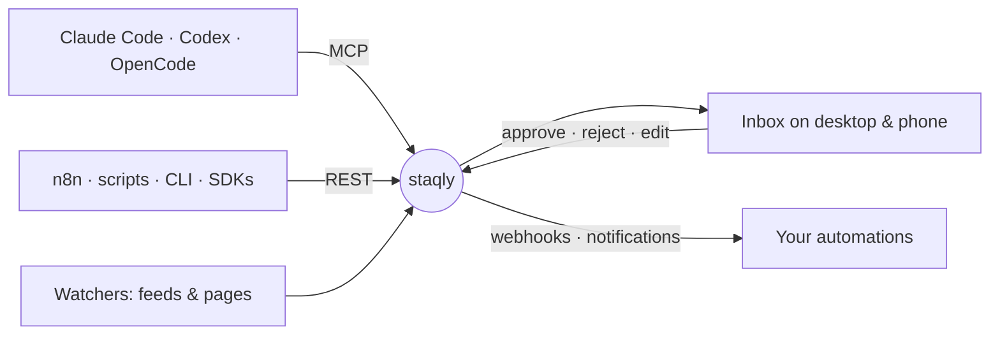

<p align="center">
  
  
</p>

<h4 align="center">The workspace for everything your AI agents create.</h4>

<p align="center">
  <a href="https://github.com/staqly/staqly/actions/workflows/ci.yml"></a>
  <a href="LICENSE"></a>
  
  
</p>

<p align="center">
  
  
</p>

<p align="center">
  <a href="#quick-start">Quick start</a> •
  <a href="#connect-your-agent">Connect your agent</a> •
  <a href="#features">Features</a> •
  <a href="#how-it-works">How it works</a> •
  <a href="#documentation">Documentation</a> •
  <a href="#license">License</a>
</p>

<p align="center">
  Your agents generate images, posts, research and data. staqly collects it in one place,<br>
  lets you approve, reject or edit it from your desktop or phone — and tells your automations what you decided.
</p>

---

## Quick start

One command installs staqly (macOS, Linux), a second one starts it:

```bash
curl -fsSL https://raw.githubusercontent.com/staqly/staqly/main/scripts/install.sh | sh
staqly serve
```

That's it: one binary with the API, MCP and dashboard. No Docker, no account, no API key,
everything stays on your machine.

| | |
|---|---|
| Dashboard | http://localhost:8080 |
| API + MCP | http://localhost:3333 · http://localhost:3333/mcp |

On your phone? Start with `staqly serve --expose`, then open **Connect a device** in the dashboard and scan the QR code.

**Prefer Docker?** The same app as two containers:

```bash
git clone https://github.com/staqly/staqly.git
cd staqly
make up        # pulls the images, starts them, opens the dashboard signed in
```

## Connect your agent

```bash
# Claude Code
claude mcp add --transport http staqly http://localhost:3333/mcp

# Codex
codex mcp add staqly --url http://localhost:3333/mcp
```

OpenCode: add this to `opencode.json` in your project (check with `opencode mcp list`):

```json
{
  "$schema": "https://opencode.ai/config.json",
  "mcp": {
    "staqly": { "type": "remote", "url": "http://localhost:3333/mcp", "enabled": true }
  }
}
```

Cursor and other MCP clients: [docs/mcp.md](docs/mcp.md). Then just ask:

> *"Create a collection called Instagram Avatar and add this image to it."*
>
> *"Show me everything that's waiting for my review."*
>
> *"Wait until I approve this post, then publish it."*

Prefer code? Use the [TypeScript SDK](packages/sdk-typescript), the [Python SDK](packages/sdk-python) or the [`staqly` CLI](docs/cli.md).

## Features

- 📥 **Review inbox** — approve, reject with feedback, or edit before approving; keyboard-first on desktop, swipe-friendly on phones
- 🤝 **Human-in-the-loop for agents** — agents wait for your decision (`await_decision`) and only act on what you approved
- 🗂️ **Collections** — images, video, text, links and JSON in gallery, table or list views, with full-text search
- ⚡ **Rules** — auto-approve, auto-reject, expire or escalate routine items so you only see what matters
- 👀 **Watchers** — pull in fresh content from RSS, Reddit, Pinterest, YouTube, GitHub and any web page
- 🔔 **Notifications** — approve straight from Telegram, Slack, Discord, ntfy or email
- 🔗 **Integrations** — MCP for Claude Code, Codex and OpenCode, REST API, signed webhooks, n8n, CLI, TypeScript and Python SDKs
- 🔒 **Local-first** — one SQLite file, keyless on your machine, nothing leaves it unless you want; optional hosted mode with workspaces and plans
- 📦 **Yours to keep** — backups, full exports and the history of every decision

## How it works



1. An agent or automation **sends** something it made — a post, an image, a summary.
2. You **review** it in the inbox (or right from Telegram or Slack).
3. staqly **tells** the agent and your automations what you decided, and keeps the history.

**Example:** an n8n workflow generates Instagram posts for an AI avatar → you approve the best ones on your phone →
n8n publishes them and staqly records the post ID. Try it: [integrations/n8n](integrations/n8n).

## Documentation

| | |
|---|---|
| 🚀 **Getting started** | [Documentation](https://staqly.github.io/staqly/docs) ([source](apps/docs)) |
| 🤖 **Agents & MCP** | [MCP setup](docs/mcp.md) · [n8n](docs/n8n.md) · [CLI](docs/cli.md) · [TypeScript SDK](packages/sdk-typescript) · [Python SDK](packages/sdk-python) |
| ⚙️ **Running staqly** | [Local vs cloud](docs/cloud.md) · [Notifications](docs/notifications.md) · [Backup](docs/backup.md) · [Monitoring](docs/observability.md) · [Data & privacy](docs/data-export.md) · [Troubleshooting](docs/troubleshooting.md) |
| 🛠️ **Under the hood** | [Technical overview](docs/technical-overview.md) · [Architecture](docs/architecture.md) · [API (OpenAPI)](apps/api/openapi.yaml) |

## Contributing

Bug reports, ideas and pull requests are welcome — see [CONTRIBUTING.md](CONTRIBUTING.md).
Found a security issue? Please report it privately: [SECURITY.md](SECURITY.md).

## License

Apache License 2.0 — see [LICENSE](LICENSE) and [NOTICE](NOTICE).
