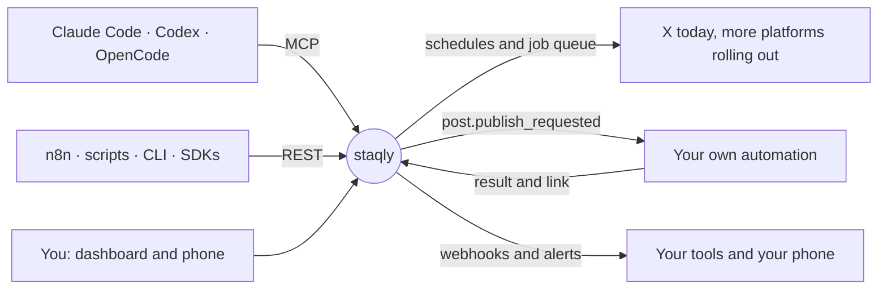

<p align="center">
  <a href="https://staqly.ai">
    <picture>
      <source media="(prefers-color-scheme: dark)" srcset="assets/brand/staqly-logo-dark.svg">
      
    </picture>
  </a>
</p>

<p align="center">
  <strong>The local-first social media scheduler for people and their AI agents.</strong><br>
  Claude Code, Codex or n8n write the posts. You see them on a calendar.<br>
  Staqly publishes them on time, retries what fails and keeps everything on your machine.
</p>

<p align="center">
  <a href="https://github.com/staqly/staqly/actions/workflows/ci.yml"></a>
  <a href="LICENSE"></a>
  
  
</p>

<p align="center">
  <a href="https://docs.staqly.ai"><strong>Documentation</strong></a> ·
  <a href="#quick-start">Quick start</a> ·
  <a href="#connect-your-agent">Connect your agent</a> ·
  <a href="https://docs.staqly.ai/api">REST API</a> ·
  <a href="sdks/typescript">TypeScript SDK</a> ·
  <a href="sdks/python">Python SDK</a> ·
  <a href="https://docs.staqly.ai/cli">CLI</a>
</p>

<p align="center"><strong>Publish today</strong> to <strong>X</strong> and through your own automation: n8n, Make, Zapier or a script of yours.<br><strong>More native platforms, rolling out:</strong></p>
<p align="center">
  <picture><source media="(prefers-color-scheme: dark)" srcset="https://cdn.simpleicons.org/x/white"></picture>&nbsp;
  &nbsp;
  &nbsp;
  <picture><source media="(prefers-color-scheme: dark)" srcset="https://cdn.simpleicons.org/threads/white"></picture>&nbsp;
  &nbsp;
  &nbsp;
  &nbsp;
  <picture><source media="(prefers-color-scheme: dark)" srcset="https://cdn.simpleicons.org/tiktok/white"></picture>&nbsp;
  &nbsp;
  &nbsp;
  &nbsp;
  &nbsp;
  &nbsp;
  <picture><source media="(prefers-color-scheme: dark)" srcset="https://cdn.simpleicons.org/medium/white"></picture>&nbsp;
  <picture><source media="(prefers-color-scheme: dark)" srcset="https://cdn.simpleicons.org/devdotto/white"></picture>&nbsp;
  
  <br><sub>and LinkedIn, Slack, Google Business and more: <a href="https://docs.staqly.ai/channels">35 platforms in the catalog</a></sub>
</p>

<p align="center">
  <picture>
    <source media="(prefers-color-scheme: dark)" srcset="assets/screenshots/schedule-a-post-light.gif">
    
  </picture>
</p>

## Why staqly

Most schedulers expect a person to type every post. Staqly expects your agents to do the writing.

1. **Agents write.** Claude Code, Codex or OpenCode draft posts over MCP. n8n and scripts use REST.
2. **Collections plan.** A collection schedule picks the next waiting post every weekday at 9, or every six hours.
3. **Staqly publishes.** Every channel goes out from a durable job queue, with retries, a link back and an alert.
4. **Agents refill.** When a collection runs dry, the schedule asks your agent or your endpoint for more.

You stay in charge from one calendar on your desktop or phone. Nothing leaves your machine unless you publish it.

## Features

| | |
|---|---|
| 📅 **Calendar** | Day, week, month and list views. One card per channel. Drag a post to another hour, or press **+** on a free slot. |
| ✍️ **Composer** | Write once, pick channels, give a channel its own text, with a character counter per platform. Bold, italic, lists and links become plain text every platform takes. |
| 🖼️ **Media** | A media library for pictures and videos, with a built-in image editor to crop, resize and add text before you post. |
| 💬 **Comments** | Add comments under a post: on X they go out as a thread, each after its own delay. |
| 🔂 **Repeat** | Publish a post again every day, week or month: the next copy is scheduled as soon as one goes out. |
| 🔁 **Collection schedules** | Weekdays at 09:00, every six hours or once. The next waiting post, chosen posts or all of them, in your time zone. |
| 🤖 **Agents that refill** | An empty schedule asks your agent (`list_requested_work`) or calls your endpoint, which returns new posts. |
| 🔌 **Your own automation** | A channel that hands the post to n8n or a script and waits for the link. Any platform works today. |
| 🧾 **Visible queue** | Publishing and schedule runs are jobs with leases and retries (1, 5, then 15 minutes). Settings shows what is queued, running or failed. |
| 🔔 **Alerts** | Telegram, Slack, Discord, ntfy or email when a post goes out or fails, a channel needs reconnecting or a schedule asks for posts. |
| 🔗 **Integrations** | MCP with 100 tools, REST with OpenAPI, signed webhooks, n8n, a CLI, and TypeScript and Python SDKs. |
| 🔒 **Local-first** | One SQLite file on your machine. Channel credentials are sealed with a key that stays there. Local agents use one access token that never leaves your machine. |
| ☁️ **Hosted mode** | Optional: workspaces, scoped API keys, sessions and plans on PostgreSQL, from the same binary. |

## Quick start

Install Staqly Community Edition, the free self-hosted version, on macOS or Linux, then start it:

```bash
curl -fsSL https://raw.githubusercontent.com/staqly/staqly/main/scripts/install.sh | sh
staqly serve
```

One binary runs the API, MCP, the job queue and the dashboard. You need no Docker and no account. At every start it prints the access token and a link that opens the dashboard signed in; agents send the same token (`staqly serve token` prints it again).

| | |
|---|---|
| Dashboard | http://localhost:8080 |
| API and MCP | http://localhost:3333 and http://localhost:3333/mcp |

Next steps:

1. Open **Channels**, press **Add channel** and pick **Your own automation** to try the whole loop today.
2. Write your first post under **Posts**, or ask your agent to.
3. Keep staqly running in the background with `staqly service install`.
4. On your phone: start with `staqly serve --expose`, open **Connect a device** and scan the QR code.

**Prefer Docker?** The Community Edition also runs as one prebuilt image, with no checkout:

```bash
docker run -d --name staqly --restart unless-stopped \
  -p 127.0.0.1:3333:3333 -p 8080:8080 \
  -v staqly-data:/data \
  --read-only --tmpfs /tmp:size=64m,mode=1777 \
  --cap-drop ALL --security-opt no-new-privileges:true \
  --memory 640m --pids-limit 256 \
  ghcr.io/staqly/staqly:latest
docker exec staqly server token   # the access token, and a link that signs the dashboard in
```

Upgrades, backups and every setting: [Run with Docker](https://docs.staqly.ai/self-hosting/docker).

## Connect your agent

```bash
export STAQLY_API_KEY=$(staqly serve token)   # Docker: $(docker exec staqly server token)

# Claude Code
claude mcp add --transport http staqly http://localhost:3333/mcp --header "Authorization: Bearer $STAQLY_API_KEY"

# Codex
codex mcp add staqly --url http://localhost:3333/mcp --bearer-token-env-var STAQLY_API_KEY
```

For OpenCode, add this to `opencode.json` in your project:

```json
{
  "$schema": "https://opencode.ai/config.json",
  "mcp": {
    "staqly": {
      "type": "remote",
      "url": "http://localhost:3333/mcp",
      "headers": { "Authorization": "Bearer {env:STAQLY_API_KEY}" },
      "enabled": true
    }
  }
}
```

Cursor and other MCP clients: see [MCP setup](https://docs.staqly.ai/mcp). Then ask:

> *"Draft five posts about the new release into Product updates, one per weekday morning."*
>
> *"What is scheduled this week, and did anything fail?"*
>
> *"Make the Bluesky version shorter and publish it now."*

## How it works



**Example.** Claude Code drafts a week of tips into *Daily tips*. The collection schedule publishes one each weekday at 9. When *Daily tips* runs dry, the schedule asks Claude for more. Walkthrough: [Let an agent fill a collection](https://docs.staqly.ai/cookbook/agent-fills-a-collection).

## Documentation

| | |
|---|---|
| **Start** | [docs.staqly.ai](https://docs.staqly.ai) · [Quick start](https://docs.staqly.ai/quickstart) · [Concepts](https://docs.staqly.ai/concepts) |
| **Agents and code** | [MCP](https://docs.staqly.ai/mcp) · [n8n](https://docs.staqly.ai/integrations/n8n) · [CLI](https://docs.staqly.ai/cli) · [TypeScript SDK](sdks/typescript) · [Python SDK](sdks/python) · [OpenAPI](apps/api/openapi.yaml) |
| **Running it** | [Local and cloud](https://docs.staqly.ai/local-vs-cloud) · [Alerts](https://docs.staqly.ai/automation/alerts) · [Backup](https://docs.staqly.ai/self-hosting/backup-and-restore) · [Monitoring](https://docs.staqly.ai/self-hosting/monitoring) · [Data and privacy](https://docs.staqly.ai/self-hosting/data-export) · [Troubleshooting](https://docs.staqly.ai/self-hosting/troubleshooting) |
| **Internals** | [Security model](https://docs.staqly.ai/self-hosting/security) · [OpenAPI](apps/api/openapi.yaml) · [Agent guide](AGENTS.md) |

## Tech stack

- Go: REST, MCP over stdio and Streamable HTTP, the job queue and webhook workers
- SQLite in the Community Edition, PostgreSQL in hosted mode, with goose migrations and sqlc queries
- Next.js and shadcn/ui for the dashboard, exported statically and embedded in the binary
- Tiptap through [editorcn](https://github.com/shadcn-labs/editorcn) for the post editor
- Turborepo and pnpm workspaces, Fumadocs for the docs

## Contributing

Bug reports, ideas and pull requests are welcome. Start with [CONTRIBUTING.md](CONTRIBUTING.md).
Please report security issues privately, as described in [SECURITY.md](SECURITY.md).

## License

Staqly is licensed under the [GNU AGPL-3.0](LICENSE): use it, run it, change it. If you offer a
modified staqly to others over a network, share your changes under the same license.
The [TypeScript SDK](sdks/typescript), the [Python SDK](sdks/python) and the
[integrations](integrations) are Apache-2.0, so they fit into code under any license.
Versions up to v0.1.0 were released under Apache-2.0. See [NOTICE](NOTICE).

Contributions are welcome under the [Contributor License Agreement](CONTRIBUTING.md#contributor-license-agreement).
