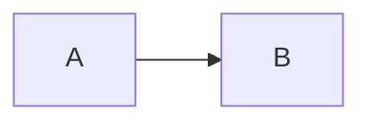

# apps/docs — staqly user documentation

Separately hosted documentation site: **Fumadocs** (Next.js App Router + MDX)
built as a **static export** (`out/`). It is *not* part of the root
`compose.yml`; it has its own `Dockerfile`.

| | |
|---|---|
| Framework | Next.js 16.4 (`output: "export"`), React 19, Tailwind v4 |
| Docs | `fumadocs-core` / `fumadocs-ui` (base-ui flavour) 16.17, `fumadocs-mdx` 15 (macro API) |
| API reference | `fumadocs-openapi` 12 — virtual pages generated from `../api/openapi.yaml` (OpenAPI 3.2) at build time |
| Search | Fumadocs built-in static Orama search (index exported to `/api/search`, searched in the browser) |
| Diagrams | ` ```mermaid ` fences → `<Mermaid>` (client-side, themed; nothing rendered at build time) |
| Tooling | TypeScript 7 (native compiler), **oxlint** (`.oxlintrc.json`: react, nextjs, typescript, import, jsx-a11y, unicorn, oxc plugins; warnings fail `npm run lint`). **oxfmt** (`.oxfmtrc.json`): printWidth 120, single quotes (double in JSX attributes), no semicolons, trailing commas, imports grouped (builtin → external → internal → relative) with a blank line between groups; `npm run format` / `format:check`. |
| Node | 24 (Dockerfile `node:24-alpine`; keep `@types/node` on 24.x to match) |

## Commands

```bash
npm install
npm run dev          # http://localhost:8090 (hot reload)
npm run build        # next build → out/, then scripts/check-links.mjs (fails on broken internal links/anchors)
npm run preview      # npx serve@latest out -l 8090
npm run lint         # oxlint --deny-warnings
npm run typecheck    # next typegen && tsc --noEmit
```

Hosting: GitHub Pages via `.github/workflows/docs.yml` on pushes to `main`,
at `https://staqly.github.io/staqly` (built with `DOCS_BASE_PATH=/staqly`;
later `docs.staqly.ai`, no prefix). With a prefix, Next only rewrites its own
links: plain ``/`<a>` and fetches must add `process.env.NEXT_PUBLIC_BASE_PATH`
(the link check fails on root-relative links without it; try
`DOCS_BASE_PATH=/staqly npm run build`).

## Layout

| Path | Role |
|---|---|
| `content/docs/**.mdx` | Pages. Folder = section; `meta.json` = order and titles |
| `content/docs/meta.json` | Sidebar: `---Separator---` headings + `...folder` to inline a folder |
| `content/docs/api/reference/` | `index.mdx` + `meta.json`; the per-tag pages are virtual (from OpenAPI) |
| `app/(home)/page.tsx` | Landing page |
| `app/docs/[[...slug]]/page.tsx` | Page renderer (MDX pages and OpenAPI pages) |
| `app/openapi.yaml`, `app/llms*.txt`, `app/llms.mdx` | Static route handlers (raw spec, LLM-friendly text) |
| `lib/collections.ts` | MDX collections (macro API) |
| `lib/source.ts` | `loader()` combining MDX + OpenAPI virtual pages (server-only) |
| `lib/openapi.ts` | Loads the spec (`OPENAPI_SPEC` env, default `../api/openapi.yaml`) and declares tags that operations use but the top-level `tags` list lacks, so every tag gets a reference page |
| `lib/shared.ts` | Site name, GitHub repo for "Edit on GitHub" |
| `components/mdx.tsx` | Components available in MDX |
| `components/mdx/bits.tsx` | `<Badge>`, `<Kbd>`, `<Method>`, `<ComingSoon>` |
| `app/global.css` | staqly theme (same tokens as `apps/web/app/globals.css`) + small helpers |
| `scripts/check-links.mjs` | Link check — the build's quality gate (pages and `#anchors`) |

## Writing pages

Frontmatter needs `title` and `description` (shown under the title and in
search). Then plain Markdown plus these components (no imports needed):

````mdx
<Callout type="warn" title="Heads up">…</Callout>          {/* info (default) | warn | error | success */}
<Cards><Card title="…" href="/docs/…">…</Card></Cards>
<Steps><Step>### Title …</Step></Steps>
<Tabs items={["REST", "MCP"]}><Tab value="REST">…</Tab><Tab value="MCP">…</Tab></Tabs>
<Accordions type="multiple"><Accordion title="…">…</Accordion></Accordions>
<Kbd>⌘</Kbd> <Badge tone="brand">cloud</Badge> <Method m="POST" path="/v1/rules" />
<ComingSoon>…</ComingSoon>

```bash tab="Claude Code"     {/* consecutive code blocks with tab="…" become tabs */}
claude mcp add …
```

```json title="opencode.json"  {/* file name header */}
{}
```


````

* Link with absolute paths (`/docs/automation/rules#matching`); the build fails
  on broken links or anchors. Heading anchors are the slugified heading text.
* Code fences need a language Shiki knows (`bash`, `json`, `ts`, `toml`,
  `yaml`, `go`, `python`, `http`, `text`…); unknown ones break the build.
* In MDX prose, `{` and `<` are syntax: put placeholders in backticks
  (`` `{ITEM_ID}` ``) or use `itm_…`.
* New page → add its file name to the folder's `meta.json`.

## Content rules

* **Only document what you can verify** in code (`apps/api/internal/**`,
  `apps/api/openapi.yaml`, `apps/web`, `integrations/`, `scripts/`, `Makefile`,
  `compose.yml`). When unsure, leave it out. Planned features get a
  `<ComingSoon>` page without invented details.
* Product name is **staqly**; identifiers stay `staqly` (`X-Staqly-*`,
  `STAQLY_*`, `staqly-api`).
* Use the real defaults: API `http://localhost:3333`, MCP
  `http://localhost:3333/mcp`, dashboard `http://localhost:8080`, cloud examples
  `https://staqly.example.com`, keys `stk_…`.
* Write for users: task first, short sentences, tables for reference data,
  one runnable example per concept (curl first; MCP / SDK in tabs).
* When the API changes: the OpenAPI pages update on the next build; update the
  hand-written pages (scopes, errors, events, limits, MCP tools) too.

## Style rules (UI)

* Colours come from the theme tokens in `app/global.css` (graphite neutrals,
  one ember accent: `--brand`, `text-brand`, `bg-brand-soft`); Fumadocs
  colours via `fd-*` utilities. Keep it in sync with the dashboard.
* Must look right at 390 px, 820 px and 1440 px, light and dark, with no
  horizontal page overflow (tables and diagrams scroll inside themselves).
* Don't add runtime services: the output must stay plain static files.

<!-- BEGIN:nextjs-agent-rules -->

## This is NOT the Next.js you know

This version has breaking changes — APIs, conventions, and file structure may all differ from your training data. Read the relevant guide in `node_modules/next/dist/docs/` (resolved from this file's directory; in monorepos the `next` package may not be visible from the repo root) before writing any code. Heed deprecation notices.

This block is written and re-added by `next dev` — verify at `node_modules/next/dist/server/lib/generate-agent-files.js`. Removing it from a diff only re-creates the uncommitted change; committing it with your work keeps the tree clean.

<!-- END:nextjs-agent-rules -->
