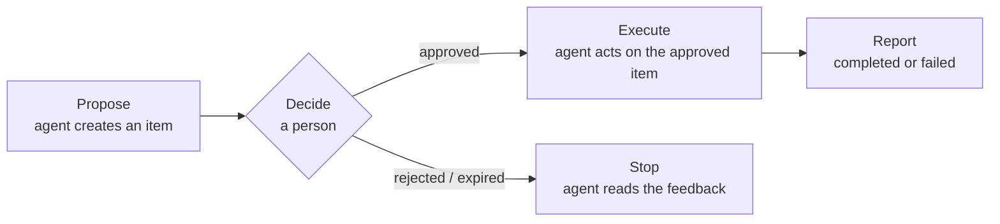

An AI agent approval workflow is a pause before a risky action, during which a person can
approve it, reject it or edit it first. This page covers the design decisions; for the code,
see [How to add human approval to an AI agent](/how-to-add-human-approval).

## When you need one

Gate an action when it is **hard to undo** and its **content or target was generated**:

| Gate it | Usually no need |
|---|---|
| Sending email, messages or posts to real people | Drafting text that a person will copy anyway |
| Spending money: refunds, purchases, ad budgets | Reading data, searching, summarizing |
| Changing production: deploys, migrations, deletes | Writing to a scratch branch or sandbox |
| Changing permissions or credentials | Actions you can roll back in one click |

## The three steps

1. **Propose.** The agent creates an item: a one-line `title`, the exact `content` it will
   send or run, and parameters in `metadata`.
2. **Decide.** You approve, reject or edit in the [Inbox](/dashboard/inbox), on your
   [phone](/cookbook/review-on-your-phone) or [in chat](/cookbook/approve-from-chat). An approval in the
   dashboard reaches the agent 10 seconds later, after its Undo has passed.
3. **Execute and report.** The agent acts only on `approved`, with the approved item, and
   records the outcome with `report_result`.

staqly holds the queue and the record; the agent performs the action itself. Step by step,
with MCP, curl and TypeScript: [Gate a risky agent action](/cookbook/approval-gate).

## Decisions that shape the workflow

### What to gate

Gate the **action**, not the whole run. "Refund 25.00 EUR on order A-1042" is quick to judge;
"approve this agent session" is not. One item per side effect keeps the record readable and
lets you approve some actions while rejecting others.

### How long to wait

| Choice | staqly setting | Default |
|---|---|---|
| When the request goes stale | `expires_in` on the item (`"1h"`, `"24h"`, 60 s to 90 days) | No expiry |
| How long the agent blocks | `timeout` of `wait_for_decision` / `waitForDecision` | 10 minutes |
| Waiting longer than a process lives | A [webhook](/integrations/webhook-receivers) on `item.approved` resumes the work | Not set up |

An `expired` item means *no*. Pick an expiry that matches the action: minutes for a deploy
window, hours for an email, days for a monthly report.

### What the reviewer may change

`editable` lists the fields a reviewer may edit before approving (`content`, `title`,
`metadata.amount_eur`). Edits elsewhere are refused with `422 not_editable`. The
`item.approved` event carries a `diff` of what changed.

### Getting the request to you

[Notifications](/automation/notifications) push new requests to your phone or Telegram, with
Approve and Reject buttons, so a decision does not wait for you to open a laptop.

### Who may decide

In cloud mode, agents get API keys with `items:write items:read` and no `items:review`, so an
agent can propose but never approve its own request. People decide from dashboard sessions.
See [Authentication & scopes](/api/authentication).

### The audit trail

Every item keeps its history: who proposed it, who decided, what they edited, and the
reported result. Browse it in [Activity](/dashboard/activity) or via
[events](/api/events); find past decisions with
[search](/cookbook/approved-yesterday).

## Approval workflows by use case

| Use case | Recipe or guide |
|---|---|
| Production migration or deploy | [Gate a risky agent action](/cookbook/approval-gate) |
| CI pipeline step | [Approval gate in CI](/cookbook/ci-approval-gate) |
| Social posts and images | [Instagram Avatar end to end](/cookbook/instagram-avatar) |
| Customer email from a support agent | [OpenAI Agents SDK](/integrations/openai-agents) |
| Refunds | [LangChain / LangGraph](/integrations/langchain) |
| Approving from your phone or Telegram | [Review on your phone](/cookbook/review-on-your-phone), [Approve from chat](/cookbook/approve-from-chat) |

## Next steps

<Cards>
  <Card title="How to add human approval" href="/how-to-add-human-approval">The code, in Python, TypeScript, REST and MCP.</Card>
  <Card title="Integrations" href="/integrations">LangChain, OpenAI Agents SDK, CrewAI, Claude Agent SDK, n8n, Make, Zapier.</Card>
  <Card title="Plans & limits" href="/plans">Approval quotas in cloud mode.</Card>
</Cards>
