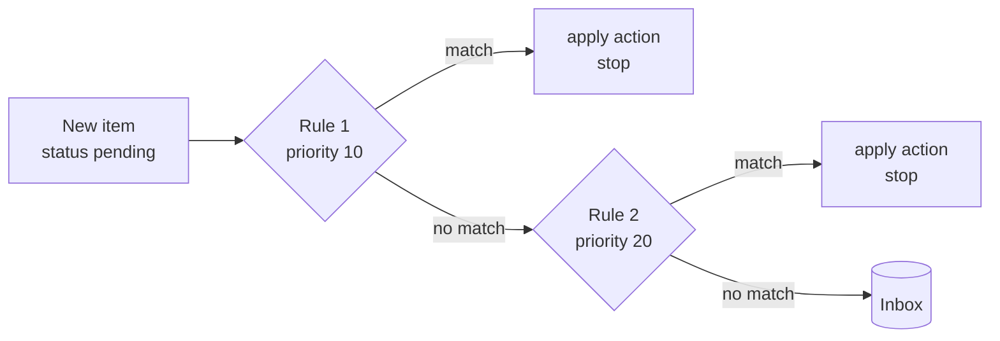

A **rule** looks at every new item the moment it is created and can act on it right away.
Without rules, every item simply waits in the Inbox.



## How rules are evaluated

- Rules run **once, when an item is created with status `pending`** (the default). Items
  created as `draft` or any other status are not evaluated, and editing an item later does
  not re-run rules.
- **Enabled** rules are tried in **priority order, lowest number first**.
- **The first matching rule wins** — its action is applied and no other rule runs for that
  item.
- Rules run inside the same transaction as the item creation, so webhooks see a consistent
  story: `item.created` followed by e.g. `item.approved`.
- The actor of everything a rule does is the **system**, named `Rule: <rule name>`, so the
  Activity log and item history show exactly which rule acted. Each rule counts how often it
  fired (`times_applied`).

Items created by [watchers](/docs/automation/watchers) are pending too — rules are the natural
way to triage them.

## Actions

| Action | What happens | Event | Params |
|---|---|---|---|
| `auto_approve` | Item becomes `approved` (with `decided_at`) | `item.approved` | `feedback` (optional note) |
| `auto_reject` | Item becomes `rejected` | `item.rejected` | `feedback` (optional) |
| `set_status` | Item moves to another status | `item.status_changed` | `status` — any status except `pending`, `approved`, `rejected` |
| `expire` | Item stays pending, with a deadline (`expires_at`); if still pending when it passes, it becomes **`expired`** with feedback *"Expired before review"* | `item.rule_applied` now, `item.expired` later | `after_seconds` — 60 to 7,776,000 (90 days) |
| `escalate` | Item stays pending and an `item.escalated` event is emitted — route it with a [webhook](/docs/automation/webhooks) | `item.escalated` | `note` (optional) |

`auto_approve` and `auto_reject` go through the normal decision path, so your automations
receive a regular `item.approved` / `item.rejected` webhook with an extra `rule` object
(`id`, `name`, `action`) in `data`.

<Callout title="Expiry without a rule">
A producer can also set a deadline per item with `expires_in` (`"24h"` or seconds) when
creating it. Either way the item ends up in the **`expired`** status with an `item.expired`
event — subscribe your webhook to it (or to `item.*`) if your automation should react to
timeouts.
</Callout>

## Matching

All parts of `match` that you set must hold (logical AND). An empty `match` matches every
new pending item.

| Field | Matches when… |
|---|---|
| `collection_ids` | the item is in one of these collections |
| `types` | the item type is one of these (`image`, `video`, `text`, `link`, `json`, `file`) |
| `source_pattern` | the item's `source` matches this glob — `*` = any characters, `?` = one character (e.g. `n8n-*`) |
| `text_contains` | the title **or** content contains this text (case-insensitive) |
| `conditions` | **every** condition on `metadata` holds (up to 10) |

### Metadata conditions

Each condition has a `path` (dot notation into `metadata`, e.g. `score` or `post.likes`), an
`op` and usually a `value`.

| `op` | Holds when the value at `path`… |
|---|---|
| `eq` / `ne` | equals / does not equal `value` (compared as text, so `0.9` and `"0.9"` are equal) |
| `lt` `lte` `gt` `gte` | is a **number** and compares accordingly — a numeric string like `"0.95"` never matches |
| `contains` | is a string containing `value` (case-insensitive), or an array with an element equal to `value` |
| `in` / `not_in` | is / is not one of the values in the **array** `value` |
| `exists` | is present and not `null` (no `value` needed) |

If the path is missing, every operator except `exists` is false — including `ne` and `not_in`.

## Examples

These four rules work together: specific rules get low numbers, the catch-all expiry gets a
high one.

<Tabs items={["Auto-approve confident output", "Reject a source", "Escalate urgent items", "Expire after 24 h"]}>
<Tab value="Auto-approve confident output">

Approve anything whose `metadata.score` is at least 0.9:

```bash
curl -s -X POST http://localhost:3333/v1/rules -H 'Content-Type: application/json' -d '{
  "name": "Auto-approve confident output",
  "priority": 10,
  "action": "auto_approve",
  "match": { "conditions": [ { "path": "score", "op": "gte", "value": 0.9 } ] },
  "params": { "feedback": "score ≥ 0.9" }
}'
```

The producer must send the score as a JSON number: `"metadata": {"score": 0.95}`.

</Tab>
<Tab value="Reject a source">

Reject everything produced by `draft-bot`:

```bash
curl -s -X POST http://localhost:3333/v1/rules -H 'Content-Type: application/json' -d '{
  "name": "Reject drafts",
  "priority": 20,
  "action": "auto_reject",
  "match": { "source_pattern": "draft-bot" },
  "params": { "feedback": "draft-bot output is never published" }
}'
```

Use a glob such as `draft-*` to cover a family of sources.

</Tab>
<Tab value="Escalate urgent items">

Flag items whose title or content mentions "urgent":

```bash
curl -s -X POST http://localhost:3333/v1/rules -H 'Content-Type: application/json' -d '{
  "name": "Escalate urgent",
  "priority": 30,
  "action": "escalate",
  "match": { "text_contains": "urgent" },
  "params": { "note": "Someone flagged this as urgent" }
}'
```

[Notification channels](/docs/automation/notifications) send `item.escalated` to Telegram,
Slack, Discord, ntfy or email by default; or subscribe a webhook to it.

</Tab>
<Tab value="Expire after 24 h">

Give everything else 24 hours; unanswered items expire automatically:

```bash
curl -s -X POST http://localhost:3333/v1/rules -H 'Content-Type: application/json' -d '{
  "name": "Expire after 24h",
  "priority": 1000,
  "action": "expire",
  "params": { "after_seconds": 86400 }
}'
```

Because the first match wins, items handled by the rules above don't get an expiry.

</Tab>
</Tabs>

With all four in place:

| New item | Result |
|---|---|
| `metadata: {"score": 0.95}` | approved by *Auto-approve confident output* |
| `source: "draft-bot"` | rejected by *Reject drafts* |
| title `URGENT fix` | stays pending, `item.escalated` emitted |
| anything else | stays pending; becomes `expired` after 24 h if undecided |

## Managing rules

<Tabs items={["REST", "MCP", "TypeScript"]}>
<Tab value="REST">

| | |
|---|---|
| <Method m="GET" path="/v1/rules" /> | list rules (`{"data":[…]}`) |
| <Method m="POST" path="/v1/rules" /> | create |
| <Method m="GET" path="/v1/rules/{id}" /> | get one |
| <Method m="PATCH" path="/v1/rules/{id}" /> | update any field, e.g. `{"enabled": false}` |
| <Method m="DELETE" path="/v1/rules/{id}" /> | delete |

Defaults on create: `priority` 100, `enabled` true. `name` is required (up to 100
characters); `priority` is 0–100,000; `feedback` and `note` up to 2,000 characters.

</Tab>
<Tab value="MCP">

`list_rules` and `create_rule` (`name`, `priority`, `action`, `match`, `params`):

> *“Create a rule that auto-approves items in Instagram Avatar whose metadata.score is at
> least 0.9.”*

</Tab>
<Tab value="TypeScript">

The SDK's generic `request` method covers endpoints without a dedicated helper:

```ts
import { Staqly } from '@staqly/sdk';

const staqly = new Staqly();
await staqly.request('POST', '/v1/rules', {
  body: {
    name: 'Reject drafts',
    priority: 20,
    action: 'auto_reject',
    match: { source_pattern: 'draft-bot' },
  },
});
```

</Tab>
</Tabs>

Changes are recorded as `rule.created`, `rule.updated` and `rule.deleted` events.

## Permissions and limits

- Managing rules needs the **`rules:manage`** scope. Because a rule can approve content
  without a human, it is **not** part of the default key created at signup — grant it
  deliberately. Sessions and local mode have it implicitly.
- Creating or updating a rule with an `auto_approve` or `auto_reject` action **also** needs
  **`items:review`** — a rule that decides is a reviewer. Without it: `403` *"rules that
  auto-approve or auto-reject also require items:review"*.
- Plan limits (cloud): **Free 5 rules, Indie 50, Team unlimited**. Over the limit, creating a
  rule returns `402 plan_limit_exceeded` with `details.limit = "rules"`.
