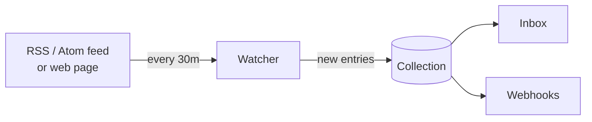

Watchers bring outside content to you, so you don't have to check sites by hand. A
**watcher** checks a feed or a web page on a schedule and turns every **new** entry into a
pending `link` item in a collection. Use one to collect inspiration, follow releases of the
tools you depend on, or notice when a pricing or status page changes. A watcher is simply an
HTTP poll of a URL you give it: **any RSS/Atom feed or web page** (JSON endpoints work too).



From the collection, new items reach the Inbox and [webhooks](/automation/webhooks) like any
other item.

## Adding a watcher

This example puts new releases of Go (from GitHub's public Atom feed) into a *Releases*
collection.

<Steps>
<Step>

### Create the watcher

<Tabs items={["Dashboard", "curl", "CLI", "MCP"]}>
<Tab value="Dashboard">

Open **Watchers** in the sidebar and click **Add a watcher**. Enter a name, paste the URL,
choose one or more collections under *Add new entries to* and how often to *Check*. Keywords
are under **Advanced: filter entries**. staqly reads the URL and picks the mode itself.

</Tab>
<Tab value="curl">

```bash
curl -s -X POST http://localhost:3333/v1/watchers \
  -H 'Content-Type: application/json' -d '{
  "name": "Go releases",
  "url": "https://github.com/golang/go/releases.atom",
  "collection": "Releases",
  "every": "1h"
}'
```

`collection` is an ID or exact name. To add each new entry to several collections, send
`"collections": ["Releases", "Go"]` instead (up to 20). `keywords`, `exclude_keywords` and
`every` are optional.

</Tab>
<Tab value="CLI">

```bash
staqly watchers create --name "Go releases" \
  --url https://github.com/golang/go/releases.atom --collection Releases --every 1h
```

Repeat `--collection` to add each new entry to several collections.

</Tab>
<Tab value="MCP">

Ask your agent; it uses `create_watcher`:

> *“Watch https://github.com/golang/go/releases.atom and put new releases into my Releases collection, checking every hour.”*

</Tab>
</Tabs>

</Step>
<Step>

### Let the first run set a baseline

The **first run** only records what is already in the feed (or the page's current text) and
creates no items, so you don't get a flood of old posts. From the next run on, every new
entry becomes a pending item.

</Step>
<Step>

### Check now (optional)

Click **Check now** on the watcher in the dashboard, or run it from the API or CLI:

```bash
curl -s -X POST http://localhost:3333/v1/watchers/wat_okkhldgfahmrv25yx45d/run
# or: staqly watchers run wat_okkhldgfahmrv25yx45d
```

The response reports `{status, new_items, entries_seen, baseline, error}`.

</Step>
</Steps>

<Callout type="warn" title="Watcher content is untrusted">
Titles, summaries and links come from the internet. They are marked `metadata.untrusted =
true` and shown with an **External content** badge in the dashboard. Don't let an agent
follow instructions found in them.
</Callout>

## Modes: Feed and Page change

Every watcher has a URL and a mode (`kind`). Leave `kind` out and staqly reads the URL once
when you create the watcher: an RSS or Atom feed becomes **Feed** (`rss`), anything else
(a page, a JSON endpoint) **Page change** (`url_diff`). The response shows what it picked.
Pass `kind` to choose yourself, for example to watch a feed's raw text for changes or to
create a watcher for a URL that is down right now (detection needs to read it):

```bash
curl -s -X POST http://localhost:3333/v1/watchers \
  -H 'Content-Type: application/json' -d '{
  "name": "Design blog",
  "url": "https://example.com/feed.xml",
  "collection": "Inspiration",
  "keywords": ["portrait", "lighting"],
  "exclude_keywords": ["sponsored"],
  "every": "6h"
}'
```

`url` must be an absolute http(s) URL without credentials. When `every` is omitted it
defaults to 1 hour (or the plan minimum, if slower). The `kind` of an existing watcher cannot
be changed: create a new one.

| Mode (`kind`) | Checks | Creates |
|---|---|---|
| **Feed** (`rss`) | An RSS 2.0, RSS 1.0 (RDF) or Atom feed | One item per new entry |
| **Page change** (`url_diff`) | The **visible text** of a web page (scripts and styles stripped), or the body of a JSON endpoint | One item titled *Changed: &lt;page title&gt;* when the text changes |

Many sites publish a feed: blogs, release pages (GitHub's `/releases.atom`), package
registries, news searches. When a site has no feed, watch the page itself with **Page change**.

<Callout title="Push sources">
Watchers only poll. When a source can push (a webhook, a WebSocket client, a script), send
its content straight to [`POST /v1/items`](/api) or have your agent call the MCP tool
`create_item` instead.
</Callout>

## What a new item looks like

| Field | Value |
|---|---|
| `type` | `link` (or `text` when the entry has no http(s) URL) |
| `title` | The entry title |
| `content` | The entry summary as plain text (HTML removed, up to 1,500 characters) |
| `url` | The entry link |
| `status` | `pending` |
| `source` | `watcher:<watcher name>` |
| `external_ref` | A stable hash of the entry ID |
| `metadata` | `untrusted: true`, `watcher: {id, name, kind, source_url}`, and `published_at` / `author` when the feed has them |

## Schedule and filtering

- **`every`** is a duration such as `"15m"`, `"6h"` or `"24h"` (at most `168h`). A small
  random jitter spreads checks out. The fastest allowed interval depends on the plan (see
  [Permissions and limits](#permissions-and-limits)).
- **The first run is a baseline**: it records what is already there and creates nothing.
- At most **20 new items per run**, oldest first, so they appear in publication order.
- **Keywords**: with `keywords`, an entry needs at least one of them in its title or summary;
  any of the `exclude_keywords` vetoes it. Matching is case-insensitive. Up to 50 words each.
- **Check now**: `POST /v1/watchers/{id}/run` runs immediately and reports
  `{status, new_items, entries_seen, baseline, error}`.
- Entries already seen are remembered for 90 days.

## Health: active → degraded → paused

| Status | Meaning |
|---|---|
| `active` | Running on schedule. |
| `degraded` | **5 consecutive failures**. Still retried on schedule; `last_error` says why. |
| `paused` | Degraded for **more than 24 hours** (or paused by you). Not checked until resumed. |

A successful run returns a degraded watcher to `active`. Resume a paused one with
`PATCH /v1/watchers/{id}` and `{"status":"active"}` (or `staqly watchers resume`). This resets
the failure count and checks right away. A manual *check now* does not resume a paused
watcher. If the plan's item quota is used up, that shows as the watcher's error.

## Fetching rules

- **robots.txt is respected** for both modes, feeds and pages alike. Rules for the
  `staqly-watcher` user agent (or `*`) are cached per host for an hour; a disallowed path
  fails with `robots_disallowed`. Sites that disallow automated access can't be watched.
- Requests identify themselves as `staqly-watcher/1.0 (+https://staqly.ai)`.
- Each fetch has a **20 s timeout** and a **3 MB** size limit; up to 5 redirects are followed.
- `429` and `5xx` responses count as failures and are retried on the next run.
- **Public internet only** by default: loopback and link-local addresses (including cloud
  metadata endpoints) are always refused, checked on the resolved IP for every hop; private
  (LAN) addresses need `WATCHER_ALLOW_PRIVATE=true`.

## Managing watchers

| Endpoint | Description |
|---|---|
| <Method m="GET" path="/v1/watchers" /> | list watchers with status, last run and errors |
| <Method m="POST" path="/v1/watchers" /> | create a watcher |
| <Method m="GET" path="/v1/watchers/{id}" /> | get one |
| <Method m="PATCH" path="/v1/watchers/{id}" /> | update; `{"status":"paused"}` / `{"status":"active"}` |
| <Method m="DELETE" path="/v1/watchers/{id}" /> | delete |
| <Method m="POST" path="/v1/watchers/{id}/run" /> | check now |

The CLI has matching commands: `staqly watchers list`, `create`, `run`, `pause`, `resume`
and `delete` (see [CLI commands](/cli/commands)). The MCP tools are `list_watchers`,
`create_watcher`, `get_watcher`, `update_watcher`, `delete_watcher` and `run_watcher`.

## Example: inspiration for the Instagram Avatar

Feed an *Inspiration* collection with visual references, keep only the relevant ones, and
look at them next to your generated avatars:

```bash
API=http://localhost:3333
curl -s -X POST $API/v1/collections -H 'Content-Type: application/json' \
  -d '{"name":"Inspiration"}'

# a photography blog's feed, only posts about portraits
curl -s -X POST $API/v1/watchers -H 'Content-Type: application/json' \
  -d '{"name":"Portrait posts","kind":"rss","url":"https://photo-blog.example.com/feed.xml","collection":"Inspiration","keywords":["portrait"],"every":"6h"}'

# a gallery page that has no feed: an item whenever its text changes
curl -s -X POST $API/v1/watchers -H 'Content-Type: application/json' \
  -d '{"name":"Gallery updates","kind":"url_diff","url":"https://gallery.example.com/new","collection":"Inspiration","every":"12h"}'
```

The separate collection keeps these references apart from your own generated content: filter
the Inbox by **Inspiration** when you want to look through them.

## Permissions and limits

- Managing watchers needs the **`watchers:manage`** scope (included in the default key).
- Watchers create items as the system (`Watcher: <name>`); those items count against the
  monthly item quota.
- Plan limits (cloud): **Free: 3 active watchers, every ≥ 15 min; Pro: unlimited,
  every ≥ 1 min.** Local installs: unlimited, every ≥ 1 min. Asking for a
  faster interval returns `402 plan_limit_exceeded` with
  `details.limit = "min_watcher_interval_seconds"`. See [Plans](/plans).

## Next steps

<Cards>
  <Card title="Watchers in the dashboard" href="/dashboard/watchers">Add, check and pause watchers without curl.</Card>
  <Card title="Notifications" href="/automation/notifications">Get a message when a watcher finds something new.</Card>
</Cards>
