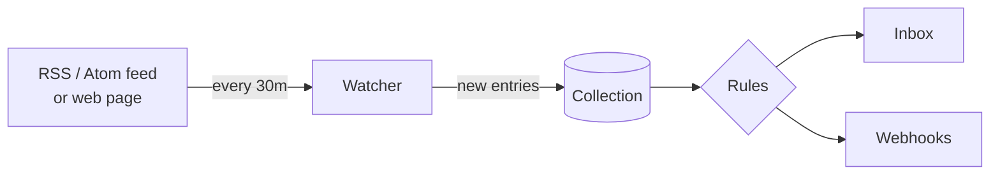

A **watcher** checks a source on a schedule and turns every **new** entry into a pending
`link` item in a collection. From there it flows through [rules](/docs/automation/rules),
the Inbox and [webhooks](/docs/automation/webhooks) like any other item.



## Kinds

| `kind` | Checks | Creates |
|---|---|---|
| `rss` | An RSS 2.0, RSS 1.0 (RDF) or Atom feed | One item per new entry |
| `url_diff` | The **visible text** of a web page (scripts and styles stripped) | One item titled *Changed: &lt;page title&gt;* when the text changes |

## What a new item looks like

| Field | Value |
|---|---|
| `type` | `link` (or `text` when the entry has no http(s) URL) |
| `title` | The entry title |
| `content` | The entry summary as plain text (HTML removed, up to 1,500 characters) |
| `url` | The entry link |
| `status` | `pending` |
| `source` | `watcher:<watcher name>` — match it in rules with `source_pattern: "watcher:*"` |
| `external_ref` | A stable hash of the entry ID |
| `metadata` | `untrusted: true`, `watcher: {id, name, kind, source_url}`, and `published_at` / `author` when the feed has them |

<Callout type="warn" title="Watcher content is untrusted">
Titles, summaries and links come from the internet. They are marked `metadata.untrusted =
true` and shown with an **External content** badge in the dashboard. Don't let an agent
follow instructions found in them.
</Callout>

## Schedule and behaviour

- **`every`** is a duration such as `"15m"`, `"6h"` or `"24h"` (at most `168h`). A small
  random jitter spreads checks out. The fastest allowed interval depends on the plan (below).
- **The first run is a baseline**: it records what is already in the feed (or the page's
  current text) and creates nothing — no flood of old posts.
- At most **20 new items per run**, oldest first, so they appear in publication order.
- **Keywords**: with `keywords`, an entry needs at least one of them in its title or summary;
  any of the `exclude_keywords` vetoes it. Matching is case-insensitive. Up to 50 words each.
- **Check now**: `POST /v1/watchers/{id}/run` runs immediately and reports
  `{status, new_items, entries_seen, baseline, error}`.
- Entries already seen are remembered for 90 days.

## Health: active → degraded → paused

| Status | Meaning |
|---|---|
| `active` | Running on schedule. |
| `degraded` | **5 consecutive failures**. Still retried on schedule; `last_error` says why. |
| `paused` | Degraded for **more than 24 hours** (or paused by you). Not checked until resumed. |

A successful run returns a degraded watcher to `active`. Resume a paused one with
`PATCH /v1/watchers/{id}` and `{"status":"active"}` — this resets the failure count and
checks right away. A manual *check now* does not resume a paused watcher. If the plan's item
quota is used up, that shows as the watcher's error.

## Fetching rules

- **robots.txt is respected.** Rules for the `staqly-watcher` user agent (or `*`) are cached
  per host for an hour; a disallowed path fails with `robots_disallowed`.
- Requests identify themselves as `staqly-watcher/1.0 (+https://staq.ly)`.
- Each fetch has a **20 s timeout** and a **3 MB** size limit; up to 5 redirects are followed.
- `429` and `5xx` responses count as failures and are retried on the next run.
- **Public internet only** by default: loopback and link-local addresses (including cloud
  metadata endpoints) are always refused, checked on the resolved IP for every hop; private
  (LAN) addresses need `WATCHER_ALLOW_PRIVATE=true`.

## Presets

Presets expand into a plain `rss` or `url_diff` watcher, so you don't have to hunt for feed
URLs. `GET /v1/watcher-presets` (or the `list_watcher_presets` MCP tool) returns the
catalog.

| Preset | Category | Kind | Default every | Parameters (* required) |
|---|---|---|---|---|
| `hn-front-page` — Hacker News front page | Community | rss | 30m | — |
| `hn-keyword` — Hacker News keyword | Community | rss | 30m | `keyword`*, `min_points` (10) |
| `reddit-subreddit` — new posts in a subreddit | Community | rss | 30m | `subreddit`* |
| `reddit-keyword` — Reddit search | Community | rss | 30m | `query`*, `subreddit` |
| `pinterest-board` — new pins on a public board | Inspiration | rss | 6h | `user`*, `board`* |
| `youtube-channel` — new videos | Content | rss | 6h | `channel_id`* (24 characters, starts with `UC`) |
| `github-releases` — new releases | Developer | rss | 1h | `owner`*, `repo`* |
| `github-commits` — commits or tags | Developer | rss | 1h | `owner`*, `repo`*, `feed` (`commits` / `tags`) |
| `npm-package` — new latest version | Developer | url_diff | 6h | `package`* |
| `pypi-package` — new releases | Developer | rss | 6h | `package`* |
| `stackoverflow-tag` — new questions | Developer | rss | 30m | `tag`* |
| `rss-feed` — any RSS / Atom feed | Content | rss | 1h | `url`*, `keywords` |
| `blog-newsletter` — a blog's feed | Content | rss | 12h | `url`*, `keywords` |
| `arxiv-papers` — new papers | Research | rss | 6h | `category` (e.g. `cs.AI`) and/or `query` |
| `google-news` — news for a search | News | rss | 1h | `query`*, `language` (`en-US`) |
| `product-hunt` — daily launches | News | rss | 6h | `keywords` (recommended: high volume) |
| `url-changed` — a page's text changed | Monitoring | url_diff | 6h | `url`* |
| `changelog-status` — changelog / status page | Monitoring | url_diff | 1h | `url`*, `keywords` (e.g. `incident`) |

`keywords` in preset parameters are comma-separated. When you don't pass `every` and the
preset's default is faster than your plan allows, the plan's minimum is used instead.

## Creating watchers

<Tabs items={["From a preset", "Custom feed", "MCP"]}>
<Tab value="From a preset">

```bash
curl -s -X POST http://localhost:3333/v1/watchers/from-preset \
  -H 'Content-Type: application/json' -d '{
  "preset_id": "reddit-subreddit",
  "params": { "subreddit": "midjourney" },
  "collection": "Inspiration",
  "every": "1h"
}'
```

`collection` is an ID or exact name; `name` and `every` are optional.

</Tab>
<Tab value="Custom feed">

```bash
curl -s -X POST http://localhost:3333/v1/watchers \
  -H 'Content-Type: application/json' -d '{
  "name": "Design blog",
  "kind": "rss",
  "url": "https://example.com/feed.xml",
  "collection": "Inspiration",
  "keywords": ["portrait", "lighting"],
  "exclude_keywords": ["sponsored"],
  "every": "6h"
}'
```

`url` must be an absolute http(s) URL without credentials. When `every` is omitted it
defaults to 1 hour (or the plan minimum, if slower). The `kind` of an existing watcher cannot
be changed — create a new one.

</Tab>
<Tab value="MCP">

`list_watcher_presets`, `create_watcher_from_preset` and `list_watchers`:

> *“Watch r/midjourney and put new posts into my Inspiration collection, checking every hour.”*

</Tab>
</Tabs>

| | |
|---|---|
| <Method m="GET" path="/v1/watcher-presets" /> | preset catalog |
| <Method m="GET" path="/v1/watchers" /> | list watchers with status, last run and errors |
| <Method m="POST" path="/v1/watchers" /> | create a custom watcher |
| <Method m="POST" path="/v1/watchers/from-preset" /> | create from a preset |
| <Method m="GET" path="/v1/watchers/{id}" /> | get one |
| <Method m="PATCH" path="/v1/watchers/{id}" /> | update; `{"status":"paused"}` / `{"status":"active"}` |
| <Method m="DELETE" path="/v1/watchers/{id}" /> | delete |
| <Method m="POST" path="/v1/watchers/{id}/run" /> | check now |

## Example: inspiration for the Instagram Avatar

Feed an *Inspiration* collection with visual references, keep only the relevant ones, and
look at them next to your generated avatars:

```bash
API=http://localhost:3333
curl -s -X POST $API/v1/collections -H 'Content-Type: application/json' \
  -d '{"name":"Inspiration","default_view":"list"}'

# a public Pinterest board with portrait references
curl -s -X POST $API/v1/watchers/from-preset -H 'Content-Type: application/json' \
  -d '{"preset_id":"pinterest-board","params":{"user":"<user>","board":"<board>"},"collection":"Inspiration"}'

# new posts in r/midjourney that talk about portraits
curl -s -X POST $API/v1/watchers/from-preset -H 'Content-Type: application/json' \
  -d '{"preset_id":"reddit-keyword","params":{"query":"portrait","subreddit":"midjourney"},"collection":"Inspiration","every":"1h"}'
```

Then let a [rule](/docs/automation/rules) expire what you don't look at within a week, so
the Inbox stays focused on your own generated content:

```bash
curl -s -X POST $API/v1/rules -H 'Content-Type: application/json' -d '{
  "name": "Inspiration expires after 7 days",
  "priority": 500,
  "action": "expire",
  "match": { "source_pattern": "watcher:*" },
  "params": { "after_seconds": 604800 }
}'
```

A complete triage setup is in the [Auto-triage cookbook](/docs/cookbook/auto-triage).

## Permissions and limits

- Managing watchers needs the **`watchers:manage`** scope (included in the default key).
- Watchers create items as the system (`Watcher: <name>`); those items count against the
  monthly item quota.
- Plan limits (cloud): **Free — 3 active watchers, every ≥ 15 min; Indie — 20, every ≥ 5 min;
  Team — unlimited, every ≥ 1 min.** Local installs: unlimited, every ≥ 1 min. Asking for a
  faster interval returns `402 plan_limit_exceeded` with
  `details.limit = "min_watcher_interval_seconds"`.
