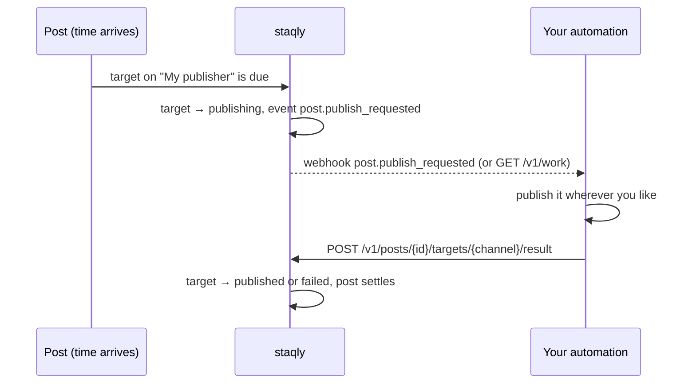

**Your own automation** (provider `custom`) is a channel without a platform behind it. When a
post targets it, staqly does not publish anything itself: it records what it wants published,
tells your webhook receiver or agent, and waits for the result. Use it for a platform staqly
does not reach yet, an internal tool, a newsletter service, or a dry run of the whole loop
without any external account.

## How it works



1. When the post is published (by hand, at its time, or by a schedule), the target on your
   channel becomes `publishing` and staqly records **`post.publish_requested`** with the post,
   the channel, the target's text and settings, and how long it will wait.
2. Your automation learns about it through a [webhook](/automation/webhooks) subscribed to
   `post.publish_requested`, or by polling **`GET /v1/work`** (MCP `list_requested_work`), which
   lists every target that waits for a result.
3. It publishes the content wherever it should go, then **reports the result** with
   `POST /v1/posts/{id}/targets/{channel}/result`: `published` with the URL and the platform's
   id, or `failed` with an error.
4. The target takes that status; the post settles when its last target does. Nothing reported
   within the collection's **processing timeout** (`processing_timeout_seconds`, else the
   server's `PROCESSING_TIMEOUT`, default 1 hour) fails the target with *No result reported*.

## Let staqly call your endpoint

Give the channel an **Endpoint URL** and staqly calls it itself for every post, instead of only
emitting the event. Set it when you add the channel, or later with **Edit connection** in the
channel's menu:

| Field | |
|---|---|
| Endpoint URL | `http://` or `https://`, for example an n8n Webhook node or your own service |
| Method | `POST` (default), `PUT` or `PATCH` send JSON; `GET` sends `post_id`, `channel_id` and `text` as query parameters |
| Headers | Optional, one per line as `Name: value`, for example `Authorization: Bearer your-token`. Stored sealed |

The JSON body:

```json
{
  "post_id": "post_3wq8m2kd7hz5vn4yjx6a",
  "channel_id": "ch_7h2kq9xw3nbvd5yhzm6a",
  "text": "Release 0.9 is out.",
  "media": [{ "id": "med_...", "name": "cover.png", "mime_type": "image/png", "size": 48213, "url": "http://localhost:3333/v1/media/med_..." }],
  "tags": ["release"],
  "settings": {},
  "thread": [{ "content": "Details in the changelog.", "media": [], "delay_seconds": 300 }]
}
```

How staqly reads the reply:

| Your endpoint answers | The target |
|---|---|
| `2xx`, optionally `{"url": "...", "external_id": "..."}` | **Published**, with that link |
| `202`, or `{"status": "publishing"}` | Waits for your result report, as in the event flow below |
| `{"status": "failed"}`, another status code, or no answer | **Failed** after the job queue's retries (1, 5, then 15 minutes) |

`thread` lists the post's [replies](/concepts#threads-comments-under-a-post) (text, media with
URLs, the wait after the part before): your automation publishes them itself, so staqly marks them
*skipped* on this channel. The `post.publish_requested` event carries them too, in `target.thread`.

The call goes through the same guard as [webhooks](/automation/webhooks): in cloud mode private
and loopback addresses are refused. Every request carries `User-Agent: staqly` and
`X-Staqly-Post` with the post id.

## Set it up

<Steps>
<Step>

### Add the channel

**Channels → Add channel → Your own automation**, or:

```bash
curl -s -X POST http://localhost:3333/v1/channels -H 'Content-Type: application/json' \
  -d '{"provider":"custom","name":"My publisher"}'
# → {"id":"ch_7h2kq9xw3nbvd5yhzm6a","provider":"custom","status":"connected", ...}
```

</Step>
<Step>

### Listen for requests

Either subscribe a webhook:

```bash
curl -s -X POST http://localhost:3333/v1/webhooks -H 'Content-Type: application/json' \
  -d '{"url":"https://n8n.example.com/webhook/staqly","events":["post.publish_requested"]}'
```

or poll what waits (an agent does this with `list_requested_work`):

```bash
curl -s http://localhost:3333/v1/work
```

```json
{
  "data": [
    {
      "kind": "target",
      "requested_at": "2026-10-20T09:00:02Z",
      "post": { "id": "post_oalirbz67y4m4cqxq5dw", "content": "v1.4 is out.", "media_items": [], "targets": [ { "channel_id": "ch_7h2kq9xw3nbvd5yhzm6a", "status": "publishing" } ] },
      "channel": { "id": "ch_7h2kq9xw3nbvd5yhzm6a", "provider": "custom", "name": "My publisher" }
    }
  ]
}
```

The webhook's `data` carries the same post snapshot plus `channel`, `target` (`channel_id`,
`content` as this channel will carry it, `settings`) and `timeout_seconds`. Media URLs in
`data.post.media_items[].url` use `PUBLIC_API_URL`; download them with the same credentials
your automation uses for the API.

</Step>
<Step>

### Report the result

```bash
curl -s -X POST http://localhost:3333/v1/posts/post_oalirbz67y4m4cqxq5dw/targets/ch_7h2kq9xw3nbvd5yhzm6a/result \
  -H 'Content-Type: application/json' \
  -d '{"status":"published","url":"https://example.com/p/1790","external_id":"1790"}'

# or
  -d '{"status":"failed","error":"Instagram API quota exceeded"}'
```

Only targets on a `custom` channel take reported results, and only while they are
`publishing` (`409` otherwise, also when the result was already reported). The result needs the
`posts:publish` scope. MCP: `report_publish_result`; CLI: `staqly posts result`; SDKs:
`reportResult` / `report_result`.

</Step>
</Steps>

## What the person sees

In the post, the target shows **Publishing** while your automation works, with how long it has
waited of the limit, then **Published** with the link you reported or **Failed** with your
error and a **Retry** button. A retry records a new `post.publish_requested`. The collection's
settings have **Fail publishing if nothing is reported within** for the timeout; **Default**
names the server's value.

[Alerts](/automation/alerts) subscribed to `post.publish_requested` say *Your automation is
asked to publish*; the default alert events tell about the final `post.published` or
`post.failed`.

## Tips

- **Deduplicate on the event id.** Webhook deliveries are at-least-once; the same request can
  arrive twice. Keep the last few `X-Staqly-Event-Id` values and skip repeats.
- **Report only what you did.** Reporting a target that another system published is how a post
  ends up twice on a platform.
- **Use `Idempotency-Key`** on the result request if your automation may retry it; the API
  replays the first answer for 24 hours.
- **Timeouts are per collection.** A newsletter that takes an hour to send gets a long limit;
  a chat bot that answers in seconds gets a short one.

## Next steps

<Cards>
  <Card title="Publish through n8n" href="/cookbook/publish-through-n8n">The whole loop as an importable workflow.</Card>
  <Card title="Webhooks" href="/automation/webhooks">Payloads, signatures, retries.</Card>
  <Card title="Webhook receiver patterns" href="/integrations/webhook-receivers">Verify, deduplicate, answer fast.</Card>
</Cards>
