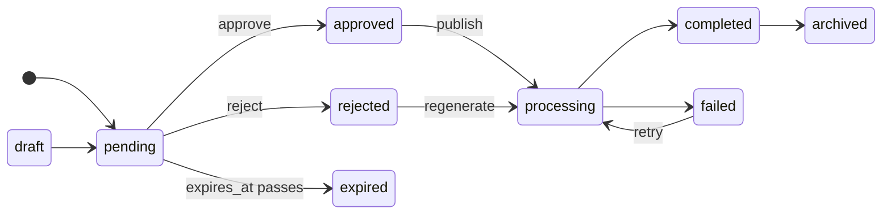
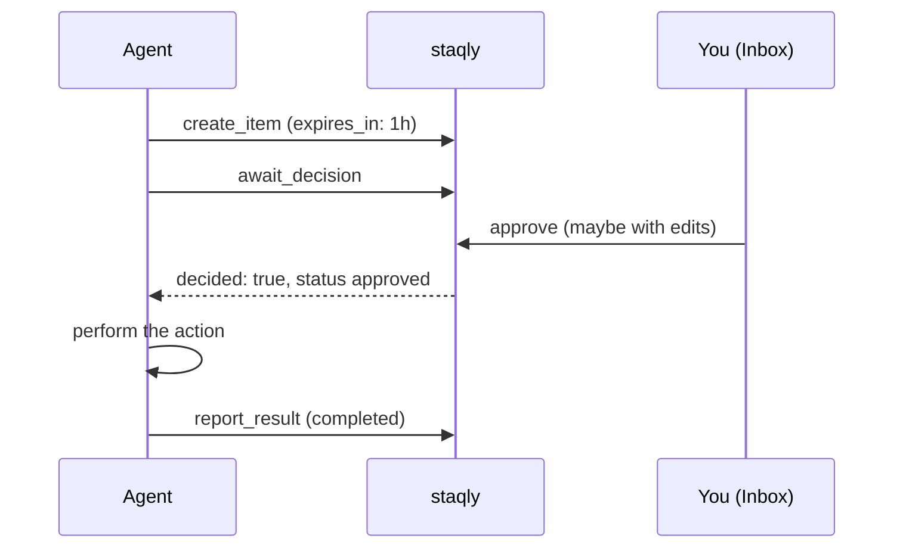

This page explains the words you will see throughout staqly and how they relate. Read it once
before you build your first automation; come back to it as a reference.

## The big picture

In one sentence: an agent saves an **item** into a **collection**, you **approve** or
**reject** it (or run another **action**), and every change is written as an **event** that
**webhooks** deliver to your other tools.

| Term | In short |
|---|---|
| [Workspace](#workspace) | The container for everything. Local mode has exactly one. |
| [Collection](#collections) | A named group of related items, like a folder. |
| [Item](#items) | One output from an agent: an image, video, text, link, JSON or file. |
| [Status](#status-lifecycle) | Where an item is in its life: `pending`, `approved`, `rejected` and more |
| [Action](#actions) | Something you or an agent can do with an item: approve, reject, or custom ones such as regenerate and publish |
| [Event](#events) | An entry in the activity log, written for every change. |
| [Webhook](#webhooks) | Delivers events to your services, such as n8n. |
| [Watcher](#watchers) | Automation inside staqly: pull in new content from feeds and web pages. |

## Workspace

Everything belongs to a **workspace**: collections, items, events, webhooks,
watchers, API keys and sessions. Every query is scoped by workspace.

- **Local mode** has exactly one workspace, created automatically on first start.
- **Cloud mode** has many; each API key and browser session belongs to exactly one, so *the
  key decides the workspace*. See [Local vs cloud](/local-vs-cloud).

## Collections

A collection groups related outputs — *Instagram Avatar*, *AI Research*, *Automation
Results*. Each collection has:

- a **name**, unique within the workspace (case-insensitive), so agents can refer to a
  collection by name instead of ID;
- a description, an icon and a **colour** (any string up to 20 characters; the dashboard offers
  eight colours such as `#3b82f6`, shown as a dot next to the collection name);
- configurable **actions** (see [below](#actions));
- an archived flag — archived collections are read-only (creating items returns `409`).

Deleting a collection is permanent and removes its items; the API requires
`?confirm=<collection name>`.

Every workspace has one **Default** collection (`is_default: true`), created with the
workspace and listed first. You can rename it and change its actions, but it cannot be
archived or deleted (`409`), so there is always somewhere to put items.

The dashboard always shows a collection's items as a table. The API still accepts and returns
a `default_view` field (`gallery`, `table` or `list`) for compatibility with older clients; it
has no effect on the dashboard.

## Items

An item is one output from an agent or automation.

| Field | Notes |
|---|---|
| `type` | `image`, `video`, `text`, `link`, `json` or `file`. Inferred when omitted (see below). |
| `title` | Up to 500 characters. Defaults to the first line of text, the URL, or `Untitled <type>`. |
| `content` | A string, or any JSON value (stored compacted). Up to 1 MiB. |
| `url` | An absolute `http(s)` URL — a link, or externally hosted media. |
| `media` | An uploaded file (image, video, PDF or any other file) served by the API after authorization. |
| `metadata` | A JSON object (up to 256 KiB): prompt, model, seed, score — anything. Searchable. |
| `source` | Who produced it, e.g. `n8n`, `mcp:Claude`, `watcher:HN`. Without one, staqly names the client that sent it (see [Agents](/dashboard/agents)). |
| `external_ref` | Your own reference ID; filterable. |
| `status` | See the [lifecycle](#status-lifecycle). |
| `tags` | Labels such as `client-a` or `urgent` (up to 20). Each tag is up to 40 characters, without commas. Items saved without tags get 1 to 3 from the [auto-tagger](/self-hosting/configuration#auto-tags-and-summaries), if one is set up. |
| `summary` | One line (up to 120 characters) on what the item is, written after the item is saved by your own AI CLI (Claude Code or Codex) or the configured model endpoint. Empty until then, or when none is set up. `POST /v1/items/{id}/summarize` writes it again (event `item.summarized`). |
| `feedback` | The latest review or action feedback. |
| `version` | Incremented on every change; a snapshot is stored before each change. |
| `decided_at` | When the item was approved, rejected or expired. |
| `expires_at` | Set from `expires_in` on creation: an undecided item becomes `expired` at this time. |
| `editable` | Optional whitelist of what a reviewer may change before approving (see [below](#edit-before-approve)). |

**Type inference** when `type` is omitted: an uploaded image → `image`, video → `video`,
other files → `file`; JSON (non-string) content → `json`; a URL without content → `link`;
anything else → `text`.

**Updating metadata**: `metadata` replaces the whole object, while `metadata_patch` merges
top-level keys (a `null` value removes a key).

## Status lifecycle

Statuses are a fixed set — `draft`, `pending`, `approved`, `rejected`, `expired`, `processing`, `completed`, `failed`, `archived`:

- New items start as **`pending`** (or whatever `status` you pass — e.g. `draft`).
- **`approved`** and **`rejected`** can only be reached through the built-in *approve* /
  *reject* actions (which need the `items:review` scope), from `pending` only. A plain
  `PATCH` cannot set them.
- Decisions are **atomic**: when several reviewers or agents decide the same item at once,
  exactly one wins and the others get `409 conflict`.
- A pending item with an **`expires_at`** (from `expires_in` on creation) that nobody decides in time becomes **`expired`**
  (event `item.expired`, feedback *"Expired before review"*).
- Your automation reports the outcome with `POST /v1/items/{id}/result` (`completed` /
  `failed`) or progress with `PATCH /v1/items/{id}`: `processing`, `completed`, `failed`,
  `archived`.
- After the decision, the reviewed content is **frozen** for agents: with `items:write` alone
  an approved or rejected item accepts only `metadata_patch` and the lifecycle status changes
  (e.g. approved → processing → completed). Everything else needs `items:review` — see
  [Security model](/self-hosting/security#review-integrity).

Lists show one badge per item, the thing that matters now: **Archived** ends the story; a run in progress or
failed comes next, named by its action (Publishing, Publish failed, Regenerating); then **Pending**; then a
finished run (Published); then the decision. The tooltip and the Decision and Run properties keep both.

Archiving an item that is still **pending** rejects it (pending and archived can't both be true), so it needs
`items:review`; an agent may still archive an item it was asked to regenerate (superseded by a new one).
**Unarchive** (`POST /v1/items/{id}/unarchive`) brings an item back where it was: to review if it was archived
while pending, else to its run or its decision.

A run starts only after a decision: actions that start one (Publish, Regenerate, your own) are not offered on
an item still waiting for review. To ask for a new version, reject with feedback and tick **Ask the agent to
regenerate** (API: `follow_up: "regenerate"` on reject; MCP `reject_item` `follow_up`).
Archived items leave the inbox and every decision filter; `?decision=archived` lists them.

## Approval gates

An agent can **wait** for your decision before doing something risky — the core loop of
staqly:

`GET /v1/items/{id}/wait` (REST) and `await_decision` (MCP) block until the item leaves
`pending` or the timeout passes. See
[Gate a risky agent action on human approval](/cookbook/approval-gate).

## Edit before approve

Reviewers can fix an item while approving it ("edit & approve"). The producer can restrict
*what* may be changed by passing `editable` when creating the item: any of `title`,
`content`, `url`, `media_id`, `metadata` or `metadata.<key>`. Empty means everything. An edit
outside the whitelist fails with `422 not_editable`. When edits were made, the
`item.approved` event carries a `diff` — `{field: {before, after}}` — so your automation sees
exactly what the human changed.

## Actions

Actions are what a reviewer — or an agent — can *do* with an item.

**Built-in** (scope `items:review`, only from `pending`):

| Action | Result | Event |
|---|---|---|
| `approve` | `approved`; optional `edits` are applied first ("edit & approve") | `item.approved` |
| `reject` | `rejected`, with feedback | `item.rejected` |

**Custom actions** are configured per collection, without code. New collections get four
defaults:

| Action | Allowed from | Sets status | Event | Feedback |
|---|---|---|---|---|
| `regenerate` | rejected, failed | processing | `item.regenerate_requested` | required |
| `publish` | approved | processing | `item.publish_requested` | optional |
| `retry` | failed | processing | `item.retry_requested` | optional |
| `archive` | any | archived | `item.archived` | optional |

Running a custom action needs the `actions:execute` scope. It records an event and
notifies webhooks — **external tools do the actual work**. See
[Custom actions](/automation/custom-actions).

## Events

Every change is written to an **immutable activity log** (a database trigger forbids
updates): `item.created`, `item.approved`, `item.rejected`, `item.status_changed`,
`item.regenerate_requested`, `collection.created`, `watcher.created` and more. Each event records the
**actor** (`type`, `id` and `name`) — you (`session` / `local`), an API key, or the `system`
(a watcher, an expiry, Stripe, a chat button). Browse them in
[Activity](/dashboard/activity) or via `GET /v1/events`, filtered by type, type prefix, actor
and date range.
Full list: [Event types](/api/events).

## Webhooks

Webhooks deliver events to your services — n8n, a server, a queue. They are **signed**
with HMAC-SHA256, **retried** with exponential backoff and delivered **at-least-once**
through a transactional outbox: the event and its deliveries are committed together with
the change itself. See [Webhooks](/automation/webhooks).

## Watchers

**Watchers** poll RSS/Atom feeds or watch web pages, and turn new entries into pending link
items. [Watchers](/automation/watchers)

## Next steps

<Cards>
  <Card title="Quickstart" href="/quickstart">Create a collection and your first item.</Card>
  <Card title="Connect agents" href="/agents">Let Claude Code, Codex, n8n or a script create items.</Card>
  <Card title="Approval gate" href="/cookbook/approval-gate">Make an agent wait for your decision.</Card>
  <Card title="Webhooks" href="/automation/webhooks">React to decisions in your own tools.</Card>
</Cards>
