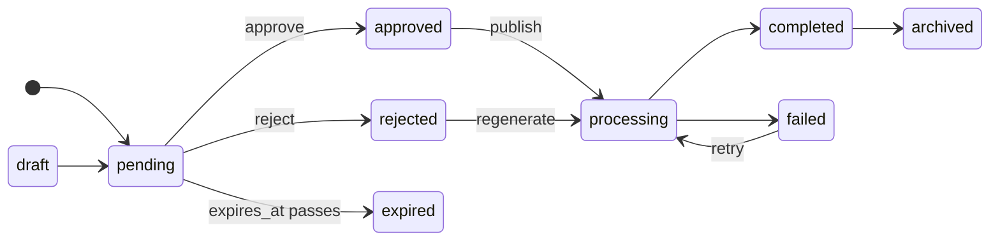
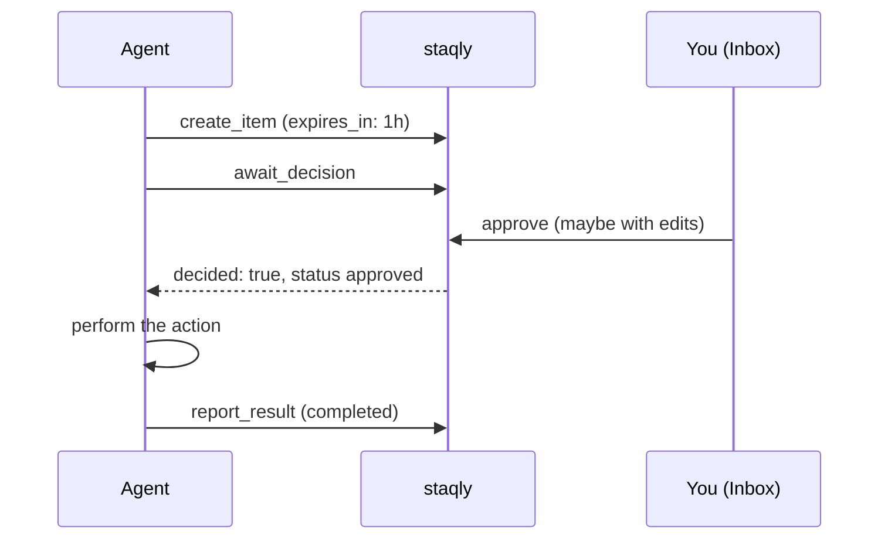

## Workspace

Everything belongs to a **workspace**: collections, items, events, webhooks, rules,
watchers, API keys and sessions. Every query is scoped by workspace.

- **Local mode** has exactly one workspace, created automatically on first start.
- **Cloud mode** has many; each API key and browser session belongs to exactly one, so *the
  key decides the workspace*. See [Local vs cloud](/docs/local-vs-cloud).

## Collections

A collection groups related outputs — *Instagram Avatar*, *AI Research*, *Automation
Results*. Each collection has:

- a **name**, unique within the workspace (case-insensitive), so agents can refer to a
  collection by name instead of ID;
- a description, icon and colour;
- a **default view**: `gallery`, `table` or `list`;
- configurable **actions** (see [below](#actions));
- an archived flag — archived collections are read-only (creating items returns `409`).

Deleting a collection is permanent and removes its items; the API requires
`?confirm=<collection name>`.

## Items

An item is one output from an agent or automation.

| Field | Notes |
|---|---|
| `type` | `image`, `video`, `text`, `link`, `json` or `file`. Inferred when omitted (see below). |
| `title` | Up to 500 characters. Defaults to the first line of text, the URL, or `Untitled <type>`. |
| `content` | A string, or any JSON value (stored compacted). Up to 1 MiB. |
| `url` | An absolute `http(s)` URL — a link, or externally hosted media. |
| `media` | An uploaded file (image, video, PDF…) served by the API after authorization. |
| `metadata` | A JSON object (up to 256 KiB): prompt, model, seed, score — anything. Searchable. |
| `source` | Who produced it, e.g. `n8n`, `mcp:Claude`, `watcher:HN`. Rules can match on it. |
| `external_ref` | Your own reference ID; filterable. |
| `status` | See the [lifecycle](#status-lifecycle). |
| `feedback` | The latest review or action feedback. |
| `version` | Incremented on every change; a snapshot is stored before each change. |
| `decided_at` | When the item was approved, rejected or expired. |
| `expires_at` | Set from `expires_in` on creation (or by an `expire` rule): an undecided item becomes `expired` at this time. |
| `editable` | Optional whitelist of what a reviewer may change before approving (see [below](#edit-before-approve)). |

**Type inference** when `type` is omitted: an uploaded image → `image`, video → `video`,
other files → `file`; JSON (non-string) content → `json`; a URL without content → `link`;
anything else → `text`.

**Updating metadata**: `metadata` replaces the whole object, while `metadata_patch` merges
top-level keys (a `null` value removes a key).

## Status lifecycle

Statuses are a fixed set — `draft`, `pending`, `approved`, `rejected`, `expired`, `processing`, `completed`, `failed`, `archived`:

- New items start as **`pending`** (or whatever `status` you pass — e.g. `draft`).
- **`approved`** and **`rejected`** can only be reached through the built-in *approve* /
  *reject* actions (which need the `items:review` scope), from `pending` only. A plain
  `PATCH` cannot set them.
- Decisions are **atomic**: when several reviewers or agents decide the same item at once,
  exactly one wins and the others get `409 conflict`.
- A pending item with an **`expires_at`** (from `expires_in` on creation, or an `expire`
  [rule](/docs/automation/rules)) that nobody decides in time becomes **`expired`**
  (event `item.expired`, feedback *"Expired before review"*).
- Your automation reports the outcome with `POST /v1/items/{id}/result` (`completed` /
  `failed`) or progress with `PATCH /v1/items/{id}`: `processing`, `completed`, `failed`,
  `archived`.
- After the decision, the reviewed content is **frozen** for agents: with `items:write` alone
  an approved or rejected item accepts only `metadata_patch` and the lifecycle status changes
  (e.g. approved → processing → completed). Everything else needs `items:review` — see
  [Security model](/docs/self-hosting/security#review-integrity).

## Approval gates

An agent can **wait** for your decision before doing something risky — the core loop of
staqly:

`GET /v1/items/{id}/wait` (REST) and `await_decision` (MCP) block until the item leaves
`pending` or the timeout passes. See
[Gate a risky agent action on human approval](/docs/cookbook/approval-gate).

## Edit before approve

Reviewers can fix an item while approving it ("edit & approve"). The producer can restrict
*what* may be changed by passing `editable` when creating the item: any of `title`,
`content`, `url`, `media_id`, `metadata` or `metadata.<key>`. Empty means everything. An edit
outside the whitelist fails with `422 not_editable`. When edits were made, the
`item.approved` event carries a `diff` — `{field: {before, after}}` — so your automation sees
exactly what the human changed.

## Actions

Actions are what a reviewer — or an agent — can *do* with an item.

**Built-in** (scope `items:review`, only from `pending`):

| Action | Result | Event |
|---|---|---|
| `approve` | `approved`; optional `edits` are applied first ("edit & approve") | `item.approved` |
| `reject` | `rejected`, with feedback | `item.rejected` |

**Custom actions** are configured per collection, without code. New collections get four
defaults:

| Action | Allowed from | Sets status | Event | Feedback |
|---|---|---|---|---|
| `regenerate` | pending, rejected, failed | processing | `item.regenerate_requested` | required |
| `publish` | approved | processing | `item.publish_requested` | optional |
| `retry` | failed | processing | `item.retry_requested` | optional |
| `archive` | any | archived | `item.archived` | optional |

Running a custom action needs the `actions:execute` scope. It records an event and
notifies webhooks — **external tools do the actual work**. See
[Custom actions](/docs/automation/custom-actions).

## Events

Every change is written to an **immutable activity log** (a database trigger forbids
updates): `item.created`, `item.approved`, `item.rejected`, `item.status_changed`,
`item.regenerate_requested`, `collection.created`, `rule.created`… Each event records the
**actor** — you (`session` / `local`), an API key, or the `system` (a rule, a watcher, an
expiry). Browse them in [Activity](/docs/dashboard/activity) or via `GET /v1/events`.
Full list: [Event types](/docs/api/events).

## Webhooks

Webhooks deliver events to your services — n8n, a server, a queue. They are **signed**
with HMAC-SHA256, **retried** with exponential backoff and delivered **at-least-once**
through a transactional outbox: the event and its deliveries are committed together with
the change itself. See [Webhooks](/docs/automation/webhooks).

## Rules and watchers

- **Rules** run when a new pending item is created and can auto-approve, auto-reject,
  change status, set an expiry, or escalate it. [Rules](/docs/automation/rules)
- **Watchers** poll RSS/Atom feeds or watch web pages, and turn new entries into pending
  link items. [Watchers](/docs/automation/watchers)
