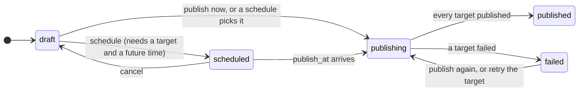

This page explains the words you will see throughout staqly and how they relate. Read it once
before you build your first automation; come back to it as a reference.

## The big picture

In one sentence: a person or an agent writes a **post** into a **collection**, the post has one
**target** per **channel**, a **job** publishes each target at the post's time or when a
**schedule** picks it, and every change is written as an **event** that **webhooks** and
**alerts** deliver to your tools and to you.

| Term | In short |
|---|---|
| [Workspace](#workspace) | The container for everything. The Community Edition has exactly one. |
| [Collection](#collections) | A named group of posts with its own schedules, like a folder with a calendar. |
| [Post](#posts) | One piece of content: text, media, tags, metadata and its targets. |
| [Target](#targets) | The post on one channel: its own text and settings, its own status and link. |
| [Channel](#channels) | A connected account on a platform, or your own automation. |
| [Provider](#providers) | A platform staqly can publish to: how it connects, what it allows. |
| [Schedule](#schedules) | A collection's rhythm: once or recurring, which posts, which channels, what to do when nothing waits. |
| [Job](#jobs) | A unit of background work with retries: publish a post, run a schedule, refresh a sign-in. |
| [Event](#events) | An entry in the activity log, written for every change. |
| [Webhook](#webhooks) and [alert](#alerts) | Deliver events to your services, or to you as a message. |

## Workspace

Everything belongs to a **workspace**: collections, posts, channels, schedules, jobs, events,
webhooks, alerts, API keys and sessions. Every query is scoped by workspace.

- **Staqly Community Edition** (`staqly serve` or the Docker image) has exactly one workspace,
  created automatically on first start.
- **Cloud mode** has many; each API key and browser session belongs to exactly one, so *the
  key decides the workspace*. See [Community Edition vs Staqly Cloud](/local-vs-cloud).

## Collections

A collection groups related posts and owns their schedules: *Product updates*, *Instagram
Avatar*, *Weekly digest*. Each collection has:

- a **name**, unique within the workspace (case-insensitive), so agents can refer to a
  collection by name instead of ID;
- a description, an icon and a **colour** (shown as a bar on calendar chips and a dot in lists);
- a **processing timeout** (`processing_timeout_seconds`, 1 minute to 24 hours): how long a
  target on [your own automation](/channels/your-own-automation) may wait for a reported
  result before it fails; without one the server's `PROCESSING_TIMEOUT` (default 1 hour) applies;
- its [schedules](#schedules);
- an archived flag: archived collections are read-only (creating posts returns `409`).

Deleting a collection is permanent and removes its schedules; the API requires
`?confirm=<collection name>`. Its posts are kept: every one moves to the Default collection as it
is. Drafts stay drafts, a scheduled post still goes out at its time, and posts that went out keep
their status and history.

Every workspace has one **Default** collection (`is_default: true`), created with the
workspace and listed first. You can rename it, but it cannot be archived or deleted (`409`), so
there is always somewhere to put posts.

## Posts

A post is one piece of content on its way to one or more channels.

| Field | Notes |
|---|---|
| `title` | Required (at most 300 characters; a `PATCH` can't empty it). Every channel shares it: platforms with a title (YouTube, Reddit, Pinterest, blogs, newsletters) publish it, refusing one longer than their own limit; elsewhere it names the post in staqly's lists. |
| `content` | The text. Each target may carry a text of its own instead (see [Targets](#targets)). |
| `media` | Media ids from `POST /v1/media`, in order; `media_items` is the same list resolved (type, size, URL). |
| `targets` | One per channel. A post needs at least one to be scheduled or published. |
| `status` | `draft`, `scheduled`, `publishing`, `published` or `failed` (see [below](#status-lifecycle)). |
| `publish_at` | When it goes out. A draft keeps the time as a note after a cancel. |
| `published_at` | When the last target was published. |
| `tags` | Labels such as `launch` or `client-a`; `GET /v1/tags` counts them. Every channel shares them: platforms with tags of their own (YouTube, Dev.to, Hashnode, Medium, WordPress) get them as their tags, your own automation gets them in `tags`, and every other channel gets them as hashtags at the end of the text (`#launch #clienta`), except those the text already has. |
| `metadata` | Free JSON for your own use: prompt, model, campaign. |
| `source` | Who created it: a client name, an agent, or `schedule:<name>` for posts a schedule fetched. |
| `external_ref` | Your own reference. |
| `repeat_every` | Repeat after publishing: `1d` to `6d`, `1w`, `2w` or `1mo` (empty: no repeat). See [Repeating posts](#repeating-posts). |
| `version` | Grows with every edit; pass `expected_version` on an update to refuse a stale edit (`409 post_changed`). |

Posts are created with `POST /v1/posts` (`collection` is an id or an exact name, `title` is required), MCP
`create_post`, the CLI `staqly posts create` or an SDK. A `PATCH` edits a draft, scheduled or
failed post; a published post is read-only (duplicate it into a new draft instead).

### Repeating posts

A post with `repeat_every` comes back: once it is **published** (every target went out), staqly
schedules a copy one interval after the post's publish time, with the same collection, text,
media, tags, metadata and channels (each with its own text and settings). The copy has
`source: "repeat"` and repeats too, so the post keeps coming back. A post that **failed** does
not repeat. If staqly was off for longer than the interval, the copy lands on the next time
still ahead (a weekly post published 20 days late comes back at the third week). Days and
months count in the workspace's time zone (**Settings → General → Workspace**, `timezone` on
`PATCH /v1/workspace`), so a weekly post at 09:00 there stays at 09:00 across daylight saving
changes.

| `repeat_every` | Comes back |
|---|---|
| `1d` ... `6d` | every 1 to 6 days |
| `1w`, `2w` | every week, every 2 weeks |
| `1mo` | every month, on the same day |

To **stop**, clear `repeat_every` on the next scheduled copy (`PATCH` with `"repeat_every": ""`
or `null`, MCP `update_post`, `staqly posts update <id> --repeat none`), or delete that copy.
A plan limit, an archived collection or channels that are gone also end the chain.

### Threads (comments under a post)

A post can carry a **thread**: up to 25 follow-up parts, each with text and/or media and a
`delay_seconds` (0 to 86400) after the part before it, the first after the post. Once a target is
published, staqly publishes the parts as **replies** on that channel, one after another, each under
the one before.

* Platforms that take replies (X, LinkedIn, Threads, Bluesky, Mastodon, Telegram, Slack, Discord,
  Facebook, Instagram, Reddit and others) publish them; each target's `replies` shows every part as
  `pending`, `publishing`, `published` (with its link), `failed` or `skipped`.
* A reply the platform refuses, or that still fails after the retries, is `failed`; the parts after
  it are `skipped`. The post itself stays published.
* Platforms without replies mark them `skipped`. [Your own automation](/channels/your-own-automation)
  receives the thread with its request and publishes it itself.
* Every part is held to each channel's limits (characters, files), like the post. The thread is
  edited with the post (`thread` replaces it, `[]` clears it) and is no longer editable once the post
  is publishing or published. Duplicates and repeats keep it.
* Events: `post.reply_published`, `post.reply_failed`.

`GET /v1/posts/{id}/preview` shows the text each target will carry and what its provider
objects to (too long, media missing) before you publish.

## Targets

A target is the post on one channel. It has:

- `content`: a text for this channel instead of the post's (`null` uses the post's), so a
  280-character X version can sit next to the long LinkedIn one;
- `settings`: the provider's per-post settings by key (a title for Reddit, a visibility for
  Mastodon), described by the provider's `settings_fields`;
- its own `status`: `pending`, `publishing`, `published` or `failed`, with `external_id` and
  `external_url` (where the post lives on the platform) once published, or `error` and
  `attempts` when not.

The post settles when its last target does. A failed target is retried alone with
`POST /v1/posts/{id}/targets/{channel}/retry`; the published ones are left as they are.
Updating a post's `targets` replaces the whole list.

## Channels

A channel is a connected account: *Brand on Mastodon*, *Telegram announcements*, *My n8n
publisher*. It belongs to a [provider](#providers) and has a `name`, the account's `handle`
and `profile_url`, provider-level default `settings` for new targets, and a status:

| Status | Meaning |
|---|---|
| `connected` | Ready to publish. |
| `needs_reconnect` | A publish or a token refresh failed with the stored credentials; `last_error` says why. Reconnect it in the dashboard, or with fresh `fields` for a token platform. |
| `disabled` | Turned off by you; its targets wait. |

Credentials are stored **sealed** (AES-256-GCM with a key kept in `DATA_DIR/secret.key` or
`STAQLY_SECRET_KEY`) and never returned. `POST /v1/channels/{id}/test` checks them against the
platform. Removing a channel removes its targets that have not gone out; the published ones stay on their posts, with the channel's name and picture. See [Channels](/channels).

## Providers

A provider is a platform staqly can publish to. `GET /v1/providers` is the catalog:

| Field | Meaning |
|---|---|
| `auth` | `oauth2` (the person is sent to the platform and comes back), `token` (a bot token, an app password, pasted in), `none` (your own automation). |
| `status` | `available` in this build, or `soon`. |
| `limits` | `max_chars`, `max_media`, `media_kinds`, `needs_title`, `needs_media`, `needs_link`, `links` and `link_modes` (what a channel does with links, and the modes it may choose), `image` (what the platform refuses in a picture). The composer counts characters per channel against them; a target over them is a `422`. |
| `credential_fields` | What `POST /v1/channels` needs in `fields` for a token platform. |
| `settings_fields` | The per-post settings a target may set. |
| `app_configured` | OAuth platforms: whether a developer app is set (the workspace's or the server's). |

Provider `custom`, **your own automation**, is available in every build: staqly emits
`post.publish_requested` for the target and waits for the result your script or n8n workflow
reports. See [Your own automation](/channels/your-own-automation).

## Status lifecycle

- New posts start as **`draft`**, unless created with `status: scheduled` (needs `publish_at`
  in the future, at most a year ahead, and a target) or `publish_now: true`.
- **Schedule** (`POST /v1/posts/{id}/schedule`) sets the time; **cancel** takes a scheduled post
  off the calendar and back to draft, keeping the time as a note.
- **Publish** (`POST /v1/posts/{id}/publish`, `202`) works from draft, scheduled or failed: the
  post becomes `publishing` and a job publishes each target.
- A post is **`published`** when every target is, **`failed`** when one is not. Retry the failed
  target alone, or publish the post again (published targets are not sent twice).
- A **published** post cannot be edited; **duplicate** it (`POST /v1/posts/{id}/duplicate`) into a
  new draft with the same content, media, tags, metadata and targets.
- **Delete** keeps the post's events as history; **purge** (`admin`) erases them too.

## Schedules

A schedule belongs to a collection and publishes on its behalf:

| Field | Meaning |
|---|---|
| `kind` | `once` (at `run_at`) or `recurring` (by `rule`). |
| `rule` | `times` (`["09:00", "17:00"]`) with optional `weekdays` (0 Sunday to 6 Saturday; empty means every day) and `tz` (an IANA name; empty takes the workspace's time zone), **or** `every_minutes`. |
| `channels` | The channels the chosen posts go to; a post's own targets win. |
| `pick` | `next`: the oldest waiting draft; `selected`: the posts in `post_ids`; `all`: every waiting draft. |
| `source` | What to do when nothing waits: `none`, `agent` (record `schedule.posts_requested`, which your agent sees in `GET /v1/work`), or `endpoint` (POST a signed request to `endpoint_url` and create the posts it returns). |
| `enabled`, `next_run_at`, `last_run_at`, `last_result` | State; `last_result` says what the last run did or why it failed. |

Runs are jobs, so they survive restarts and are retried. **Run now**
(`POST /v1/schedules/{id}/run`) runs it at once without moving the next regular run. Details and
the endpoint contract: [Schedules](/automation/schedules).

## Jobs

Background work is a **job** in a durable queue ([River](https://riverqueue.com), in the same database:
SQLite in the Community Edition, PostgreSQL in the cloud). A job is written in the same transaction as the change it
belongs to (scheduling a post queues its publish job, or neither happens), survives restarts, is
retried up to 3 times with growing delays (about 1, 5 and 15 minutes), and is visible to you. A job
still running when its server stopped is picked up again after 15 minutes.

| Kind | What it does |
|---|---|
| `publish_post` | Starts publishing a post: one `publish_target` job per target. |
| `publish_target` | Publishes one target through its provider, or asks your own automation. |
| `target_timeout` | Fails a target on your own automation that reported nothing within the processing timeout. |
| `run_schedule` | Runs a schedule at its time. |
| `refresh_channel` | Refreshes an OAuth sign-in before it expires; a failure marks the channel `needs_reconnect`. |
| `repeat_post` | Creates the next occurrence of a repeating post once it is published. |
| `publish_reply` | Publishes one comment of a post's thread, after its delay. |
| `repost` | Reposts a published post from another channel of the workspace (X). |
| `notify_people`, `notify_person` | Cloud: emails the people who [get notified](/dashboard/notifications) about an event, one job per person. |
| `sync_seats`, `sync_entitlements` | Cloud with billing: brings the subscription's seats in line with the members, and reads what Stripe grants the workspace. |
| `ai_run` | Runs one AI request (the [design editor](/dashboard/design-editor), MCP `generate_media`) and keeps its result. |

Statuses are `queued`, `running`, `done`, `failed` and `cancelled`. One live job exists per
subject (`publish_post:<post id>`): queueing the same key again replaces a queued job; a running
one finishes its run and then runs again at the new time (never two runs at once). Up to
`JOB_CONCURRENCY` jobs run at once (default 4), at most half of them for one workspace while
another workspace's job waits. Done, failed and cancelled jobs are kept for 7 days. See them in **Settings → System → Queue** or with `GET /v1/jobs`; retry a
failed one, cancel a queued one.

## Events

Every change is written to an **immutable activity log** (a database trigger forbids
updates): `post.created`, `post.scheduled`, `post.published`, `post.failed`,
`channel.connected`, `schedule.ran` and more. Each event records the **actor** (`type`, `id` and
`name`): you (`session` / `local`), an API key, or the `system` (the scheduler, the publisher,
Stripe). Browse them in [Activity](/dashboard/activity) or via `GET /v1/events`, filtered by
type, type prefix, post, channel, schedule, actor and date range. Full list:
[Event types](/api/events).

## Webhooks

Webhooks deliver events to your services: n8n, a server, a queue. They are **signed** with
HMAC-SHA256, **retried** with exponential backoff and delivered **at-least-once** through a
transactional outbox: the event and its deliveries are committed together with the change
itself. A webhook subscribes to event types or family globs such as `post.*`; an unknown
pattern is refused with `422`, so a typo cannot silently match nothing. Deliveries run in
parallel, so two events can arrive in either order: sort by the event's `created_at` and drop
duplicates by its `id`. See [Webhooks](/automation/webhooks).

## Alerts

Alerts turn events into messages for people: Telegram, Slack, Discord, ntfy or email. By
default an alert tells you when a post was published or failed and when a channel needs
reconnecting; subscribe it to other events (`post.scheduled`, `schedule.posts_requested`) or
restrict it to some collections. See [Alerts](/automation/alerts).

## Next steps

<Cards>
  <Card title="Quickstart" href="/quickstart">Connect a channel, write a post, set a schedule.</Card>
  <Card title="Channels" href="/channels">Every platform and how it connects.</Card>
  <Card title="Schedules" href="/automation/schedules">Rules, picks and the agent and endpoint sources.</Card>
  <Card title="Webhooks" href="/automation/webhooks">React to publishing in your own tools.</Card>
</Cards>
