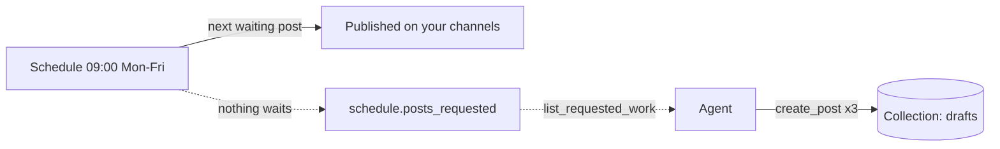

You want a steady stream of posts without writing each one by hand or giving each one a time.
Let a **schedule** publish the next waiting draft every morning, and let your agent (Claude
Code, Codex, OpenCode) refill the collection whenever the schedule asks.

## What you need

- Staqly running ([Quickstart](/quickstart)) with at least one connected
  [channel](/channels) (your own automation works for a dry run).
- An agent connected over [MCP](/mcp).

## Build it

<Steps>
<Step>

### Create the collection and the schedule

In the dashboard: **Posts → New** → *Daily tips*. Then **Settings → Schedules → New schedule**:
**At fixed times** `09:00`, Mon to Fri, your time zone, your channels, **The next waiting post
(oldest first)**, and **Ask my agent for new posts** under *When nothing is waiting*.

Or let the agent do it:

> Create a collection called Daily tips with a schedule that publishes the next waiting post
> every weekday at 9:00 Europe/Warsaw on my Telegram channel, and asks me for new posts when
> it runs out.

The agent calls `create_collection`, `list_channels` and `create_schedule` with
`rule: { times: ["09:00"], weekdays: [1,2,3,4,5], tz: "Europe/Warsaw" }`, `pick: "next"` and
`source: "agent"`.

</Step>
<Step>

### Write the first batch

> Write five short tips about using the calendar into Daily tips, one post each, for the
> Telegram channel.

Five `create_post` calls, five drafts. The calendar shows the schedule's next runs as hollow
chips (`09:00 · Daily tips · next post`) but no post yet: the schedule picks one when it runs.

</Step>
<Step>

### Let it run

Every weekday at 09:00 the oldest draft goes out. **Run now** on the schedule (or
`run_schedule`) publishes one right away so you can see it work. Each run records
`schedule.ran`; the post's history records *Published* per channel.

</Step>
<Step>

### Refill when asked

On the sixth morning the run finds nothing. The schedule records `schedule.posts_requested`,
the bell shows *Posts wanted*, and `GET /v1/work` lists the schedule with `kind: posts`. Tell
your agent, once, in its instructions or in the conversation:

> When `list_requested_work` shows a schedule asking for posts, write three new drafts into its
> collection in the voice of the previous posts there, each targeting the schedule's channels.

Ask it *"Is anything asking me for posts?"*, or run it on a timer (`claude -p` from cron, a
Codex task). The next run publishes the first new draft.

</Step>
</Steps>

## Variations

- **Everything at once.** *Every waiting post* instead of the next one publishes the whole
  batch at the slot; combine it with **Every few hours** for a drip.
- **A script instead of an agent.** Use *Call an endpoint that returns posts*: see
  [Posts from your endpoint](/cookbook/posts-from-your-endpoint).
- **Review before it goes out.** Keep the agent's posts as drafts and look at them on
  **Posts** before the morning; drag one onto a slot on the calendar to pin it.
- **Tell yourself.** An [alert](/automation/alerts) on `schedule.posts_requested` sends a
  message when the collection runs dry.

## Reference

- [Schedules](/automation/schedules), [MCP tools](/mcp/tools): `create_schedule`,
  `list_requested_work`, `create_post`.
- [Scopes](/api/authentication#scopes): a drafting agent needs `collections:read posts:read
  posts:write media:write`; the schedule publishes on its own, so the agent needs no
  `posts:publish`.
