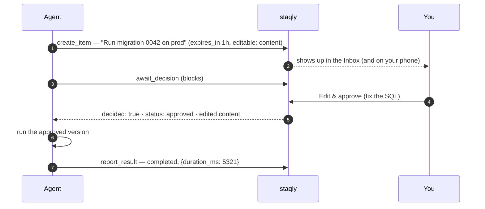

Some things an agent should never do on its own: run a production migration, email a customer,
publish a post, spend money. In this recipe the agent **asks first**. It creates an item that
describes the action, waits for your decision, and runs the action only if you approve it,
even if you edited the details first. It's for anyone who lets an AI agent (Claude Code,
Codex, a script) touch something that matters.



## What you need

- staqly running on your computer: `staqly serve` ([install](/quickstart)), or the
  [Docker image](/self-hosting/docker). The API is at `http://localhost:3333`.
- One of these:
  - an agent connected over MCP, like [Claude Code](/agents/claude-code), [Codex](/agents/codex)
    or [another MCP client](/agents/other-mcp-clients)
  - `curl` and `jq` for the shell version
  - the [TypeScript SDK](/sdk/typescript)

## Build it

<Steps>
<Step>

### Create a collection for approval requests

Every item lives in a collection, and the collection has to exist before an agent can create
items in it. A separate **Deploys** collection keeps approval requests apart from other
content.

```bash
staqly collections create Deploys
```

Or click **New collection** in the dashboard, or ask your agent to call `create_collection`.

</Step>
<Step>

### Propose the action

The agent creates an item that describes exactly what it wants to do. Three options make the
proposal safe and quick to review:

- **`expires_in`**: `"1h"`, `"24h"` or a number of seconds (1 minute to 90 days). If nobody
  decides in time, the item becomes `expired`. Treat that as a *no*.
- **`editable`**: what you may change before approving: `title`, `content`, `url`,
  `media_id`, `metadata` or `metadata.<key>`. Edits to any other field are refused with
  `422 not_editable`. Leave it empty to allow every field.
- **`metadata`**: the parameters of the action (environment, recipients, amount). You see them
  while reviewing, and the agent reads back exactly what you approved.

| Step | MCP tool | REST |
|---|---|---|
| Propose | `create_item` | `POST /v1/collections/{collection}/items` |

</Step>
<Step>

### Wait for your decision

The agent blocks until you decide. Both wait calls return `{"decided": true, "item": {"id": "itm_oalirbz67y4m4cqxq5dw", "status": "approved"}}` and
**always return the current item**. `decided: false` only means the timeout passed and the
item is still pending, so the agent calls again. The item leaves `pending` when you approve
it, reject it, or it **expires**.

| Step | MCP tool | REST |
|---|---|---|
| Wait | `await_decision` (up to 300 s per call) | `GET /v1/items/{id}/wait?timeout=60` (up to 60 s per call) |

`await_decision` waits 45 s by default (`timeout_seconds`, max 300). Many MCP clients give up on a tool call
after 60 s, so keep it under your client's limit and call again, or raise the limit first (see
[MCP tools](/mcp/tools#wait-for-the-decision-await_decision)).

</Step>
<Step>

### Act only if the status is `approved`

Anything else (`rejected`, `expired`) means *don't do it*. If you edited the item before
approving, the agent must use the **returned item**, not its original proposal. The
`item.approved` event also carries a `diff` of what you changed.

</Step>
<Step>

### Report the result

Close the loop so the item records how the story ended.

| Step | MCP tool | REST |
|---|---|---|
| Report | `report_result` | `POST /v1/items/{id}/result` |

It takes `status` (`completed` or `failed`), an optional `result` (any JSON, stored in
`metadata.result`) and `error` (stored in `metadata.error`). It works on items that are
`approved` or `processing`; otherwise it returns `409`. It emits `item.completed` or
`item.failed`, so dashboards and webhooks see the outcome.

</Step>
</Steps>

## The code

<Tabs items={["MCP (no code)", "curl", "TypeScript"]}>
<Tab value="MCP (no code)">

Most agents need no code. Ask in plain language:

> *"Before running the migration, create an item in the Deploys collection describing it,
> expiring in an hour, with only the content editable. Wait for my decision; run it only if I
> approve, using the content I approved, then report the result."*

staqly's MCP server instructions already teach the model this pattern: `create_item`, then
`await_decision`, act only if the status is `approved`, then `report_result`. A decided
`await_decision` call returns:

```json title="await_decision → result"
{
  "decided": true,
  "item": {
    "id": "itm_oalirbz67y4m4cqxq5dw",
    "status": "approved",
    "content": "ALTER TABLE users ADD COLUMN last_seen_at timestamptz NULL",
    "editable": ["content", "metadata.note"],
    "expires_at": "2026-10-13T11:09:10.584957Z"
  }
}
```

</Tab>
<Tab value="curl">

```bash
API=http://localhost:3333

# 1. propose
ITEM=$(curl -s -X POST "$API/v1/collections/Deploys/items" -H 'Content-Type: application/json' -d '{
  "title": "Run DB migration 0042 on prod",
  "content": "ALTER TABLE users ADD COLUMN last_seen_at timestamptz",
  "metadata": { "env": "prod", "risk": "high" },
  "source": "deploy-agent",
  "expires_in": "1h",
  "editable": ["content", "metadata.note"]
}' | jq -r .id)

# 2. wait (repeat while decided == false)
while :; do
  R=$(curl -s "$API/v1/items/$ITEM/wait?timeout=60")
  [ "$(echo "$R" | jq -r .decided)" = "true" ] && break
done
STATUS=$(echo "$R" | jq -r .item.status)

# 3. act only if approved, using the approved content; 4. report the result
if [ "$STATUS" = "approved" ]; then
  echo "$R" | jq -r .item.content | psql "$PROD_DB" \
    && curl -s -X POST "$API/v1/items/$ITEM/result" -H 'Content-Type: application/json' \
         -d '{"status":"completed","result":{"applied":true}}' \
    || curl -s -X POST "$API/v1/items/$ITEM/result" -H 'Content-Type: application/json' \
         -d '{"status":"failed","error":"psql exited non-zero"}'
else
  echo "Not approved ($STATUS), skipping."
fi
```

</Tab>
<Tab value="TypeScript">

`requiresApproval` wraps a function so that every call first asks you. The function runs only
after approval, gets reported `completed` (or `failed`, re-throwing the error), and a
rejection or expiry throws `RejectedError`.

```ts
import { RejectedError, Staqly } from '@staqly/sdk'

const staqly = new Staqly() // local mode: no key needed

const migrate = staqly.requiresApproval((sql: string) => runMigration(sql), {
  collection: 'Deploys',
  title: 'Run DB migration 0042 on prod',
  content: (sql) => sql,
  metadata: { env: 'prod', risk: 'high' },
  expires_in: '1h',
  editable: ['content'],
})

try {
  await migrate('ALTER TABLE users ADD COLUMN last_seen_at timestamptz')
} catch (err) {
  if (err instanceof RejectedError) {
    console.log('Not approved, skipping.')
  } else {
    throw err
  }
}
```

The wrapper calls your function with the arguments you passed, not with the reviewer's edits.
If the reviewer may edit, use `requestApproval` and act on the returned item instead:

```ts
const decision = await staqly.requestApproval('Deploys', {
  title: 'Run DB migration 0042 on prod',
  content: 'ALTER TABLE users ADD COLUMN last_seen_at timestamptz',
  expires_in: '1h',
  editable: ['content'],
})

if (decision.approved) {
  try {
    const result = await runMigration(decision.item.content) // the approved, possibly edited SQL

    await staqly.items.reportResult(decision.item.id, { status: 'completed', result })
  } catch (err) {
    await staqly.items.reportResult(decision.item.id, { status: 'failed', error: String(err) })
    throw err
  }
}
```

`requestApproval` waits up to 10 minutes by default; pass `{ timeout: ms }` as the third
argument to wait longer.

</Tab>
</Tabs>

## Tips

- **Make reviewing fast.** Put a one-line summary in `title`, the exact command or text in
  `content`, and the parameters in `metadata`. Review in the Inbox with <Kbd>⇧</Kbd> <Kbd>A</Kbd> /
  <Kbd>⇧</Kbd> <Kbd>R</Kbd> / <Kbd>⇧</Kbd> <Kbd>E</Kbd>, [on your phone](/cookbook/review-on-your-phone) or
  [in Telegram](/cookbook/approve-from-chat).
- **Set an expiry** with `expires_in` (for example `"1h"`), so a request nobody answers turns
  `expired` instead of waiting forever.
- **Use a separate key in cloud mode.** Give the agent `items:write items:read` but not
  `items:review`, so it can propose and wait but never approve itself.
- **Gate a CI pipeline** the same way with one CLI command: see
  [Approval gate in CI](/cookbook/ci-approval-gate).

## Reference

<Cards>
  <Card title="MCP tools" href="/mcp/tools">`create_item`, `await_decision`, `report_result`</Card>
  <Card title="TypeScript SDK" href="/sdk/typescript">Client, methods and errors</Card>
  <Card title="Events" href="/api/events">`item.approved`, `item.completed`, `item.failed`</Card>
  <Card title="Scopes" href="/api/authentication">Keys that can propose but not approve</Card>
</Cards>
