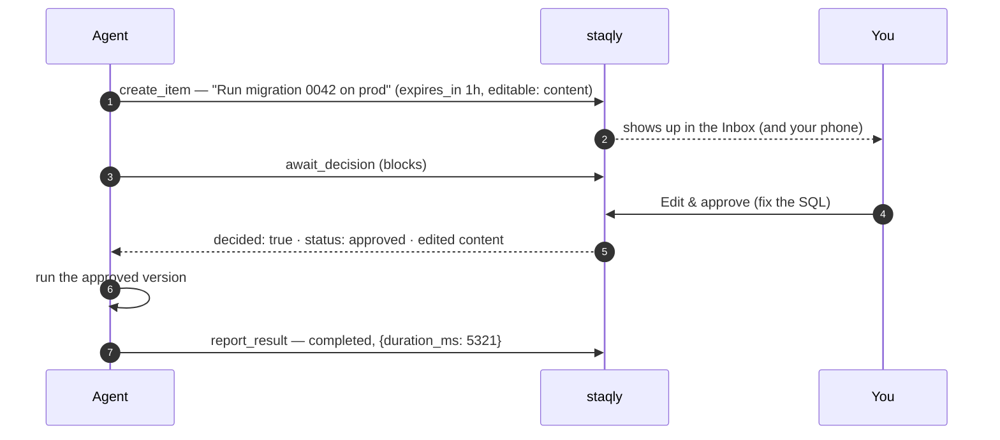

Some things an agent should never do on its own: run a production migration, send an email
to a customer, publish a post, spend money. With staqly the agent **asks first**: it creates
an item describing what it wants to do, waits for your decision, and acts only if you approve
— possibly after you edited the details.



## The four steps

| Step | MCP tool | REST |
|---|---|---|
| 1. Propose | `create_item` | `POST /v1/collections/{collection}/items` |
| 2. Wait | `await_decision` (up to 300 s per call) | `GET /v1/items/{id}/wait?timeout=60` (up to 60 s per call) |
| 3. Act — **only if `status` is `approved`** | — | — |
| 4. Report | `report_result` | `POST /v1/items/{id}/result` |

Both wait calls return `{"decided": …, "item": {…}}` and **always return the current item**.
`decided: false` means the timeout passed and the item is still pending — just call again.
The item leaves `pending` when it is approved, rejected, or **expires**.

## Useful options when proposing

- **`expires_in`** — `"1h"`, `"24h"` or a number of seconds (1 minute to 90 days). If nobody
  decides in time, the item becomes `expired` and the waiting agent gets
  `decided: true, status: "expired"` — treat that as a *no*.
- **`editable`** — what the reviewer may change before approving: `title`, `content`, `url`,
  `media_id`, `metadata` or `metadata.<key>`. Anything else is refused with
  `422 not_editable`. Leave it empty to allow every field.
- **`metadata`** — put the parameters of the action here (environment, recipients, amount), so
  the reviewer sees them and the agent reads back exactly what was approved.

When the reviewer edits before approving, the agent must use the **returned item** (not its
original proposal), and the `item.approved` event carries a `diff` of what changed.

## With MCP

Most agents need no code — ask in plain language:

> *“Before running the migration, create an item in the Deploys collection describing it,
> expiring in an hour, with only the content editable. Wait for my decision; run it only if I
> approve, using the content I approved, then report the result.”*

staqly's server instructions already tell the model this pattern: `create_item`, then
`await_decision`, act only if the status is `approved`, then `report_result`.

```json title="await_decision → result"
{
  "decided": true,
  "item": {
    "id": "itm_…",
    "status": "approved",
    "content": "ALTER TABLE … (reviewed)",
    "editable": ["content", "metadata.note"],
    "expires_at": "2026-10-13T11:09:10.584957Z"
  }
}
```

## With curl

```bash
API=http://localhost:3333

# 1. propose
ITEM=$(curl -s -X POST "$API/v1/collections/Deploys/items" -H 'Content-Type: application/json' -d '{
  "title": "Run DB migration 0042 on prod",
  "content": "ALTER TABLE …",
  "metadata": { "env": "prod", "risk": "high" },
  "source": "deploy-agent",
  "expires_in": "1h",
  "editable": ["content", "metadata.note"]
}' | jq -r .id)

# 2. wait (repeat while decided == false)
while :; do
  R=$(curl -s "$API/v1/items/$ITEM/wait?timeout=60")
  [ "$(echo "$R" | jq -r .decided)" = "true" ] && break
done
STATUS=$(echo "$R" | jq -r .item.status)

# 3. act only if approved — using the approved content
if [ "$STATUS" = "approved" ]; then
  echo "$R" | jq -r .item.content | psql "$PROD_DB" \
    && curl -s -X POST "$API/v1/items/$ITEM/result" -H 'Content-Type: application/json' \
         -d '{"status":"completed","result":{"applied":true}}' \
    || curl -s -X POST "$API/v1/items/$ITEM/result" -H 'Content-Type: application/json' \
         -d '{"status":"failed","error":"psql exited non-zero"}'
else
  echo "Not approved ($STATUS) — skipping."
fi
```

## With the TypeScript SDK

```ts
import { Staqly, type CreateItemInput, type Item } from '@staqly/sdk';

const staqly = new Staqly();

/** Propose an action, wait for a human, run it only if approved, report the outcome. */
async function withApproval<T>(proposal: CreateItemInput, act: (approved: Item) => Promise<T>) {
  const item = await staqly.createItem('Deploys', { expires_in: '1h', ...proposal });

  let decision: { decided: boolean; item: Item };
  do {
    decision = await staqly.request('GET', `/v1/items/${item.id}/wait`, { query: { timeout: 60 } });
  } while (!decision.decided);

  if (decision.item.status !== 'approved') return null; // rejected or expired

  try {
    const result = await act(decision.item); // use the approved (possibly edited) item
    await staqly.request('POST', `/v1/items/${item.id}/result`, { body: { status: 'completed', result } });
    return result;
  } catch (err) {
    await staqly.request('POST', `/v1/items/${item.id}/result`, { body: { status: 'failed', error: String(err) } });
    throw err;
  }
}

await withApproval(
  { title: 'Run DB migration 0042 on prod', content: 'ALTER TABLE …', editable: ['content'] },
  async (approved) => runMigration(approved.content),
);
```

## Reporting the result

`report_result` / `POST /v1/items/{id}/result` takes `status` (`completed` or `failed`), an
optional `result` (any JSON, stored in `metadata.result`) and `error` (stored in
`metadata.error`). It works on items that are `approved` or `processing`; otherwise `409`.
It emits `item.completed` or `item.failed`, so dashboards and webhooks see how the story ended.

## Tips

- **Make the reviewer fast**: put a one-line summary in `title`, the exact command or text in
  `content`, and the parameters in `metadata`. Review happens in the Inbox with
  <Kbd>a</Kbd> / <Kbd>r</Kbd> / <Kbd>e</Kbd> — or on your phone.
- **Automate the boring cases** with [rules](/docs/automation/rules): e.g. auto-approve
  `metadata.risk = "low"`, escalate `metadata.env = "prod"`.
- **Separate keys** (cloud): give the agent `items:write items:read` but not `items:review`,
  so it can propose and wait but never approve itself.
