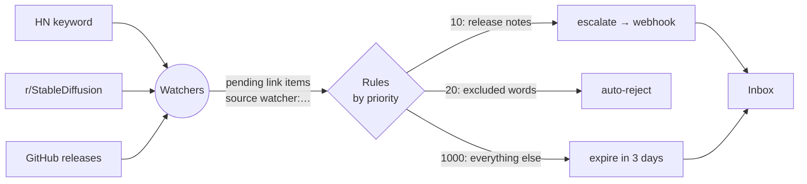

Goal: follow a few sources about AI image generation, let staq.ly throw away the noise, flag
the important bits, and quietly expire whatever you don't get to.



## 1. A collection for incoming links

```bash
API=http://localhost:3333
curl -s -X POST $API/v1/collections -H 'Content-Type: application/json' \
  -d '{"name":"AI Radar","description":"Links collected by watchers","default_view":"list"}'
```

## 2. Watchers

```bash
# Hacker News posts mentioning Stable Diffusion with at least 50 points
curl -s -X POST $API/v1/watchers/from-preset -H 'Content-Type: application/json' \
  -d '{"preset_id":"hn-keyword","params":{"keyword":"stable diffusion","min_points":"50"},"collection":"AI Radar"}'

# New posts in a subreddit
curl -s -X POST $API/v1/watchers/from-preset -H 'Content-Type: application/json' \
  -d '{"preset_id":"reddit-subreddit","params":{"subreddit":"StableDiffusion"},"collection":"AI Radar","every":"1h"}'

# Releases of a tool you depend on
curl -s -X POST $API/v1/watchers/from-preset -H 'Content-Type: application/json' \
  -d '{"preset_id":"github-releases","params":{"owner":"comfyanonymous","repo":"ComfyUI"},"collection":"AI Radar","name":"ComfyUI releases"}'
```

The first run of each watcher is a **baseline** — nothing is created until something new is
published. Use `POST /v1/watchers/{id}/run` to check immediately.

## 3. Rules

Rules see every new pending item, including watcher items (`source` = `watcher:<name>`).
Lowest priority first; the first match wins.

```bash
# 10 — releases of tools we depend on are important: escalate (stays pending)
curl -s -X POST $API/v1/rules -H 'Content-Type: application/json' -d '{
  "name": "Escalate releases",
  "priority": 10,
  "action": "escalate",
  "match": { "source_pattern": "watcher:ComfyUI*" },
  "params": { "note": "New release of a dependency" }
}'

# 20 — drop obvious noise
curl -s -X POST $API/v1/rules -H 'Content-Type: application/json' -d '{
  "name": "Reject memes",
  "priority": 20,
  "action": "auto_reject",
  "match": { "source_pattern": "watcher:*", "text_contains": "meme" },
  "params": { "feedback": "Filtered as noise" }
}'

# 1000 — everything else from watchers expires after 3 days if you don't look at it
curl -s -X POST $API/v1/rules -H 'Content-Type: application/json' -d '{
  "name": "Watcher items expire",
  "priority": 1000,
  "action": "expire",
  "match": { "source_pattern": "watcher:*" },
  "params": { "after_seconds": 259200 }
}'
```

<Callout title="Filter at the source when you can">
Watchers have their own `keywords` / `exclude_keywords` (and presets like `rss-feed` take a
`keywords` parameter). Entries filtered there never become items, so they don't count against
your monthly item quota. Rules are for decisions *after* an item exists.
</Callout>

## 4. Get told about escalations

Subscribe a webhook to `item.escalated` (and `item.expired`, if you care) — for example an n8n
workflow that posts to your chat:

```bash
curl -s -X POST $API/v1/webhooks -H 'Content-Type: application/json' \
  -d '{"url":"http://n8n:5678/webhook/radar","events":["item.escalated"]}'
```

Or skip the webhook: a [notification channel](/docs/automation/notifications) (Telegram, Slack,
Discord, ntfy, email) notifies on `item.escalated` by default — with Approve / Reject buttons.

## 5. Review

Open the Inbox filtered to the collection. Watcher items show an **External content** badge —
their text comes from the internet and is marked `metadata.untrusted = true`. Approve what's
worth keeping; the rest expires on its own.

Check the health of your sources with `GET /v1/watchers` (or ask your agent *"are any of my
watchers failing?"*): a watcher with 5 consecutive failures turns `degraded`, and after 24 h
degraded it pauses itself.
