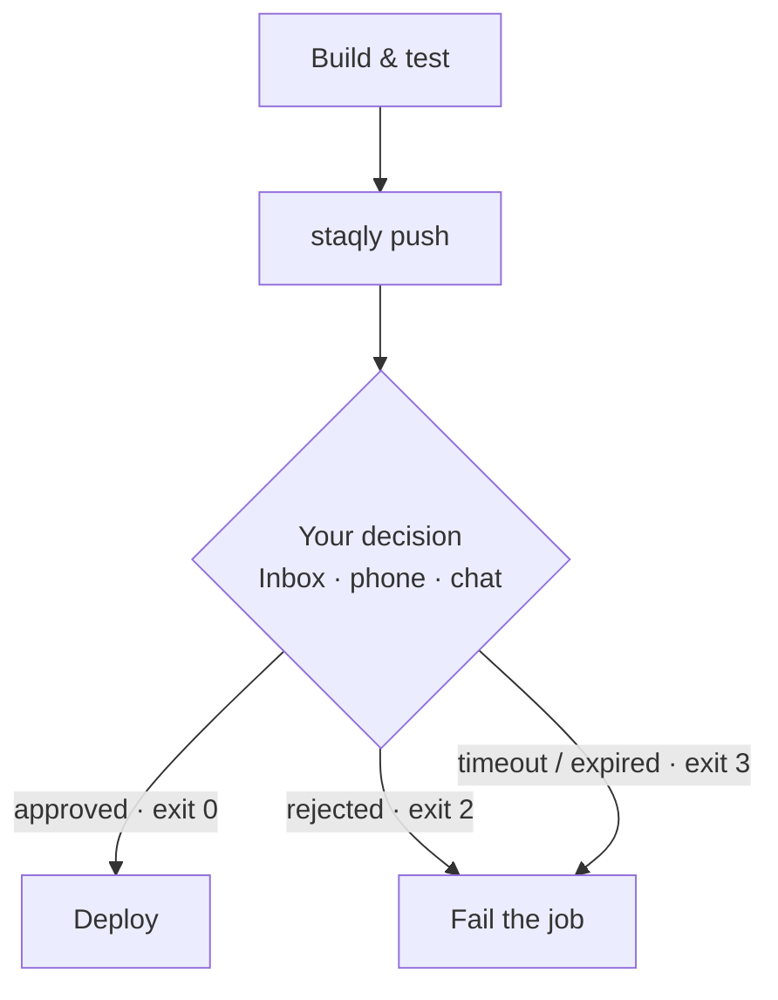

The [`staqly` CLI](/docs/cli) turns an approval into an **exit code**: `staqly push` creates an
item, waits for a decision, and exits `0` when approved, `2` when rejected and `3` when nobody
decided in time. CI systems understand exit codes, so a human approval becomes an ordinary
pipeline step.



## 1. A key for CI (cloud)

Create an API key with only `items:write items:read` under **Integrations → API keys** (or
`staqly keys create --name "CI gate" --scope items:read,items:write`). Without `items:review`
the pipeline can ask, but never approve itself. Store it as a CI secret.

## 2. GitHub Actions

```yaml title=".github/workflows/deploy.yml"
- name: Install staqly
  run: |
    curl -fsSL https://raw.githubusercontent.com/staqly/staqly/main/scripts/install.sh | sh
    echo "$HOME/.local/bin" >> "$GITHUB_PATH"

- name: Wait for human approval
  env:
    STAQLY_API_URL: https://staqly.example.com
    STAQLY_API_KEY: ${{ secrets.STAQLY_API_KEY }}   # scopes: items:write items:read
  run: |
    staqly push Deploys \
      --title "Deploy ${GITHUB_REF_NAME} to production" \
      --content "$(git log -1 --pretty=%B)" \
      --url "$GITHUB_SERVER_URL/$GITHUB_REPOSITORY/actions/runs/$GITHUB_RUN_ID" \
      --external-ref "$GITHUB_SHA" \
      --idempotency-key "deploy-$GITHUB_SHA-$GITHUB_RUN_ATTEMPT" \
      --timeout 2h

- name: Deploy
  run: ./deploy.sh
```

Exit `0` lets the next step run; `2` (rejected) and `3` (timed out) fail the job. The
idempotency key makes a retried step reuse the same item instead of asking twice.

## 3. Branch on the outcome

```bash
staqly push Deploys --title "Release v1.4" --timeout 1h
case $? in
  0) ./deploy.sh ;;
  2) echo "Rejected — not deploying"; exit 1 ;;
  3) echo "Nobody decided in time"; exit 1 ;;
  *) echo "staqly error"; exit 1 ;;
esac
```

| Exit | Meaning |
|---|---|
| `0` | approved |
| `2` | rejected |
| `3` | still pending after `--timeout`, or the item **expired** (`--expires-in`) |
| `4` | left `pending` with another status (e.g. a custom action, archived) |
| `1` | API or network error |

## 4. Report the result

Close the loop so the item shows what happened after approval:

```bash
id=$(staqly push Deploys --title "Deploy v1.4" --json | jq -r .id) || exit $?
if ./deploy.sh; then
  staqly items result "$id" --status completed --result "{\"version\":\"v1.4\"}"
else
  staqly items result "$id" --status failed --error "deploy.sh failed"
fi
```

## How the wait works

`push` long-polls `GET /v1/items/{id}/wait` (up to 60 s per request) until the item leaves
`pending` or `--timeout` passes (default `30m`). It retries network errors, `5xx` and `429`
(honouring `Retry-After`), so a flaky connection doesn't fail the job. While it waits, review
the item anywhere: the Inbox, your phone, or [Telegram](/docs/cookbook/approve-from-chat).

Useful options: `--expires-in 2h` (the item itself expires, so the Inbox stays clean),
`--editable title,metadata.sql` (what the reviewer may change), `--file` (attach a build
artifact or screenshot), `--meta k=v` (structured parameters).

<Callout title="Verified">
Against a local server: approve → exit 0 (with the reviewer's feedback printed), reject →
exit 2, `--timeout 3s` with nobody deciding → exit 3.
</Callout>
