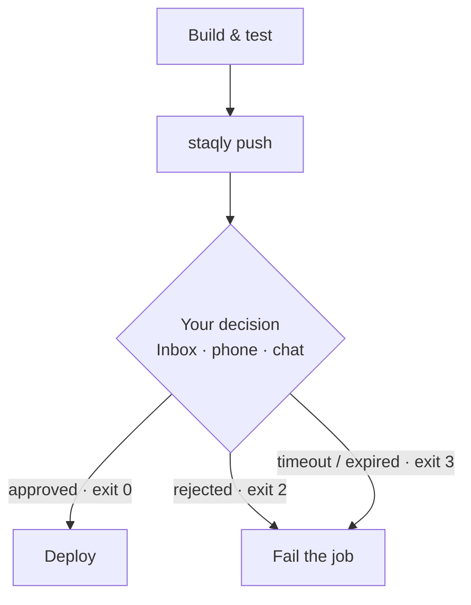

You want a person to sign off before your pipeline deploys to production. In this recipe you add
one step to **your own deployment pipeline** (GitHub Actions, or any CI): it creates a
"Deploy to production?" item in staqly and pauses until someone approves it in the Inbox, on
their phone or in chat. Approve and the deploy runs; reject, or let it time out, and the job
fails.

<Callout type="warn" title="The runner must be able to reach staqly">
A GitHub-hosted runner runs on GitHub's machines, so it can't reach staqly on your laptop
(`localhost:3333`). For this recipe you need a staqly instance the runner can reach over the
internet: a [cloud-mode server](/self-hosting/cloud-deployment) behind HTTPS, with an API key.
A self-hosted runner on the same machine as a local staqly works too, without a key.
</Callout>



The trick is the [`staqly` CLI](/cli): `staqly push` creates an item, waits for a decision and
turns it into an **exit code**. CI systems understand exit codes, so a human approval becomes
an ordinary pipeline step.

## What you need

- A staqly server in [cloud mode](/local-vs-cloud) that your CI can reach, e.g.
  `https://staqly.example.com` ([deploy one](/self-hosting/cloud-deployment)).
- Admin access to that workspace, to create an API key.
- A GitHub repository with a deploy workflow (or any other CI that runs shell steps).

## Build it

<Steps>
<Step>

### Create a Deploys collection

Approval requests are items, and items live in a collection that must exist first. Create it
once in the dashboard (**New collection**), or with the CLI against your server:

```bash
export STAQLY_API_URL=https://staqly.example.com STAQLY_API_KEY=stk_...   # an admin key
staqly collections create Deploys
```

</Step>
<Step>

### Create an API key that can ask but not approve

Under **API keys** in the sidebar, create a key with only the `items:write` and `items:read`
scopes. Or use the CLI with the admin key from the previous step:

```bash
staqly keys create --name "CI gate" --scope items:read,items:write
```

Without `items:review` the pipeline can ask for approval but never approve itself. Store the
key (`stk_...`) as a repository secret named `STAQLY_API_KEY` (**Settings → Secrets and
variables → Actions** in GitHub).

</Step>
<Step>

### Add the approval step to your workflow

Put two steps before your deploy step: one installs the `staqly` CLI, the other waits for
approval.

```yaml title=".github/workflows/deploy.yml"
- name: Install staqly
  run: |
    curl -fsSL https://raw.githubusercontent.com/staqly/staqly/main/scripts/install.sh | sh
    echo "$HOME/.local/bin" >> "$GITHUB_PATH"

- name: Wait for human approval
  env:
    STAQLY_API_URL: https://staqly.example.com
    STAQLY_API_KEY: ${{ secrets.STAQLY_API_KEY }}   # scopes: items:write items:read
  run: |
    staqly push Deploys \
      --title "Deploy ${GITHUB_REF_NAME} to production" \
      --content "$(git log -1 --pretty=%B)" \
      --url "$GITHUB_SERVER_URL/$GITHUB_REPOSITORY/actions/runs/$GITHUB_RUN_ID" \
      --external-ref "$GITHUB_SHA" \
      --idempotency-key "deploy-$GITHUB_SHA-$GITHUB_RUN_ATTEMPT" \
      --timeout 2h

- name: Deploy
  run: ./deploy.sh
```

Exit `0` lets the next step run; `2` (rejected) and `3` (timed out) fail the job. The
`--url` links the item back to the workflow run, and the idempotency key makes a retried step
reuse the same item instead of asking twice.

</Step>
<Step>

### Approve it

Push a commit. The job stops at **Wait for human approval** and the item appears in your
staqly Inbox. Approve it and the deploy continues; any feedback you write is printed in the
job log.

</Step>
<Step>

### Report the result (optional)

Close the loop so the item shows what happened after approval. `--json` prints the decided
item, and the exit code still reflects the decision:

```bash
out=$(staqly push Deploys --title "Deploy v1.4" --json) || exit $?   # stop unless approved
id=$(echo "$out" | jq -r .id)

if ./deploy.sh; then
  staqly items result "$id" --status completed --result '{"version":"v1.4"}'
else
  staqly items result "$id" --status failed --error "deploy.sh failed"
  exit 1
fi
```

</Step>
</Steps>

## Exit codes

| Exit | Meaning |
|---|---|
| `0` | approved |
| `1` | API or network error |
| `2` | rejected |
| `3` | still pending after `--timeout`, or the item **expired** (`--expires-in`) |
| `4` | left `pending` with another status (e.g. a custom action, archived) |

To handle each outcome yourself, capture the code instead of letting the step fail. GitHub
Actions runs `bash -e`, which would stop at the first non-zero exit:

```bash
code=0
staqly push Deploys --title "Release v1.4" --timeout 1h || code=$?

case $code in
  0) ./deploy.sh ;;
  2) echo "Rejected, not deploying"; exit 1 ;;
  3) echo "Nobody decided in time"; exit 1 ;;
  *) echo "staqly error ($code)"; exit 1 ;;
esac
```

## How the wait works

`push` long-polls `GET /v1/items/{id}/wait` (up to 60 s per request) until the item leaves
`pending` or `--timeout` passes (default `30m`). It retries network errors, `5xx` and `429`
(honoring `Retry-After`), so a flaky connection doesn't fail the job. While it waits, review
the item anywhere: the Inbox, [your phone](/cookbook/review-on-your-phone) or
[Telegram](/cookbook/approve-from-chat).

## Useful options

| Option | What it does |
|---|---|
| `--expires-in 2h` | The item itself expires if nobody decides, so the Inbox stays clean |
| `--editable title,metadata.sql` | Fields the reviewer may change before approving |
| `--file build.zip` | Attach a build artifact or screenshot (the idempotency key isn't sent with `--file`) |
| `--meta k=v` | Structured parameters, shown to the reviewer (repeatable) |
| `--no-wait` | Create the item and return immediately |

## Reference

<Cards>
  <Card title="CLI commands" href="/cli/commands">`push`, `items result`, `keys create`</Card>
  <Card title="Scripting with the CLI" href="/cli/scripting">Exit codes, JSON output, profiles</Card>
  <Card title="Cloud deployment" href="/self-hosting/cloud-deployment">Run staqly where CI can reach it</Card>
  <Card title="Scopes" href="/api/authentication">What `items:write` and `items:review` allow</Card>
</Cards>
