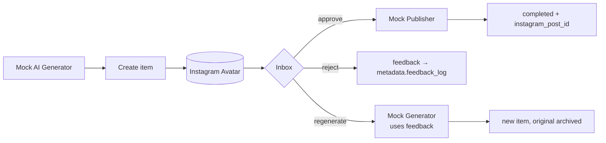
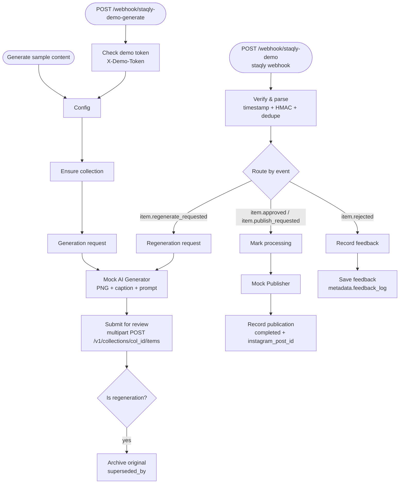

You want to see the whole content loop before wiring up real AI and social accounts. In this
recipe an n8n workflow generates an "Instagram avatar" image, staqly puts it in your Inbox, and
your decision drives what happens next: approve and it gets published, reject and your feedback
is recorded, regenerate and a new version arrives. Generation and publishing are **mocked**, so
you need no AI or Instagram account; swap the mock nodes for real ones later. It's for anyone
who automates content with n8n.



## What you need

- staqly running: `staqly serve` ([install](/quickstart)) or the
  [Docker image](/self-hosting/docker).
- n8n, either your own or the example container. See [n8n networking](/integrations/n8n) if yours
  runs somewhere else.
- The files in [`integrations/n8n/`](https://github.com/staqly/staqly/tree/main/integrations/n8n)
  from the staqly repository: the workflow `instagram-avatar-demo.json` and the setup script
  `setup-demo.sh`. Run the commands below from the repository root.
- `curl`, plus `jq` or `python3`.

## Build it

<Steps>
<Step>

### Start n8n

n8n and staqly have to reach each other in both directions: n8n calls the staqly API, and
staqly sends review events to an n8n webhook. Which addresses work depends on how you run
staqly.

<Tabs items={["staqly serve", "Docker"]}>
<Tab value="staqly serve">

Run n8n on the same computer. The demo verifies webhook signatures with Node's `crypto`, which
n8n has to allow:

```bash
NODE_FUNCTION_ALLOW_BUILTIN=crypto npx n8n    # n8n at http://localhost:5678
```

staqly refuses to send webhooks to `localhost` by default, so restart it with loopback
targets allowed:

```bash
WEBHOOK_ALLOW_LOOPBACK=true staqly serve
```

</Tab>
<Tab value="Docker">

Start the example n8n container next to staqly, from a checkout of the repository. It joins the
`staqly_default` network, so the two reach each other as `http://n8n:5678` and `http://api:3333`.
With the [Docker image](/self-hosting/docker) (not Compose), create that network once and attach
the `staqly` container to it as `api`:

```bash
docker network create staqly_default                         # only with docker run
docker network connect --alias api staqly_default staqly     # only with docker run
docker compose -f integrations/n8n/compose.yml up -d    # n8n at http://localhost:5678
```

The example publishes n8n on `127.0.0.1` only. To reach it from other machines, change the
port mapping and protect n8n yourself (owner account, HTTPS).

</Tab>
</Tabs>

Open `http://localhost:5678` and create the n8n owner account.

</Step>
<Step>

### Register the collection and the webhook

The setup script creates the **Instagram Avatar** collection and a webhook that
sends `item.approved`, `item.rejected`, `item.regenerate_requested` and
`item.publish_requested` from that collection to n8n:

```bash tab="staqly serve"
./integrations/n8n/setup-demo.sh http://localhost:5678/webhook/staqly-demo
```

```bash tab="Docker"
./integrations/n8n/setup-demo.sh    # webhook → http://n8n:5678/webhook/staqly-demo
```

It prints a **signing secret** and a random **demo token**; keep both for step 4. With Docker
staqly but n8n on the host, pass `http://host.docker.internal:5678/webhook/staqly-demo`
instead.

For a cloud instance, set the server and key:
`STAQLY_API_URL=https://staqly.example.com STAQLY_API_KEY=stk_... ./integrations/n8n/setup-demo.sh <url>`.
The script passes the key to curl through a private header file, never on the command line.

</Step>
<Step>

### Import the workflow

In n8n: **Create workflow → ⋯ → Import from file** → `instagram-avatar-demo.json`. With the
example Docker container you can also run:

```bash
docker compose -f integrations/n8n/compose.yml exec n8n \
  n8n import:workflow --input=/workflows/instagram-avatar-demo.json
```

</Step>
<Step>

### Configure the nodes

The workflow ships locked down, so a few values need pasting before it does anything:

- **API address.** The workflow calls `http://api:3333` (the Docker address). With
  `staqly serve`, or any n8n outside the staqly Docker network, change `apiBaseUrl` to
  `http://localhost:3333` in the **Config** node and in **Verify & parse**.
- **Signing secret.** Paste it into `CONFIG.webhookSecret` in **Verify & parse**. The node
  **fails closed**: while the secret is empty it rejects every event.
- **Demo token.** Paste it into `DEMO_TOKEN` in **Check demo token**. The HTTP generate trigger
  only runs for requests that send it in an `X-Demo-Token` header; while it is empty the HTTP
  trigger is disabled. The manual trigger needs no token.
- **Credentials.** Local mode needs none. Cloud: on each HTTP Request node choose
  *Authentication → Generic → Header Auth* with `Authorization: Bearer stk_...`.

</Step>
<Step>

### Generate and review

**Publish** (activate) the workflow, then run **Generate sample content** in n8n, or trigger
it over HTTP with your demo token:

```bash
curl -X POST http://localhost:5678/webhook/staqly-demo-generate -H 'X-Demo-Token: DEMO_TOKEN'
```

A pending image appears in the Inbox. Try each path:

| You do | n8n does | You see |
|---|---|---|
| **Approve** | marks it *processing*, "publishes" it, records the result | item `completed` with `metadata.instagram_post_id` |
| **Reject** with feedback | records the feedback | feedback appended to `metadata.feedback_log` |
| **Regenerate** with feedback ("make her smile") | generates a new image using the feedback | a new pending item; the original is archived with `superseded_by` |

</Step>
</Steps>

## How it works



**Verify & parse** is the part to copy into your own workflows. It checks that
`X-Staqly-Timestamp` is a plain number within 5 minutes, verifies `X-Staqly-Signature`
(HMAC-SHA256, constant-time compare) and drops repeated deliveries of the same
`X-Staqly-Event-Id` (the last 500 IDs are kept in the workflow's static data). That's why n8n
needs `NODE_FUNCTION_ALLOW_BUILTIN=crypto` (already set in the example compose file).

All of these paths were exercised against a real n8n 2.42.7 instance (local mode, no
credentials), including rejection of unsigned, forged, stale and malformed-timestamp events,
deduplication of a repeated event ID, and rejection of generate requests without the demo
token.

## Troubleshooting

- **Nothing reaches n8n after a decision:** check the webhook URL matches your setup (step 2)
  and, with `staqly serve`, that you started it with `WEBHOOK_ALLOW_LOOPBACK=true`. Failed deliveries are retried; see
  [Webhooks](/automation/webhooks).
- **n8n gets errors calling staqly:** `apiBaseUrl` still points at `http://api:3333` while n8n
  isn't on the Docker network (step 4).
- **Every event is rejected:** the signing secret in **Verify & parse** is empty or doesn't
  match the one `setup-demo.sh` printed. Each run of the script registers a new webhook with a
  new secret, so use the secret from the run whose webhook you kept.

## Going further

- Pull in visual references with an [inspiration watcher](/automation/watchers).
- Get each new caption on your phone with a [notification channel](/automation/notifications).
- Review on your phone: [Review on your phone](/cookbook/review-on-your-phone).

## Reference

<Cards>
  <Card title="n8n" href="/integrations/n8n">Networking and building your own flows</Card>
  <Card title="Webhooks" href="/automation/webhooks">Events, signatures and retries</Card>
  <Card title="Custom actions" href="/automation/custom-actions">How Regenerate and Publish work</Card>
</Cards>
