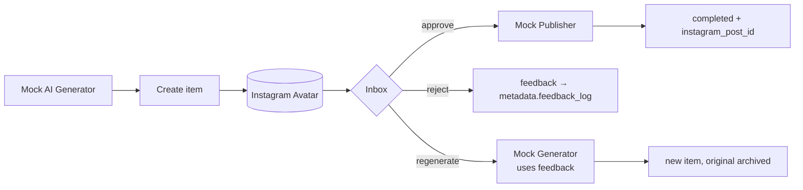
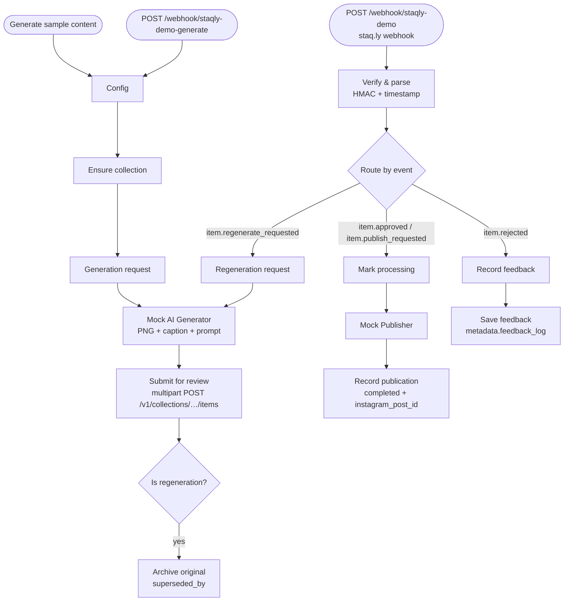

This recipe runs the full loop with the importable n8n workflow
`integrations/n8n/instagram-avatar-demo.json`. Generation and publishing are **mocked**, so
you need no AI or Instagram account — swap the mock nodes for real ones later.



<Steps>
<Step>

### Start n8n

Use your own n8n, or run the example next to staq.ly (it joins the `staqly_default` network):

```bash
docker compose -f integrations/n8n/compose.yml up -d     # n8n at http://localhost:5678
```

Open it and create the n8n owner account.

</Step>
<Step>

### Register the collection and the webhook

```bash
./integrations/n8n/setup-demo.sh
# n8n on the host instead of the compose network:
./integrations/n8n/setup-demo.sh http://host.docker.internal:5678/webhook/staqly-demo
```

It creates the **Instagram Avatar** collection (gallery view) and a webhook for
`item.approved`, `item.rejected`, `item.regenerate_requested` and `item.publish_requested` on
that collection — and prints the **signing secret**. Cloud instance:
`STAQLY_API_URL=https://… STAQLY_API_KEY=stk_… ./integrations/n8n/setup-demo.sh <url>`.

</Step>
<Step>

### Import the workflow

In n8n: **Create workflow → ⋯ → Import from file** → `instagram-avatar-demo.json`. With the
example compose you can also run:

```bash
docker compose -f integrations/n8n/compose.yml exec n8n \
  n8n import:workflow --input=/workflows/instagram-avatar-demo.json
```

</Step>
<Step>

### Configure two nodes

- If n8n is **not** on the staq.ly compose network, change `apiBaseUrl` in the **Config** node
  and in **Verify & parse** (`http://localhost:3333` for n8n on the host).
- Paste the secret into `CONFIG.webhookSecret` in **Verify & parse**. Verification uses Node's
  `crypto`, which needs `NODE_FUNCTION_ALLOW_BUILTIN=crypto` (set in the example compose).
  Leaving it empty skips verification — fine for a quick local test only.
- Local mode needs no credentials. Cloud: on each HTTP Request node choose *Authentication →
  Generic → Header Auth* with `Authorization: Bearer <API key>`.

</Step>
<Step>

### Generate and review

**Publish** (activate) the workflow, then run **Generate sample content** — or
`curl -X POST http://localhost:5678/webhook/staqly-demo-generate`. A pending image appears in
the Inbox. Then try each path:

| You do | n8n does | You see |
|---|---|---|
| **Approve** | marks it *processing*, "publishes" it, records the result | item `completed` with `metadata.instagram_post_id` |
| **Reject** with feedback | records the feedback | feedback appended to `metadata.feedback_log` |
| **Regenerate** with feedback ("make her smile") | generates a new image using the feedback | a new pending item; the original is archived with `superseded_by` |

</Step>
</Steps>

## How the workflow is built



All of these paths were exercised against a real n8n 2.42.7 instance (local mode, no
credentials), including signature verification and rejection of a forged request.

## Going further

- Pull in visual references with an [inspiration watcher](/docs/automation/watchers#example-inspiration-for-the-instagram-avatar).
- Auto-approve captions your model is confident about with a [rule](/docs/automation/rules).
- Review on your phone: [Review on your phone](/docs/cookbook/review-on-your-phone).
