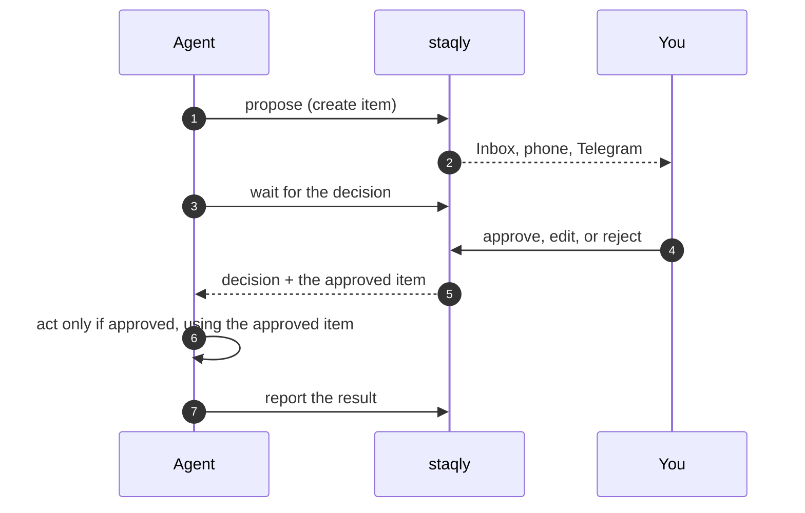

AI agents are good at drafting and bad at knowing when to stop and ask. Human approval puts a
checkpoint in front of the actions that matter: the agent **proposes** the action, a person
**approves or rejects** it (and may edit it), and the agent **acts only on approval**, then
**reports** what happened.

staqly is that checkpoint. It stores the proposal as an item, shows it in your Inbox, on your
phone or in chat, and hands the decision back to the agent.



## Before you start

- staqly running locally: `curl -fsSL https://raw.githubusercontent.com/staqly/staqly/main/scripts/install.sh | sh`, then
  `staqly serve` ([quickstart](/quickstart)). The API is at `http://localhost:3333`.
- A collection for the requests: `staqly collections create Approvals`.

## Option 1: the SDK (recommended for your own agents)

`request_approval` / `requestApproval` creates the item, waits for the decision and returns
it. The side effect sits in your code after the check, so the model cannot skip it.

<Tabs items={["Python", "TypeScript"]}>
<Tab value="Python">

```python
from staqly import Staqly

staqly = Staqly()

d = staqly.request_approval(
    "Approvals",
    title="Send the October newsletter to 4,210 subscribers",
    content=draft,
    metadata={"list": "newsletter", "recipients": 4210},
    expires_in="4h",
    editable=["content"],
)

if d.approved:
    campaign_id = mailer.send(d.item.content)  # the approved, possibly edited text
    staqly.items.report_result(d.item.id, status="completed", result={"campaign_id": campaign_id})
else:
    print(f"Not sent ({d.status}): {d.feedback}")
```

</Tab>
<Tab value="TypeScript">

```ts
import { Staqly } from '@staqly/sdk'

const staqly = new Staqly()

const d = await staqly.requestApproval('Approvals', {
  title: 'Send the October newsletter to 4,210 subscribers',
  content: draft,
  metadata: { list: 'newsletter', recipients: 4210 },
  expires_in: '4h',
  editable: ['content'],
})

if (d.approved) {
  const campaignId = await mailer.send(String(d.item.content)) // the approved, possibly edited text

  await staqly.items.reportResult(d.item.id, { status: 'completed', result: { campaign_id: campaignId } })
} else {
  console.log(`Not sent (${d.status}): ${d.feedback}`)
}
```

</Tab>
</Tabs>

Even shorter: wrap the function itself with `@staqly.requires_approval` (Python) or
`staqly.requiresApproval` (TypeScript); see the [Python SDK](/sdk/python#gate-an-action-on-approval)
and [TypeScript SDK](/sdk/typescript#gate-an-action-on-approval).

## Option 2: REST, from any language

Three calls: create the item, long-poll until it is decided, report the result.

```bash
API=http://localhost:3333

ITEM=$(curl -s -X POST "$API/v1/collections/Approvals/items" -H 'Content-Type: application/json' \
  -d '{"title":"Delete 312 stale accounts","metadata":{"count":312},"expires_in":"1h"}' | jq -r .id)

curl -s "$API/v1/items/$ITEM/wait?timeout=60"   # repeat while "decided" is false

curl -s -X POST "$API/v1/items/$ITEM/result" -H 'Content-Type: application/json' \
  -d '{"status":"completed","result":{"deleted":312}}'
```

The complete loop, with error handling, is in the
[approval gate recipe](/cookbook/approval-gate#the-code).

## Option 3: MCP, no code

Agents that speak MCP (Claude Code, Codex, Cursor, the Claude Agent SDK, the OpenAI Agents
SDK) get the tools `create_item`, `await_decision` and `report_result` from
`http://localhost:3333/mcp`. Ask in plain language:

> Before you run the migration, create an item in Approvals describing it, wait for my
> decision, run it only if I approve, then report the result.

Setup per client: [Connect agents](/agents). With MCP the model is trusted to follow the
pattern; for actions that must never run unapproved, put the gate in code (option 1).

## Make the gate hold

An approval step only protects you if it is the **only path** to the side effect:

- **Keep the credentials out of the model's reach.** The tool that sends, pays or deploys
  should be the gated one; don't also give the agent a raw shell with the same keys.
- **Act on the returned item.** Reviewers may edit `content` or `metadata` before approving;
  limit what they may change with `editable`, and use the item you get back, not the original
  proposal.
- **Treat `expired` as no.** Set `expires_in` so stale requests close themselves; anything
  other than `approved` means don't act.
- **Use a key that cannot approve** in cloud mode: `items:write items:read`, without
  `items:review`. See [Authentication & scopes](/api/authentication).
- **Treat proposal text as data.** Content that came from emails or web pages may contain
  instructions; the reviewer sees it, the agent should not obey it.

## Pick your framework

<Cards>
  <Card title="LangChain / LangGraph" href="/integrations/langchain">Gated tool or durable `interrupt()`.</Card>
  <Card title="OpenAI Agents SDK" href="/integrations/openai-agents">A `function_tool` that asks first.</Card>
  <Card title="CrewAI" href="/integrations/crewai">A crew tool that waits for you.</Card>
  <Card title="Claude Agent SDK" href="/integrations/claude-agent-sdk">Custom tool or `canUseTool` gate.</Card>
  <Card title="n8n, Make, Zapier" href="/integrations">No-code flows with webhooks.</Card>
  <Card title="AI agent approval workflow" href="/ai-agent-approval-workflow">Design choices: what to gate, expiry, notifications.</Card>
</Cards>
