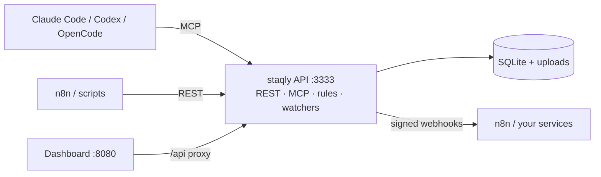

staqly is a **local-first, self-hostable workspace** where AI agents and automations —
Claude Code, Codex, OpenCode, n8n, your own scripts — store what they generate: images,
videos, text, links and JSON. You review it in an **Inbox**: approve, reject with
feedback, edit, or trigger custom actions such as *regenerate* or *publish* that flow
back to your automations through signed webhooks.

Everything runs on your machine: one Go process, one SQLite file, one uploads folder.
No cloud account, no Redis, no Postgres.

## How it fits together

<Cards>
  <Card title="Agents create items" href="/docs/concepts#items">
    An agent calls `create_item` over MCP, or n8n posts to the REST API. Each output becomes an
    **item** in a **collection** with metadata, media and a full history.
  </Card>
  <Card title="You decide in the Inbox" href="/docs/dashboard/inbox">
    Pending items wait for you. Approve with <Kbd>a</Kbd>, reject with feedback with <Kbd>r</Kbd>,
    edit before approving with <Kbd>e</Kbd> — on desktop or your phone.
  </Card>
  <Card title="Automations react" href="/docs/automation/webhooks">
    Every decision is an event. Webhooks deliver it — signed, retried, at-least-once — so n8n
    can publish, regenerate or log feedback.
  </Card>
  <Card title="Rules and watchers do the rest" href="/docs/automation/rules">
    Auto-approve high-confidence output, expire stale items, and let watchers pull in new
    posts from RSS feeds and web pages.
  </Card>
</Cards>

## Two ways to run it

| | **Local mode** (default) | **Cloud mode** |
|---|---|---|
| Who | You, on your own computer | A hosted, multi-tenant instance |
| Credentials | None — only this machine can connect | Scoped API keys `stk_…`, browser sessions, recovery keys |
| Workspaces | One, created automatically | Many — anyone (or only `SETUP_TOKEN` holders) can create one |
| Limits | Unlocked | Free / Indie / Team plans |

Read [Local vs cloud](/docs/local-vs-cloud) for the details.

## Where to next

<Cards>
  <Card title="Quickstart" href="/docs/quickstart">Run staqly, create your first item and connect an agent in five minutes.</Card>
  <Card title="Concepts" href="/docs/concepts">Workspaces, collections, items, statuses, actions, events.</Card>
  <Card title="Connect agents" href="/docs/agents">Claude Code, Codex, OpenCode, any MCP client, n8n, scripts.</Card>
  <Card title="API reference" href="/docs/api/reference">Every REST endpoint, generated from the OpenAPI 3.2 contract.</Card>
</Cards>
