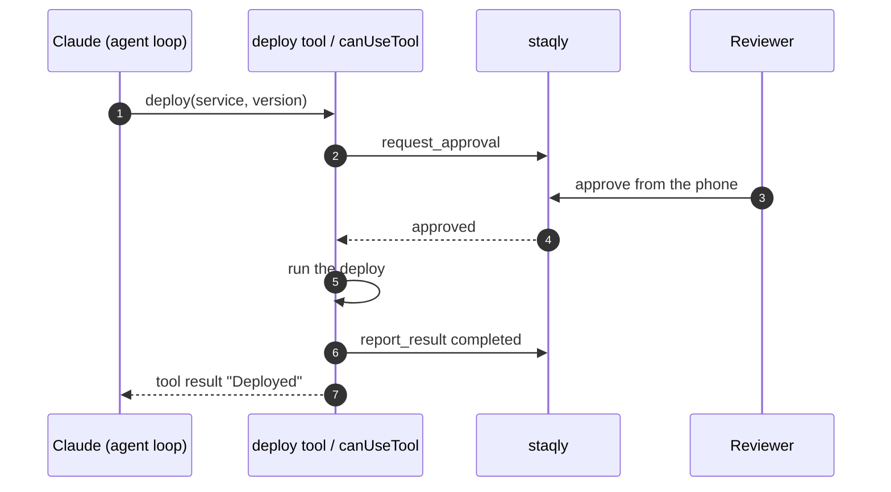

The [Claude Agent SDK](https://docs.claude.com/en/api/agent-sdk/overview) (Anthropic) is the
agent harness behind Claude Code, available as a Python and a TypeScript library. It runs the
agent loop and the built-in tools (Bash, file edits, web search) and lets you add your own
tools as in-process MCP servers. staqly plugs in three ways:

| Option | What is gated | Use it when |
|---|---|---|
| **Gated custom tool** | One tool you write (refund, deploy, send) | You own the side effect |
| **`canUseTool` permission gate** | Any tool call the SDK would ask permission for, including Bash | You want a person to approve built-in tool calls remotely |
| **staqly MCP server** | Whatever the model files with `create_item` | The agent should also save drafts and results in staqly |

## How it works



## Gated custom tool

Install: `pip install staqly claude-agent-sdk` or
`npm install @staqly/sdk @anthropic-ai/claude-agent-sdk zod`. Custom tools run in an
in-process MCP server created with `create_sdk_mcp_server` / `createSdkMcpServer`; the model
sees them as `mcp__<server>__<tool>`.

<Tabs items={["Python", "TypeScript"]}>
<Tab value="Python">

```python title="agent.py"
import asyncio
from typing import Any

from claude_agent_sdk import ClaudeAgentOptions, ClaudeSDKClient, create_sdk_mcp_server, tool
from staqly import AsyncStaqly

staqly = AsyncStaqly()  # http://localhost:3333 or $STAQLY_API_URL


@tool("deploy", "Deploy a service version to production. A human approves every deploy.", {"service": str, "version": str})
async def deploy(args: dict[str, Any]) -> dict[str, Any]:
    d = await staqly.request_approval(
        "Approvals",
        title=f"Deploy {args['service']} {args['version']} to production",
        metadata={"service": args["service"], "version": args["version"], "env": "prod"},
        source="release-agent",
        expires_in="1h",
        editable=["metadata.version"],
        timeout=60 * 60,
    )

    if not d.approved:
        text = f"Deploy not approved ({d.status}). Feedback: {d.feedback or 'none'}"
        return {"content": [{"type": "text", "text": text}]}

    version = d.item.metadata["version"]  # the reviewer may have pinned another version

    try:
        run_id = await ci.deploy(args["service"], version)
    except Exception as e:
        await staqly.items.report_result(d.item.id, status="failed", error=str(e))
        return {"content": [{"type": "text", "text": f"Deploy failed: {e}"}], "is_error": True}

    await staqly.items.report_result(d.item.id, status="completed", result={"run_id": run_id})

    return {"content": [{"type": "text", "text": f"Deployed {args['service']} {version} (run {run_id})."}]}


release = create_sdk_mcp_server(name="release", version="1.0.0", tools=[deploy])

options = ClaudeAgentOptions(
    mcp_servers={"release": release},
    allowed_tools=["mcp__release__deploy"],
)


async def main() -> None:
    async with ClaudeSDKClient(options=options) as client:
        await client.query("Release checkout 2.4.1 to production.")

        async for message in client.receive_response():
            print(message)


asyncio.run(main())
```

</Tab>
<Tab value="TypeScript">

```ts title="agent.ts"
import { createSdkMcpServer, query, type SDKUserMessage, tool } from '@anthropic-ai/claude-agent-sdk'
import { Staqly } from '@staqly/sdk'
import { z } from 'zod'

const staqly = new Staqly() // http://localhost:3333 or $STAQLY_API_URL

const deploy = tool(
  'deploy',
  'Deploy a service version to production. A human approves every deploy.',
  { service: z.string(), version: z.string() },
  async ({ service, version }) => {
    const d = await staqly.requestApproval(
      'Approvals',
      {
        title: `Deploy ${service} ${version} to production`,
        metadata: { service, version, env: 'prod' },
        source: 'release-agent',
        expires_in: '1h',
        editable: ['metadata.version'],
      },
      { timeout: 60 * 60_000 },
    )

    if (!d.approved) {
      return { content: [{ type: 'text', text: `Deploy not approved (${d.status}). Feedback: ${d.feedback || 'none'}` }] }
    }

    const approvedVersion = String(d.item.metadata.version) // the reviewer may have pinned another version

    try {
      const runId = await ci.deploy(service, approvedVersion)

      await staqly.items.reportResult(d.item.id, { status: 'completed', result: { run_id: runId } })

      return { content: [{ type: 'text', text: `Deployed ${service} ${approvedVersion} (run ${runId}).` }] }
    } catch (err) {
      await staqly.items.reportResult(d.item.id, { status: 'failed', error: String(err) })

      return { content: [{ type: 'text', text: `Deploy failed: ${err}` }], isError: true }
    }
  },
)

const release = createSdkMcpServer({ name: 'release', version: '1.0.0', tools: [deploy] })

// In-process MCP tools need streaming input, so the prompt is an async generator.
async function* prompt(): AsyncGenerator<SDKUserMessage> {
  yield {
    type: 'user',
    message: { role: 'user', content: 'Release checkout 2.4.1 to production.' },
    parent_tool_use_id: null,
    session_id: '',
  }
}

for await (const message of query({
  prompt: prompt(),
  options: { mcpServers: { release }, allowedTools: ['mcp__release__deploy'] },
})) {
  console.log(message)
}
```

</Tab>
</Tabs>

## Gate built-in tools with `canUseTool`

The SDK calls a permission callback before any tool that is not pre-allowed. Route that
question to staqly and a person approves the exact Bash command or file edit, from anywhere.
The tool input becomes the item content; if the reviewer edits it, the edited input runs.

<Tabs items={["Python", "TypeScript"]}>
<Tab value="Python">

```python
from claude_agent_sdk import ClaudeAgentOptions, PermissionResultAllow, PermissionResultDeny, ToolPermissionContext
from staqly import AsyncStaqly

staqly = AsyncStaqly()


async def ask_staqly(tool_name: str, input_data: dict, context: ToolPermissionContext):
    d = await staqly.request_approval(
        "Approvals",
        title=f"Allow {tool_name}?",
        content=input_data,
        source="claude-agent",
        expires_in="30m",
        editable=["content"],
        timeout=30 * 60,
    )

    if d.approved:
        return PermissionResultAllow(updated_input=d.item.content)

    return PermissionResultDeny(message=f"A human said no ({d.status}): {d.feedback or 'no feedback'}")


options = ClaudeAgentOptions(can_use_tool=ask_staqly, allowed_tools=["Read", "Grep", "Glob"])
```

</Tab>
<Tab value="TypeScript">

```ts
import type { CanUseTool } from '@anthropic-ai/claude-agent-sdk'
import { Staqly } from '@staqly/sdk'

const staqly = new Staqly()

const askStaqly: CanUseTool = async (toolName, input) => {
  const d = await staqly.requestApproval(
    'Approvals',
    { title: `Allow ${toolName}?`, content: input, source: 'claude-agent', expires_in: '30m', editable: ['content'] },
    { timeout: 30 * 60_000 },
  )

  if (d.approved) {
    return { behavior: 'allow', updatedInput: d.item.content as Record<string, unknown> }
  }

  return { behavior: 'deny', message: `A human said no (${d.status}): ${d.feedback || 'no feedback'}` }
}

const options = { canUseTool: askStaqly, allowedTools: ['Read', 'Grep', 'Glob'] }
```

</Tab>
</Tabs>

Read-only tools listed in `allowed_tools` / `allowedTools` run without asking; everything
else goes through staqly. Like custom tools, the permission callback needs streaming input
(`ClaudeSDKClient` in Python, an async generator prompt in TypeScript).

## Connect the staqly MCP server

To let Claude save drafts, search past items and run the approval flow itself, add staqly's
Streamable HTTP endpoint as an MCP server:

<Tabs items={["Python", "TypeScript"]}>
<Tab value="Python">

```python
options = ClaudeAgentOptions(
    mcp_servers={"staqly": {"type": "http", "url": "http://localhost:3333/mcp"}},
    allowed_tools=["mcp__staqly__create_item", "mcp__staqly__await_decision", "mcp__staqly__report_result"],
)
```

</Tab>
<Tab value="TypeScript">

```ts
const options = {
  mcpServers: { staqly: { type: 'http' as const, url: 'http://localhost:3333/mcp' } },
  allowedTools: ['mcp__staqly__create_item', 'mcp__staqly__await_decision', 'mcp__staqly__report_result'],
}
```

</Tab>
</Tabs>

In cloud mode use `https://staqly.example.com/mcp` and add
`"headers": {"Authorization": "Bearer stk_..."}`. staqly's server instructions already
teach the model to create the item, wait with `await_decision`, act only on `approved`, and
report the result.

## Next steps

<Cards>
  <Card title="Claude Code" href="/agents/claude-code">The same MCP server in Claude Code, no code needed.</Card>
  <Card title="MCP tools" href="/mcp/tools">Every tool and the scope it needs.</Card>
  <Card title="Approval gate recipe" href="/cookbook/approval-gate">The flow step by step.</Card>
</Cards>
