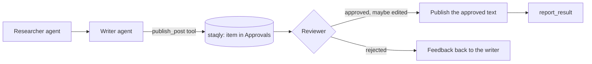

[CrewAI](https://www.crewai.com) runs teams ("crews") of role-playing agents that work through
tasks with tools. Crews often run unattended, which makes them a good fit for staqly: the crew
does the research and drafting, and a person approves the one step that leaves the building.

CrewAI is a Python framework; there is no official TypeScript version. The TypeScript tab
below shows the same gate with the staqly TypeScript SDK, for a TS service that a crew calls
or that runs next to it.

## How it works



## Example: publishing only approved posts

Install: `pip install staqly crewai`.

<Tabs items={["Python", "TypeScript"]}>
<Tab value="Python">

```python title="crew.py"
from crewai import Agent, Crew, Task
from crewai.tools import tool
from staqly import Staqly

staqly = Staqly()  # http://localhost:3333 or $STAQLY_API_URL


@tool("Publish blog post")
def publish_post(title: str, markdown: str) -> str:
    """Publish a blog post. A human editor approves (and may edit) every post first."""
    d = staqly.request_approval(
        "Approvals",
        title=title,
        content=markdown,
        metadata={"action": "publish", "channel": "blog"},
        source="content-crew",
        expires_in="24h",
        editable=["title", "content"],
        timeout=24 * 60 * 60,
    )

    if not d.approved:
        return f"Not published ({d.status}). Editor feedback: {d.feedback or 'none'}"

    try:
        url = cms.publish(d.item.title, d.item.content)  # the approved, possibly edited post
    except Exception as e:
        staqly.items.report_result(d.item.id, status="failed", error=str(e))
        raise

    staqly.items.report_result(d.item.id, status="completed", result={"url": url})

    return f"Published at {url}"


writer = Agent(
    role="Technical writer",
    goal="Write and publish clear, accurate posts about our releases",
    backstory="You turn release notes into posts developers enjoy reading.",
    tools=[publish_post],
)

task = Task(
    description="Write a short post about release 2.4.1 from these notes: {notes}. Publish it with the tool.",
    expected_output="The published URL, or the editor's feedback if the post was not approved.",
    agent=writer,
)

crew = Crew(agents=[writer], tasks=[task])
print(crew.kickoff(inputs={"notes": "Faster search, dark mode on mobile, 3 bug fixes."}))
```

</Tab>
<Tab value="TypeScript">

```ts title="publish.ts"
import { Staqly } from '@staqly/sdk'

const staqly = new Staqly() // http://localhost:3333 or $STAQLY_API_URL

// No official CrewAI for TypeScript: call this from your TS service, for example the
// endpoint a Python crew's tool posts to.
export async function publishPost(title: string, markdown: string): Promise<string> {
  const d = await staqly.requestApproval(
    'Approvals',
    {
      title,
      content: markdown,
      metadata: { action: 'publish', channel: 'blog' },
      source: 'content-crew',
      expires_in: '24h',
      editable: ['title', 'content'],
    },
    { timeout: 24 * 60 * 60_000 },
  )

  if (!d.approved) {
    return `Not published (${d.status}). Editor feedback: ${d.feedback || 'none'}`
  }

  try {
    const url = await cms.publish(d.item.title, String(d.item.content)) // the approved, possibly edited post

    await staqly.items.reportResult(d.item.id, { status: 'completed', result: { url } })

    return `Published at ${url}`
  } catch (err) {
    await staqly.items.reportResult(d.item.id, { status: 'failed', error: String(err) })
    throw err
  }
}
```

</Tab>
</Tabs>

The tool's return value goes back to the agent. On a rejection the writer sees the editor's
feedback and can revise the post and call the tool again, which files a new request.

## Let the crew use staqly over MCP

`crewai-tools` can load MCP servers. Point it at staqly's Streamable HTTP endpoint to give
agents the `create_item`, `await_decision` and `report_result` tools directly:

```python
from crewai import Agent
from crewai_tools import MCPServerAdapter

with MCPServerAdapter({"url": "http://localhost:3333/mcp", "transport": "streamable-http"}) as staqly_tools:
    reviewer_aware = Agent(
        role="Release manager",
        goal="Ship releases only after a human approves them in staqly",
        backstory="You file every release in the Approvals collection and wait for the decision.",
        tools=staqly_tools,
    )
```

In cloud mode use `https://staqly.example.com/mcp` and add an `Authorization: Bearer` header
with the API key.

## Tips

- **One request per side effect.** Gate the tool that publishes, not the whole crew run, so
  the reviewer judges a concrete action.
- **Long waits.** A crew blocked for a day holds a process. For long waits, end the run after
  filing the item (`staqly.items.create`) and start a follow-up run from a
  [webhook](/integrations/webhook-receivers) on `item.approved`.
- **Set an expiry** with `expires_in`, so a post nobody reviews in time turns `expired`
  instead of waiting forever.

## Next steps

<Cards>
  <Card title="Python SDK" href="/sdk/python">`request_approval` and the `@requires_approval` decorator.</Card>
  <Card title="Webhook receivers" href="/integrations/webhook-receivers">Resume work when a decision arrives.</Card>
  <Card title="AI agent approval workflow" href="/ai-agent-approval-workflow">What to gate, expiry, notifications.</Card>
</Cards>
