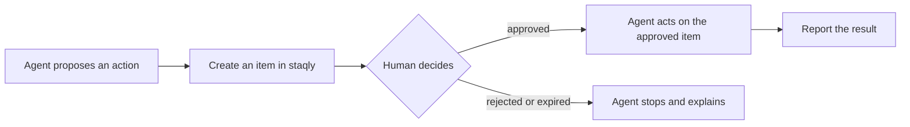

staqly sits between an agent that wants to do something and the moment it actually happens.
Whatever framework or automation tool you use, the integration is the same four steps:



1. **Propose.** The agent's tool creates an item that describes the action (title, exact
   content, parameters in `metadata`).
2. **Wait.** The tool blocks on the decision (`wait_for_decision` / `waitForDecision`, the
   `await_decision` MCP tool) or, for long waits, resumes on a [webhook](/automation/webhooks).
3. **Act only when approved.** Use the **returned item**, so reviewer edits are applied.
4. **Report the result** with `report_result` / `reportResult`, so the item records how the
   story ended.

The [Python SDK](/sdk/python) and [TypeScript SDK](/sdk/typescript) wrap the first three steps
in one call: `request_approval` / `requestApproval`. For the reasoning behind the pattern, read
[How to add human approval to an AI agent](/how-to-add-human-approval).

## Pick your integration

<Cards>
  <Card title="LangChain / LangGraph" href="/integrations/langchain">A gated tool, or a durable `interrupt()` resumed by a webhook.</Card>
  <Card title="OpenAI Agents SDK" href="/integrations/openai-agents">A `function_tool` that asks first, or staqly's MCP tools.</Card>
  <Card title="CrewAI" href="/integrations/crewai">A CrewAI tool that waits for your decision.</Card>
  <Card title="Claude Agent SDK" href="/integrations/claude-agent-sdk">A custom tool, a `canUseTool` gate, or the staqly MCP server.</Card>
  <Card title="n8n" href="/integrations/n8n">HTTP Request nodes and signed webhooks; demo workflow included.</Card>
  <Card title="Make (Integromat)" href="/integrations/make">HTTP module to propose, Custom webhook to react.</Card>
  <Card title="Zapier" href="/integrations/zapier">Webhooks by Zapier to propose, Catch Raw Hook to react.</Card>
  <Card title="Webhook receivers" href="/integrations/webhook-receivers">Verify signatures, deduplicate, answer fast.</Card>
</Cards>

Coding agents (Claude Code, Codex, Cursor, Windsurf, OpenCode) connect over MCP with no code:
see [Connect agents](/agents).

## Two ways to connect

| Way | Best for | Endpoint |
|---|---|---|
| **SDK** (Python or TypeScript) | Your own tool code decides exactly what is gated | `http://localhost:3333/v1/...` |
| **MCP** (Streamable HTTP) | Letting the model call `create_item`, `await_decision` and `report_result` itself | `http://localhost:3333/mcp` |
| **REST + webhooks** | No-code tools (n8n, Make, Zapier) and other languages | `http://localhost:3333/v1/...` |

An SDK tool is the stronger gate: the side effect lives inside your code, after the approval
check, so the model cannot skip it. With MCP alone, the model is trusted to wait for the
decision before acting.

## Self-hosted vs cloud

The same integrations work against a staqly on your own computer (local mode) and against a
hosted, multi-tenant instance (cloud mode). Only the base URL and the API key change.

| Aspect | Self-hosted (local mode) | Cloud (cloud mode) |
|---|---|---|
| Status | Default mode, ready to use | Same app with `STAQLY_MODE=cloud`, run by you or an operator |
| Base URL | `http://localhost:3333` | Your cloud URL, e.g. `https://staqly.example.com` |
| Setup | `curl -fsSL https://raw.githubusercontent.com/staqly/staqly/main/scripts/install.sh \| sh` then `staqly serve`, or [Docker](/self-hosting/docker) | Sign up on the instance, then create an API key (`stk_...`) under **API keys** in the sidebar |
| Credentials | None (requests must come from this machine) | `Authorization: Bearer` API key with [scopes](/api/authentication) |
| API surface | Full REST API, MCP at `/mcp`, webhooks | Same REST API, MCP at `/mcp`, webhooks |
| Approval quota | None | 50 approvals per month on Free, unlimited on Pro ([plans](/plans)) |
| Watcher limits | None | 3 active watchers, every 15 min at most on Free; unlimited, every minute on Pro |
| Reachable from SaaS tools (Make, Zapier) | No, the API listens on `127.0.0.1` only | Yes |
| Support | [GitHub issues](https://github.com/staqly/staqly/issues) | The instance operator; GitHub issues for the software |

Both SDKs read the base URL from `STAQLY_API_URL` and the key from `STAQLY_API_KEY`, or take
them in the constructor:

<Tabs items={["Python", "TypeScript"]}>
<Tab value="Python">

```python
import os

from staqly import Staqly

local = Staqly()  # http://localhost:3333, no key
cloud = Staqly(base_url="https://staqly.example.com", api_key=os.environ["STAQLY_API_KEY"])
```

</Tab>
<Tab value="TypeScript">

```ts
import { Staqly } from '@staqly/sdk'

const local = new Staqly() // http://localhost:3333, no key
const cloud = new Staqly({ baseUrl: 'https://staqly.example.com', apiKey: process.env.STAQLY_API_KEY })
```

</Tab>
</Tabs>

<Callout title="Give agents a key that cannot approve">
In cloud mode, give the agent a key with `items:write items:read` but not `items:review`. It
can propose and wait, but never approve its own request.
</Callout>

## Collection used in the examples

Every example in this section files its requests in a collection called **Approvals**. Create
it once:

```bash
staqly collections create Approvals
```
