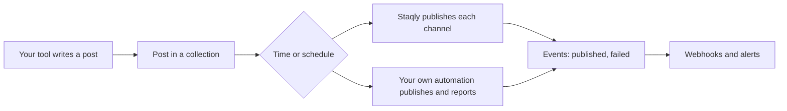

Staqly sits between the tools that produce content and the channels it goes to. Whatever
produces your posts (an agent, an n8n workflow, a script, a cron job), the integration is the
same loop:



1. **Write.** Your tool creates a post (`POST /v1/posts`, an SDK, MCP `create_post`) with the
   channels it should go to, and a time or none.
2. **Publish.** At the time, or when a collection's [schedule](/automation/schedules) picks the
   post, a job publishes every channel. A channel on [your own automation](/channels/your-own-automation)
   hands the post back to you instead and waits for your result.
3. **React.** `post.published`, `post.failed` and the other [events](/api/events) reach your
   services as signed [webhooks](/automation/webhooks), and you as [alerts](/automation/alerts).

## Pick your integration

<Cards>
  <Card title="n8n" href="/integrations/n8n">HTTP Request nodes to write posts, a Webhook trigger to publish through your own automation.</Card>
  <Card title="Webhook receivers" href="/integrations/webhook-receivers">Verify signatures, deduplicate, answer fast.</Card>
  <Card title="TypeScript SDK" href="/sdk/typescript">`posts`, `channels`, `schedules`, `work`, `verifyWebhook`.</Card>
  <Card title="Python SDK" href="/sdk/python">The same client, sync and async.</Card>
  <Card title="CLI" href="/cli/scripting">Cron jobs and shell scripts.</Card>
</Cards>

Coding agents (Claude Code, Codex, Cursor, Windsurf, OpenCode) connect over MCP with no code:
see [Connect agents](/agents).

## Three ways to connect

| Way | Best for | Endpoint |
|---|---|---|
| **SDK** (Python or TypeScript) | Your own code writes posts and publishes through your own automation | `http://localhost:3333/v1/...` |
| **MCP** (Streamable HTTP) | Letting the model call `create_post`, `schedule_post` and `list_requested_work` itself | `http://localhost:3333/mcp` |
| **REST + webhooks** | No-code tools (n8n) and other languages | `http://localhost:3333/v1/...` |

## Self-hosted vs cloud

The same integrations work against a staqly on your own computer (local mode) and against a
hosted, multi-tenant instance (cloud mode). Only the base URL and the API key change.

| Aspect | Self-hosted (local mode) | Cloud (cloud mode) |
|---|---|---|
| Status | Default mode, ready to use | Same app with `STAQLY_MODE=cloud`, run by you or an operator |
| Base URL | `http://localhost:3333` | Your cloud URL, e.g. `https://staqly.example.com` |
| Setup | `curl -fsSL https://raw.githubusercontent.com/staqly/staqly/main/scripts/install.sh \| sh` then `staqly serve`, or [Docker](/self-hosting/docker) | Sign up on the instance and save the **Admin key** it shows once (`stk_...`); where your plan allows more keys (Free allows one), create a scoped key for each tool under **API keys** in the sidebar |
| Credentials | None (requests must come from this machine) | `Authorization: Bearer` API key with [scopes](/api/authentication) |
| API surface | Full REST API, MCP at `/mcp`, webhooks | Same REST API, MCP at `/mcp`, webhooks |
| Quota | None | 50 posts per month and 3 channels on Free, unlimited on Pro ([plans](/plans)) |
| OAuth platforms | Your own developer app per platform | The operator's apps, or your own |
| Reachable from SaaS tools | No, the API listens on `127.0.0.1` only | Yes |
| Support | [GitHub issues](https://github.com/staqly/staqly/issues) | The instance operator; GitHub issues for the software |

Both SDKs read the base URL from `STAQLY_API_URL` and the key from `STAQLY_API_KEY`, or take
them in the constructor:

<Tabs items={["Python", "TypeScript"]}>
<Tab value="Python">

```python
import os

from staqly import Staqly

local = Staqly()  # http://localhost:3333, no key
cloud = Staqly(base_url="https://staqly.example.com", api_key=os.environ["STAQLY_API_KEY"])
```

</Tab>
<Tab value="TypeScript">

```ts
import { Staqly } from '@staqly/sdk'

const local = new Staqly() // http://localhost:3333, no key
const cloud = new Staqly({ baseUrl: 'https://staqly.example.com', apiKey: process.env.STAQLY_API_KEY })
```

</Tab>
</Tabs>

<Callout title="Give writers a key that cannot publish">
In cloud mode, give a tool that only drafts a key with `posts:write posts:read collections:read`
and no `posts:publish`. It fills collections; your schedules, a person or a publisher key send
the posts out.
</Callout>
