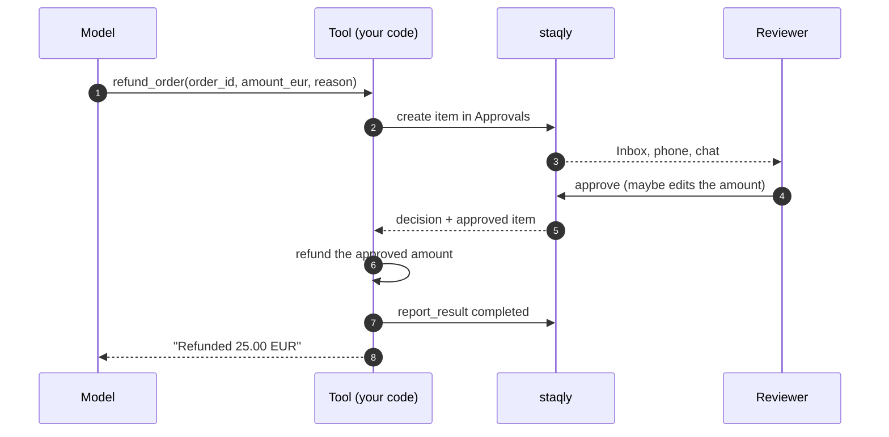
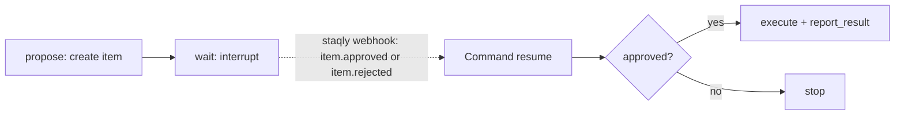

[LangChain](https://www.langchain.com) gives a model tools to call; [LangGraph](https://langchain-ai.github.io/langgraph/)
runs agents as graphs with checkpoints. Use staqly when a tool does something that should not
happen without a person saying yes: refund an order, send an email, change production.

There are two patterns:

| Pattern | How the agent waits | Use it when |
|---|---|---|
| **Gated tool** | The tool blocks on `request_approval` until you decide | Decisions take minutes; the process stays up |
| **LangGraph `interrupt()`** | The graph pauses at a checkpoint; a staqly webhook resumes it | Decisions can take hours or days; workers restart |

## How it works



## Gated tool

Install the packages first: `pip install staqly langchain langchain-openai` or
`npm install @staqly/sdk langchain @langchain/core @langchain/openai zod`.

<Tabs items={["Python", "TypeScript"]}>
<Tab value="Python">

```python title="agent.py"
from langchain.agents import create_agent
from langchain_core.tools import tool
from staqly import Staqly

staqly = Staqly()  # http://localhost:3333 or $STAQLY_API_URL


@tool
def refund_order(order_id: str, amount_eur: float, reason: str) -> str:
    """Refund an order. A human reviews every refund before it is paid out."""
    d = staqly.request_approval(
        "Approvals",
        title=f"Refund {amount_eur:.2f} EUR on order {order_id}",
        content=reason,
        metadata={"order_id": order_id, "amount_eur": amount_eur},
        source="support-agent",
        expires_in="1h",
        editable=["metadata.amount_eur"],
        timeout=60 * 60,
    )

    if not d.approved:
        return f"Refund not approved ({d.status}). Reviewer feedback: {d.feedback or 'none'}"

    amount = d.item.metadata["amount_eur"]  # the reviewer may have lowered it

    try:
        refund_id = payments.refund(order_id, amount)
    except Exception as e:
        staqly.items.report_result(d.item.id, status="failed", error=str(e))
        raise

    staqly.items.report_result(d.item.id, status="completed", result={"refund_id": refund_id})

    return f"Refunded {amount:.2f} EUR on order {order_id} ({refund_id})."


agent = create_agent(model="openai:gpt-4.1", tools=[refund_order])
agent.invoke({"messages": [{"role": "user", "content": "Order A-1042 arrived broken, refund it."}]})
```

</Tab>
<Tab value="TypeScript">

```ts title="agent.ts"
import { tool } from '@langchain/core/tools'
import { Staqly } from '@staqly/sdk'
import { createAgent } from 'langchain'
import { z } from 'zod'

const staqly = new Staqly() // http://localhost:3333 or $STAQLY_API_URL

const refundOrder = tool(
  async ({ orderId, amountEur, reason }) => {
    const d = await staqly.requestApproval(
      'Approvals',
      {
        title: `Refund ${amountEur.toFixed(2)} EUR on order ${orderId}`,
        content: reason,
        metadata: { order_id: orderId, amount_eur: amountEur },
        source: 'support-agent',
        expires_in: '1h',
        editable: ['metadata.amount_eur'],
      },
      { timeout: 60 * 60_000 },
    )

    if (!d.approved) {
      return `Refund not approved (${d.status}). Reviewer feedback: ${d.feedback || 'none'}`
    }

    const amount = Number(d.item.metadata.amount_eur) // the reviewer may have lowered it

    try {
      const refundId = await payments.refund(orderId, amount)

      await staqly.items.reportResult(d.item.id, { status: 'completed', result: { refund_id: refundId } })

      return `Refunded ${amount.toFixed(2)} EUR on order ${orderId} (${refundId}).`
    } catch (err) {
      await staqly.items.reportResult(d.item.id, { status: 'failed', error: String(err) })
      throw err
    }
  },
  {
    name: 'refund_order',
    description: 'Refund an order. A human reviews every refund before it is paid out.',
    schema: z.object({ orderId: z.string(), amountEur: z.number(), reason: z.string() }),
  },
)

const agent = createAgent({ model: 'openai:gpt-4.1', tools: [refundOrder] })

await agent.invoke({ messages: [{ role: 'user', content: 'Order A-1042 arrived broken, refund it.' }] })
```

</Tab>
</Tabs>

Return a clear message on rejection. The model reads it and can tell the user, or try a
different proposal that takes the reviewer's feedback into account.

## Durable approval with LangGraph `interrupt()`

A blocking tool ties up a worker while you decide. With a checkpointer, LangGraph can pause the
graph instead: one node files the request, the next calls `interrupt()`, and a staqly webhook
resumes the thread with `Command(resume=...)` when you decide. The item's `external_ref` holds
the LangGraph `thread_id`, so the webhook knows which thread to resume.



<Tabs items={["Python", "TypeScript"]}>
<Tab value="Python">

```python title="graph.py"
import sqlite3
from typing import TypedDict

from langgraph.checkpoint.sqlite import SqliteSaver
from langgraph.graph import END, START, StateGraph
from langgraph.types import Command, interrupt
from staqly import Staqly

staqly = Staqly()


class State(TypedDict, total=False):
    thread_id: str
    order_id: str
    amount_eur: float
    item_id: str
    decision: dict


def propose(state: State) -> State:
    item = staqly.items.create(
        "Approvals",
        title=f"Refund {state['amount_eur']:.2f} EUR on order {state['order_id']}",
        metadata={"order_id": state["order_id"], "amount_eur": state["amount_eur"]},
        external_ref=state["thread_id"],  # how the webhook finds this thread
        expires_in="72h",
        editable=["metadata.amount_eur"],
    )
    return {"item_id": item.id}


def wait(state: State) -> State:
    decision = interrupt({"item_id": state["item_id"]})  # pauses until resumed
    return {"decision": decision}


def execute(state: State) -> State:
    if state["decision"]["status"] != "approved":
        return {}

    amount = state["decision"]["item"]["metadata"]["amount_eur"]
    refund_id = payments.refund(state["order_id"], amount)
    staqly.items.report_result(state["item_id"], status="completed", result={"refund_id": refund_id})
    return {}


builder = StateGraph(State)
builder.add_node("propose", propose)
builder.add_node("wait", wait)
builder.add_node("execute", execute)
builder.add_edge(START, "propose")
builder.add_edge("propose", "wait")
builder.add_edge("wait", "execute")
builder.add_edge("execute", END)

graph = builder.compile(checkpointer=SqliteSaver(sqlite3.connect("graphs.db", check_same_thread=False)))
```

The webhook receiver (FastAPI) verifies the signature and resumes the thread:

```python title="webhook.py"
from fastapi import FastAPI, HTTPException, Request
from langgraph.types import Command
from staqly import WebhookVerificationError, verify_webhook

from graph import graph

app = FastAPI()


@app.post("/hooks/staqly")
async def staqly_webhook(request: Request) -> dict[str, bool]:
    try:
        event = verify_webhook(SECRET, await request.body(), request.headers)
    except WebhookVerificationError:
        raise HTTPException(status_code=400, detail="invalid signature")

    if event.type in ("item.approved", "item.rejected", "item.expired") and event.item:
        config = {"configurable": {"thread_id": event.item.external_ref}}
        graph.invoke(Command(resume=event.item.model_dump(mode="json")), config=config)

    return {"ok": True}
```

Start a run with `graph.invoke({"thread_id": "refund-A-1042", "order_id": "A-1042", "amount_eur": 25.0}, config={"configurable": {"thread_id": "refund-A-1042"}})`.

</Tab>
<Tab value="TypeScript">

```ts title="graph.ts"
import { Annotation, Command, END, interrupt, MemorySaver, START, StateGraph } from '@langchain/langgraph'
import { type Item, Staqly } from '@staqly/sdk'

const staqly = new Staqly()

const State = Annotation.Root({
  threadId: Annotation<string>,
  orderId: Annotation<string>,
  amountEur: Annotation<number>,
  itemId: Annotation<string>,
  decision: Annotation<Item>,
})

export const graph = new StateGraph(State)
  .addNode('propose', async (s) => {
    const item = await staqly.items.create('Approvals', {
      title: `Refund ${s.amountEur.toFixed(2)} EUR on order ${s.orderId}`,
      metadata: { order_id: s.orderId, amount_eur: s.amountEur },
      external_ref: s.threadId, // how the webhook finds this thread
      expires_in: '72h',
      editable: ['metadata.amount_eur'],
    })

    return { itemId: item.id }
  })
  .addNode('wait', (s) => ({ decision: interrupt<{ itemId: string }, Item>({ itemId: s.itemId }) }))
  .addNode('execute', async (s) => {
    if (s.decision.status !== 'approved') {
      return {}
    }

    const refundId = await payments.refund(s.orderId, Number(s.decision.metadata.amount_eur))

    await staqly.items.reportResult(s.itemId, { status: 'completed', result: { refund_id: refundId } })

    return {}
  })
  .addEdge(START, 'propose')
  .addEdge('propose', 'wait')
  .addEdge('wait', 'execute')
  .addEdge('execute', END)
  .compile({ checkpointer: new MemorySaver() }) // use a persistent checkpointer in production
```

The webhook receiver verifies the signature and resumes the thread:

```ts title="app/api/staqly/route.ts"
import { type ItemEventData, verifyWebhook } from '@staqly/sdk/webhooks'

import { graph } from './graph'

export async function POST(req: Request) {
  const event = await verifyWebhook<ItemEventData>(process.env.STAQLY_WEBHOOK_SECRET!, await req.text(), req.headers)

  if (['item.approved', 'item.rejected', 'item.expired'].includes(event.type)) {
    const config = { configurable: { thread_id: event.data.item.external_ref } }

    await graph.invoke(new Command({ resume: event.data.item }), config)
  }

  return new Response('ok')
}
```

</Tab>
</Tabs>

Subscribe the webhook to `item.approved`, `item.rejected` and `item.expired`, filtered to the
**Approvals** collection. Webhooks are delivered at least once: before resuming, check that the
thread is still waiting (`graph.get_state(config).next` / `graph.getState(config)`), so a
duplicate delivery does not resume it twice. See [Webhook receivers](/integrations/webhook-receivers).

## Use staqly's MCP tools instead

If you would rather let the model call `create_item`, `await_decision` and `report_result`
itself, load staqly's MCP server with
[`langchain-mcp-adapters`](https://github.com/langchain-ai/langchain-mcp-adapters):

```python
from langchain_mcp_adapters.client import MultiServerMCPClient

client = MultiServerMCPClient({"staqly": {"transport": "streamable_http", "url": "http://localhost:3333/mcp"}})
tools = await client.get_tools()
```

In cloud mode add `"headers": {"Authorization": "Bearer stk_..."}`. The gated tool above
is still the safer choice for real side effects, because the model cannot skip the wait.

## Next steps

<Cards>
  <Card title="Python SDK" href="/sdk/python">`request_approval`, `wait_for_decision`, `report_result`.</Card>
  <Card title="TypeScript SDK" href="/sdk/typescript">`requestApproval`, `waitForDecision`, `reportResult`.</Card>
  <Card title="Webhook receivers" href="/integrations/webhook-receivers">Verify, deduplicate and answer fast.</Card>
  <Card title="Approval gate recipe" href="/cookbook/approval-gate">The same flow over MCP and curl.</Card>
</Cards>
