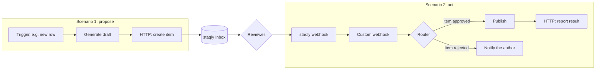

[Make](https://www.make.com) (formerly Integromat) builds automations ("scenarios") from
modules. Use staqly when a scenario produces something a person should check before the next
module runs: a social post, an invoice, a reply to a customer.

There is no dedicated staqly app in Make. The generic **HTTP** and **Webhooks** modules cover
everything:

| Direction | Make module | staqly endpoint or feature |
|---|---|---|
| Make → staqly: propose | HTTP › Make a request | `POST /v1/collections/{collection}/items` |
| Make → staqly: report | HTTP › Make a request | `POST /v1/items/{id}/result` |
| staqly → Make: decision | Webhooks › Custom webhook | A staqly [webhook](/automation/webhooks) on `item.approved`, `item.rejected` |

<Callout type="warn" title="Make runs in the cloud">
Make's servers cannot reach a local staqly, whose API listens on `127.0.0.1` only. To
create items from Make, use a [cloud-mode](/local-vs-cloud) instance such as
`https://staqly.example.com` with an API key. Webhooks still work from a local staqly, because
staqly calls Make's public hook URL.
</Callout>

## How it works



Two scenarios keep it simple: the first files the request and ends; the second starts when
the decision arrives, so nothing sits waiting for hours.

## Set it up

<Steps>
<Step>

### Create items from scenario 1

Add **HTTP › Make a request**:

| Field | Value |
|---|---|
| URL | `https://staqly.example.com/v1/collections/Approvals/items` |
| Method | `POST` |
| Headers | `Authorization: Bearer stk_...`, `Idempotency-Key: make-{{1.id}}` |
| Body type | Raw, content type `JSON (application/json)` |
| Parse response | Yes |

```json title="Request content"
{
  "title": "Post to LinkedIn: {{1.headline}}",
  "content": "{{2.text}}",
  "metadata": { "channel": "linkedin", "row_id": "{{1.id}}" },
  "source": "make",
  "expires_in": "24h",
  "editable": ["content"]
}
```

The response's `id` (for example `itm_oalirbz67y4m4cqxq5dw`) identifies the request. Store it
if a later step needs it.

</Step>
<Step>

### Receive decisions in scenario 2

Start scenario 2 with **Webhooks › Custom webhook** and copy its URL (for example
`https://hook.eu1.make.com/abc123def456`). In its advanced settings turn on **Get request
headers** and **JSON pass-through**, so you get the raw body needed to check the signature.

Then point a staqly webhook at it:

```bash
staqly webhooks create --url https://hook.eu1.make.com/abc123def456 --events item.approved,item.rejected
```

Save the signing secret it prints (`whsec_...`).

</Step>
<Step>

### Verify the signature

Add a filter after the webhook that lets a bundle through only when
`X-Staqly-Signature` equals `sha256=` followed by the HMAC-SHA256 of
`<X-Staqly-Timestamp>.<raw body>` with the signing secret. Make's built-in `sha256()` function
computes an HMAC when you pass the secret as its key argument. The exact scheme is in
[Verifying signatures](/automation/webhooks#verifying-signatures).

</Step>
<Step>

### Branch and act

Parse the raw body with **JSON › Parse JSON**, then add a **Router**:

- route 1, filter `type` equals `item.approved`: publish `data.item.content` (the reviewer's
  edited version), then call **HTTP › Make a request** `POST /v1/items/{{data.item.id}}/result`
  with `{"status":"completed","result":{"post_url":"https://www.linkedin.com/feed/update/urn:li:activity:7120000000000000000"}}`;
- route 2, filter `type` equals `item.rejected`: send `data.feedback` to the author.

</Step>
</Steps>

## Tips

- **Duplicates.** Deliveries are at-least-once. Use a Data store keyed by the event `id` (also
  in the `X-Staqly-Event-Id` header) and skip events you have already handled.
- **Answer fast.** Make answers the webhook as soon as it accepts the bundle, so staqly will
  not retry slow scenarios. If you add a **Webhook response** module, return `200`.
- **Waiting inside one scenario** is possible with `GET /v1/items/{id}/wait?timeout=60` in a
  Repeater, but each call costs operations; the two-scenario setup is cheaper.

## Next steps

<Cards>
  <Card title="Webhooks" href="/automation/webhooks">Events, payloads, retries.</Card>
  <Card title="Webhook receivers" href="/integrations/webhook-receivers">Patterns that apply to any receiver.</Card>
  <Card title="Zapier" href="/integrations/zapier">The same flow in Zapier.</Card>
</Cards>
