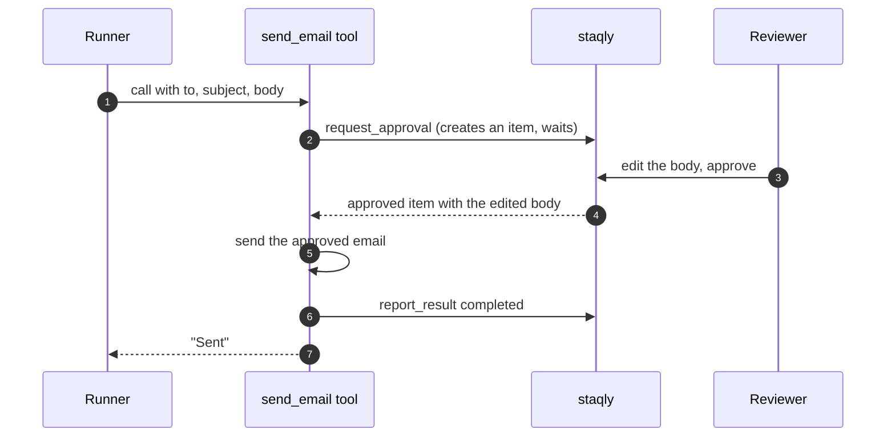

The [OpenAI Agents SDK](https://openai.github.io/openai-agents-python/) runs an agent loop:
the model picks tools, the SDK calls them and feeds the results back. Wrap any tool with a
real-world side effect (sending email, paying, deploying) in a staqly approval, so the tool
runs only after a person approves it, from the Inbox, their phone or a chat message.

The Agents SDK has its own in-process approval hooks. staqly adds what they lack: a shared
Inbox for every agent, approvals from a phone or Telegram, expiry, reviewer edits and an audit trail of who decided what.

## How it works



## Example: an email tool that asks first

Install: `pip install staqly openai-agents` or `npm install @staqly/sdk @openai/agents zod`.

<Tabs items={["Python", "TypeScript"]}>
<Tab value="Python">

```python title="agent.py"
import asyncio

from agents import Agent, Runner, function_tool
from staqly import AsyncStaqly

staqly = AsyncStaqly()  # http://localhost:3333 or $STAQLY_API_URL


@function_tool
async def send_email(to: str, subject: str, body: str) -> str:
    """Send an email to a customer. A human approves every email first.

    Args:
        to: Recipient address.
        subject: Subject line.
        body: Plain-text body.
    """
    d = await staqly.request_approval(
        "Approvals",
        title=f"Email {to}: {subject}",
        content=body,
        metadata={"to": to, "subject": subject},
        source="support-agent",
        expires_in="4h",
        editable=["content", "metadata.subject"],
        timeout=4 * 60 * 60,
    )

    if not d.approved:
        return f"Email not sent ({d.status}). Reviewer feedback: {d.feedback or 'none'}"

    try:
        message_id = await mailer.send(to, d.item.metadata["subject"], d.item.content)
    except Exception as e:
        await staqly.items.report_result(d.item.id, status="failed", error=str(e))
        raise

    await staqly.items.report_result(d.item.id, status="completed", result={"message_id": message_id})

    return f"Sent to {to} ({message_id})."


agent = Agent(
    name="Support",
    instructions="Answer customer tickets. Use send_email to reply; never promise anything the email does not say.",
    tools=[send_email],
)


async def main() -> None:
    result = await Runner.run(agent, "Reply to ana@example.com: her replacement ships on Monday.")
    print(result.final_output)


asyncio.run(main())
```

</Tab>
<Tab value="TypeScript">

```ts title="agent.ts"
import { Agent, run, tool } from '@openai/agents'
import { Staqly } from '@staqly/sdk'
import { z } from 'zod'

const staqly = new Staqly() // http://localhost:3333 or $STAQLY_API_URL

const sendEmail = tool({
  name: 'send_email',
  description: 'Send an email to a customer. A human approves every email first.',
  parameters: z.object({ to: z.string(), subject: z.string(), body: z.string() }),
  execute: async ({ to, subject, body }) => {
    const d = await staqly.requestApproval(
      'Approvals',
      {
        title: `Email ${to}: ${subject}`,
        content: body,
        metadata: { to, subject },
        source: 'support-agent',
        expires_in: '4h',
        editable: ['content', 'metadata.subject'],
      },
      { timeout: 4 * 60 * 60_000 },
    )

    if (!d.approved) {
      return `Email not sent (${d.status}). Reviewer feedback: ${d.feedback || 'none'}`
    }

    try {
      const messageId = await mailer.send(to, String(d.item.metadata.subject), String(d.item.content))

      await staqly.items.reportResult(d.item.id, { status: 'completed', result: { message_id: messageId } })

      return `Sent to ${to} (${messageId}).`
    } catch (err) {
      await staqly.items.reportResult(d.item.id, { status: 'failed', error: String(err) })
      throw err
    }
  },
})

const agent = new Agent({
  name: 'Support',
  instructions: 'Answer customer tickets. Use send_email to reply; never promise anything the email does not say.',
  tools: [sendEmail],
})

const result = await run(agent, 'Reply to ana@example.com: her replacement ships on Monday.')

console.log(result.finalOutput)
```

</Tab>
</Tabs>

What happens on each outcome:

| Outcome | `d.status` | What the tool does |
|---|---|---|
| Approved | `approved` | Sends the approved (possibly edited) email and reports `completed` |
| Approved, sending fails | `approved` | Reports `failed` with the error, then raises |
| Rejected | `rejected` | Returns the reviewer's feedback to the model; nothing is sent |
| Nobody decided in 4 hours | `expired` | Returns "not sent"; nothing is sent |

## Use staqly's MCP server

The Agents SDK can also load staqly's tools over MCP (Streamable HTTP), so the model can file
items, wait and report results without your code:

<Tabs items={["Python", "TypeScript"]}>
<Tab value="Python">

```python
import asyncio

from agents import Agent, Runner
from agents.mcp import MCPServerStreamableHttp


async def main() -> None:
    async with MCPServerStreamableHttp(name="staqly", params={"url": "http://localhost:3333/mcp"}) as staqly_mcp:
        agent = Agent(
            name="Release manager",
            instructions="Before any deploy, create an item in Approvals, call await_decision, and deploy only if it is approved.",
            mcp_servers=[staqly_mcp],
        )
        await Runner.run(agent, "Ship version 2.4.1 to production.")


asyncio.run(main())
```

</Tab>
<Tab value="TypeScript">

```ts
import { Agent, MCPServerStreamableHttp, run } from '@openai/agents'

const staqlyMcp = new MCPServerStreamableHttp({ name: 'staqly', url: 'http://localhost:3333/mcp' })

await staqlyMcp.connect()

const agent = new Agent({
  name: 'Release manager',
  instructions: 'Before any deploy, create an item in Approvals, call await_decision, and deploy only if it is approved.',
  mcpServers: [staqlyMcp],
})

await run(agent, 'Ship version 2.4.1 to production.')
await staqlyMcp.close()
```

</Tab>
</Tabs>

In cloud mode pass `https://staqly.example.com/mcp` and an `Authorization: Bearer` header with
the API key. With MCP alone the model is trusted to wait; for side effects that must never
happen unapproved, use the gated tool above.

## Next steps

<Cards>
  <Card title="Python SDK" href="/sdk/python">Sync and async clients, `request_approval`.</Card>
  <Card title="TypeScript SDK" href="/sdk/typescript">`requestApproval`, `requiresApproval`.</Card>
  <Card title="MCP tools" href="/mcp/tools">`create_item`, `await_decision`, `report_result`.</Card>
  <Card title="Notifications" href="/automation/notifications">Approve from Telegram, Slack or your phone.</Card>
</Cards>
