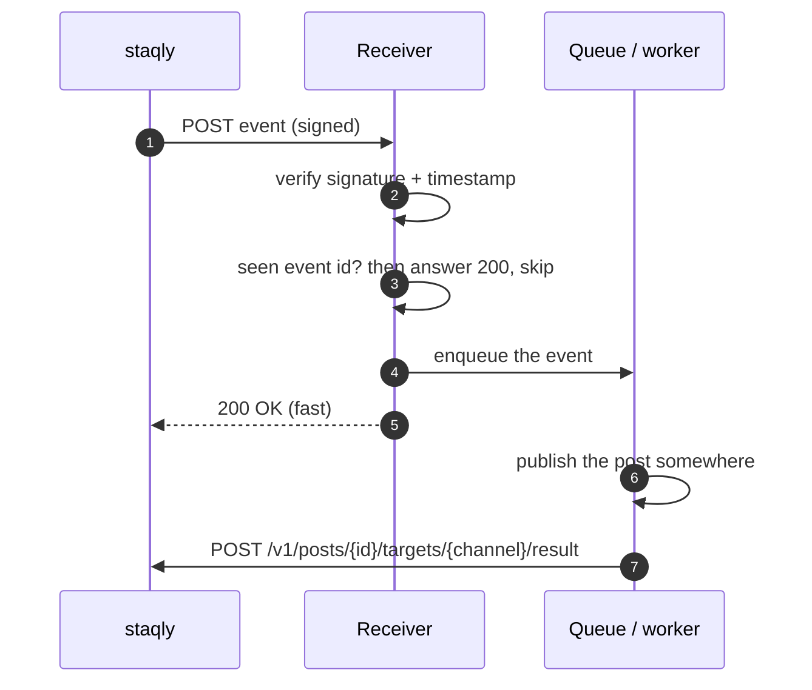

A webhook receiver is the endpoint that hears what happened: it publishes a post through
[your own automation](/channels/your-own-automation), logs the links of what went out, or
tells the team why a platform refused a post. These patterns
keep it safe and correct under at-least-once delivery. The full delivery contract (headers,
payload, retry schedule) is on the [Webhooks](/automation/webhooks) page.

## The rules

| Rule | Why |
|---|---|
| Verify `X-Staqly-Signature` on the **raw** body before doing anything | Anyone can POST to your URL; re-serialized JSON breaks the signature |
| Reject timestamps more than 300 s old | Stops replays of a captured request |
| Deduplicate on the event `id` (`X-Staqly-Event-Id`) | The same event can arrive more than once |
| Order by the event's `created_at`, not by arrival | Deliveries run in parallel and retry, so events can arrive out of order ([Delivery guarantees](/automation/webhooks#delivery-guarantees)) |
| Answer `2xx` within a few seconds, do the work afterwards | Slow answers time out (`timeout_ms`, default 10 s) and get retried |
| Answer `410 Gone` to stop deliveries for good | staqly stops retrying that delivery at once |
| Act on the post in the payload, then report the result for your own automation | The payload is the snapshot at event time, with the text each channel carries |

## How it works



## Verify the signature

The signature is `sha256=` plus the hex HMAC-SHA256 of `"<X-Staqly-Timestamp>.<raw body>"`,
keyed with the webhook's signing secret. The SDKs do it for you; the manual version shows what
happens.

<Tabs items={["Python", "TypeScript"]}>
<Tab value="Python">

```python title="With the SDK (FastAPI)"
from fastapi import FastAPI, HTTPException, Request
from staqly import WebhookVerificationError, verify_webhook

app = FastAPI()


@app.post("/hooks/staqly")
async def staqly_webhook(request: Request) -> dict[str, bool]:
    try:
        event = verify_webhook(SECRET, await request.body(), request.headers)
    except WebhookVerificationError:
        raise HTTPException(status_code=400, detail="invalid signature")

    handle(event)
    return {"ok": True}
```

```python title="Without the SDK"
import hashlib
import hmac
import time


def verify_staqly(secret: str, raw_body: bytes, headers) -> bool:
    ts = headers.get("X-Staqly-Timestamp", "")
    sig = headers.get("X-Staqly-Signature", "")

    if not ts.isdigit() or abs(time.time() - int(ts)) > 300:
        return False

    mac = hmac.new(secret.encode(), ts.encode() + b"." + raw_body, hashlib.sha256)
    return hmac.compare_digest(sig, "sha256=" + mac.hexdigest())
```

</Tab>
<Tab value="TypeScript">

```ts title="With the SDK (Express)"
import { verifyWebhook, WebhookVerificationError } from '@staqly/sdk/webhooks'
import express from 'express'

const app = express()

// express.raw keeps the body as bytes: the signature is computed over the exact bytes sent.
app.post('/hooks/staqly', express.raw({ type: 'application/json' }), async (req, res) => {
  try {
    const event = await verifyWebhook(process.env.STAQLY_WEBHOOK_SECRET!, req.body.toString('utf8'), req.headers)

    await handle(event)
    res.sendStatus(200)
  } catch (err) {
    if (err instanceof WebhookVerificationError) {
      res.status(400).send('invalid signature')

      return
    }

    throw err
  }
})

app.listen(4000)
```

```ts title="Without the SDK (Node.js)"
import { createHmac, timingSafeEqual } from 'node:crypto'

export function verifyStaqly(secret: string, rawBody: string, headers: Record<string, string | undefined>) {
  const ts = headers['x-staqly-timestamp'] ?? ''
  const sig = headers['x-staqly-signature'] ?? ''

  if (!/^\d+$/.test(ts) || Math.abs(Date.now() / 1000 - Number(ts)) > 300) {
    return false
  }

  const expected = 'sha256=' + createHmac('sha256', secret).update(`${ts}.${rawBody}`).digest('hex')

  return sig.length === expected.length && timingSafeEqual(Buffer.from(sig), Buffer.from(expected))
}
```

</Tab>
</Tabs>

In Next.js route handlers use `await req.text()` for the raw body; in Flask,
`request.get_data()`. Examples for both are on the [TypeScript SDK](/sdk/typescript#verify-webhooks)
and [Python SDK](/sdk/python#verify-webhooks) pages.

## Deduplicate, answer fast, work later

Record the event `id` with a unique constraint before doing the work. A duplicate fails the
insert and is acknowledged without side effects. Hand the real work to a queue or background
task, so staqly gets its `200` right away.

<Tabs items={["Python", "TypeScript"]}>
<Tab value="Python">

```python
import sqlite3

from fastapi import BackgroundTasks

db = sqlite3.connect("receiver.db", check_same_thread=False)
db.execute("CREATE TABLE IF NOT EXISTS seen_events (id TEXT PRIMARY KEY)")


@app.post("/hooks/staqly")
async def staqly_webhook(request: Request, tasks: BackgroundTasks) -> dict[str, bool]:
    try:
        event = verify_webhook(SECRET, await request.body(), request.headers)
    except WebhookVerificationError:
        raise HTTPException(status_code=400, detail="invalid signature")

    try:
        with db:
            db.execute("INSERT INTO seen_events (id) VALUES (?)", (event.id,))
    except sqlite3.IntegrityError:
        return {"ok": True}  # already handled: acknowledge, do nothing

    tasks.add_task(process, event)  # runs after the response is sent
    return {"ok": True}


def process(event) -> None:
    if event.type != "post.publish_requested":
        return

    post, channel, target = event.data["post"], event.data["channel"], event.data["target"]

    try:
        url = publish(target["content"], post["media_items"])
    except Exception as e:
        staqly.posts.report_result(post["id"], channel["id"], status="failed", error=str(e))
        return

    staqly.posts.report_result(post["id"], channel["id"], status="published", url=url)
```

</Tab>
<Tab value="TypeScript">

```ts
import { type PostEventData, verifyWebhook, type WebhookEvent } from '@staqly/sdk/webhooks'

app.post('/hooks/staqly', express.raw({ type: 'application/json' }), async (req, res) => {
  let event: WebhookEvent<PostEventData>

  try {
    event = await verifyWebhook<PostEventData>(secret, req.body.toString('utf8'), req.headers)
  } catch {
    res.status(400).send('invalid signature')

    return
  }

  // INSERT ... ON CONFLICT DO NOTHING returns 0 rows for an event we have already seen.
  const { rowCount } = await db.query('INSERT INTO seen_events (id) VALUES ($1) ON CONFLICT DO NOTHING', [event.id])

  res.sendStatus(200) // answer first

  if (rowCount === 1) {
    await queue.add('staqly-event', event) // a worker publishes and calls staqly.posts.reportResult
  }
})
```

</Tab>
</Tabs>

If processing can fail after you answered `200`, the worker must retry on its own (the queue
does that), because staqly considers the delivery done. Report `failed` with
`report_result` / `reportResult` when you give up, so the post shows what went wrong on that channel.

## Retries and status codes

| Your answer | What staqly does |
|---|---|
| Any `2xx` | Delivery `succeeded` |
| `410 Gone` | Stops retrying this delivery immediately |
| Other status, timeout or connection error | Retries with exponential backoff: 15 s first, doubling, capped at 1 h, up to `max_attempts` (default 8), then `failed`. After 5 failures in a row the webhook's deliveries pause for a while ([circuit breaker](/automation/webhooks#when-a-receiver-keeps-failing)) |

Retries keep the same `X-Staqly-Event-Id` and `X-Staqly-Delivery` but get a fresh
`X-Staqly-Timestamp` and signature. Failed deliveries can be re-sent from the dashboard or with
`POST /v1/webhook-deliveries/{id}/retry`. Details: [Retries](/automation/webhooks#retries)
and [Delivery guarantees](/automation/webhooks#delivery-guarantees).

## Test your receiver locally

- Send a test event from the webhook's page in the dashboard, or with
  `staqly webhooks test wh_4f2kq7zr8m3xv6np1tbc`.
- Staqly Community Edition refuses loopback targets by default. To deliver to a receiver on
  `http://localhost:4000`, set `WEBHOOK_ALLOW_LOOPBACK=true`; see the
  [network policy](/automation/webhooks#network-policy-ssrf-guard).
- Build signed test requests with `computeWebhookSignature()` (TypeScript) or
  `compute_signature(secret, ts, body)` (Python).

## Next steps

<Cards>
  <Card title="Webhooks" href="/automation/webhooks">The delivery contract in full.</Card>
  <Card title="Events" href="/api/events">Every event type and its payload.</Card>
  <Card title="Publish through n8n" href="/cookbook/publish-through-n8n">The same loop as an n8n workflow.</Card>
</Cards>
