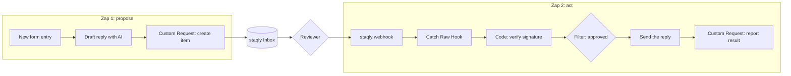

[Zapier](https://zapier.com) connects thousands of apps with trigger-and-action "Zaps". Add
staqly when a Zap generates something a person should approve before it reaches a customer,
a channel or a ledger.

There is no staqly app in the Zapier directory yet. **Webhooks by Zapier** (a built-in app)
does the job:

| Direction | Zapier step | staqly endpoint or feature |
|---|---|---|
| Zap → staqly: propose | Webhooks by Zapier › Custom Request (action) | `POST /v1/collections/{collection}/items` |
| staqly → Zap: decision | Webhooks by Zapier › Catch Raw Hook (trigger) | A staqly [webhook](/automation/webhooks) on `item.approved`, `item.rejected` |
| Zap → staqly: report | Webhooks by Zapier › Custom Request (action) | `POST /v1/items/{id}/result` |

<Callout type="warn" title="Zapier needs a reachable staqly">
Zapier runs in the cloud, so it cannot call a local staqly on `127.0.0.1`. Create items
against a [cloud-mode](/local-vs-cloud) instance such as `https://staqly.example.com` with an
API key. A local staqly can still send its webhooks to Zapier.
</Callout>

## How it works



## Set it up

<Steps>
<Step>

### Zap 1: create the item

Add **Webhooks by Zapier › Custom Request**:

| Field | Value |
|---|---|
| Method | `POST` |
| URL | `https://staqly.example.com/v1/collections/Approvals/items` |
| Data | the JSON below, with fields mapped from earlier steps |
| Headers | `Authorization`: `Bearer stk_...`, `Content-Type`: `application/json` |

```json title="Data"
{
  "title": "Reply to ana@example.com: order A-1042",
  "content": "Hi Ana, your replacement ships on Monday.",
  "metadata": { "to": "ana@example.com", "ticket": "A-1042" },
  "source": "zapier",
  "expires_in": "8h",
  "editable": ["content"]
}
```

</Step>
<Step>

### Zap 2: catch the decision

Start a second Zap with **Webhooks by Zapier › Catch Raw Hook** (the raw variant keeps the
exact body and the headers, which the signature check needs). Copy its URL and subscribe a
staqly webhook to it:

```bash
staqly webhooks create --url https://hooks.zapier.com/hooks/catch/1234567/abcde12/ --events item.approved,item.rejected
```

Keep the signing secret (`whsec_...`) for the next step.

</Step>
<Step>

### Verify the signature in a Code step

Add **Code by Zapier › Run JavaScript** with input fields `body` (raw body),
`timestamp` (`X-Staqly-Timestamp` header) and `signature` (`X-Staqly-Signature` header):

```js title="Code by Zapier"
const crypto = require('crypto')

const secret = 'whsec_...' // better: store it in Zapier's Storage or an env field
const age = Math.abs(Date.now() / 1000 - Number(inputData.timestamp))
const expected = 'sha256=' + crypto.createHmac('sha256', secret).update(`${inputData.timestamp}.${inputData.body}`).digest('hex')
const valid =
  age <= 300 &&
  expected.length === inputData.signature.length &&
  crypto.timingSafeEqual(Buffer.from(expected), Buffer.from(inputData.signature))

const event = JSON.parse(inputData.body)

output = { valid, type: event.type, event_id: event.id, item_id: event.data.item.id, content: event.data.item.content, feedback: event.data.feedback || '' }
```

The scheme is described in [Verifying signatures](/automation/webhooks#verifying-signatures).

</Step>
<Step>

### Filter, act, report

- **Filter**: continue only if `valid` is true and `type` is `item.approved`.
- **Action**: send `content` (the approved, possibly edited reply) with Gmail, Slack or any app.
- **Custom Request**: `POST https://staqly.example.com/v1/items/{item_id}/result` with
  `{"status":"completed","result":{"sent":true}}`.

A second path (Paths by Zapier) can handle `item.rejected` and forward `feedback` to the
author.

</Step>
</Steps>

## Tips

- **Duplicates.** staqly delivers at least once. Use **Storage by Zapier** to remember handled
  `event_id`s and stop the Zap for repeats.
- **Retries.** Catch Raw Hook answers `200` right away, so staqly does not retry because a Zap
  is slow. Failed deliveries are visible under the webhook's delivery history.
- **No polling needed.** Zapier could poll `GET /v1/items?status=approved`, but the webhook
  is instant and costs fewer tasks.

## Next steps

<Cards>
  <Card title="Webhooks" href="/automation/webhooks">Events, payloads and retries.</Card>
  <Card title="Webhook receivers" href="/integrations/webhook-receivers">Idempotency and fast responses.</Card>
  <Card title="Make" href="/integrations/make">The same flow in Make.</Card>
</Cards>
