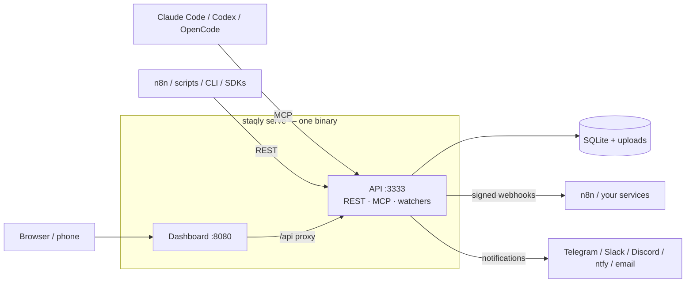

staqly is a workspace for everything your AI agents create. Agents and automations (Claude
Code, Codex, OpenCode, n8n, your own scripts) save their output in staqly, and you review it
in one **Inbox** before it is used.

Use staqly when an agent produces something you want to check first: an image to post, a
draft to send, a risky action to confirm. It runs on your own computer and keeps your data
there.

## What it does

- **Stores agent output.** Images, videos, text, links, JSON and files, each saved as an
  [item](/concepts#items) inside a [collection](/concepts#collections), with its metadata
  and full history. With a small model set up, each item also gets a one-line
  [summary and tags](/self-hosting/configuration#auto-tags-and-summaries).
- **Lets you review it.** In the Inbox you approve, reject with feedback, edit, or run custom
  actions such as *regenerate* or *publish*.
- **Tells your automations.** Every decision is sent back to your tools as a signed webhook,
  so n8n or your own service can publish, regenerate or log feedback.

Everything runs on your machine: one binary (`staqly serve`, or the same app as one Docker
container), one SQLite file, one uploads folder. No cloud account, no Redis, no Postgres.

## How it fits together

<Cards>
  <Card title="Agents create items" href="/concepts#items">
    An agent calls `create_item` over MCP, or n8n posts to the REST API. Each output becomes an
    **item** in a **collection** with metadata, media and a full history.
  </Card>
  <Card title="You decide in the Inbox" href="/dashboard/inbox">
    Pending items wait for you. Approve with <Kbd>⇧</Kbd> <Kbd>A</Kbd>, reject with feedback with <Kbd>⇧</Kbd> <Kbd>R</Kbd>,
    edit before approving with <Kbd>⇧</Kbd> <Kbd>E</Kbd>, on desktop or your phone.
  </Card>
  <Card title="Automations react" href="/automation/webhooks">
    Every decision is an event. Webhooks deliver it (signed, retried, at-least-once) so n8n
    can publish, regenerate or log feedback.
  </Card>
  <Card title="Watchers bring content in" href="/automation/watchers">
    Watchers pull in new posts from RSS feeds and web pages, and items you set to expire
    leave the Inbox on their own.
  </Card>
</Cards>

## Two ways to run it

staqly runs in one of two modes. Most people want **local mode**, the default.

| Aspect | **Local mode** (default) | **Cloud mode** |
|---|---|---|
| Who | You, on your own computer | A hosted, multi-tenant instance |
| Credentials | None: only this machine can connect | Scoped API keys `stk_...`, browser sessions, recovery keys |
| Workspaces | One, created automatically | Many: anyone (or only `SETUP_TOKEN` holders) can create one |
| Limits | Unlocked | Free or Pro ($30/mo, 7-day trial) |

Read [Local vs cloud](/local-vs-cloud) for the details.

## Where to next

<Cards>
  <Card title="Quickstart" href="/quickstart">Run staqly, create your first item and connect an agent in five minutes.</Card>
  <Card title="Concepts" href="/concepts">Workspaces, collections, items, statuses, actions, events.</Card>
  <Card title="Connect agents" href="/agents">Claude Code, Codex, OpenCode, any MCP client, n8n, scripts.</Card>
  <Card title="API reference" href="/api/reference">Every REST endpoint, generated from the OpenAPI 3.2 contract.</Card>
</Cards>
