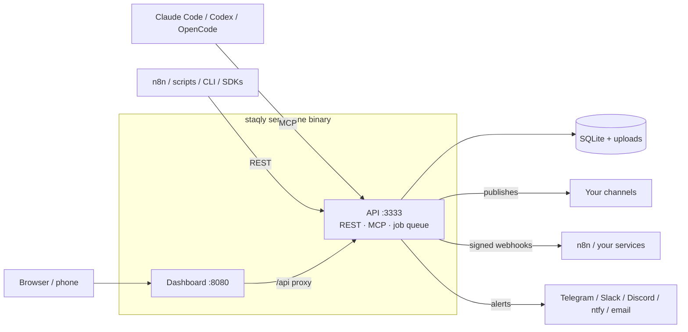

Staqly is the local-first social media scheduler for people and their AI agents. You (or Claude Code, Codex, n8n,
a script) write posts into **collections**, connect the accounts they should go to as
**channels**, and either pick a time per post or let a **schedule** publish the next waiting
post every morning. Use it hosted, or run it yourself on your computer or a server.

Use staqly when content is produced faster than it is published: an agent drafts a week of
posts overnight, you look them over in the calendar, and a schedule sends one out each day to
the channels you chose.

## What it does

- **Holds the posts.** Text, media and per-channel variants, grouped in collections, each with
  a status (`draft`, `scheduled`, `publishing`, `published` or `failed`) and a full history.
- **Publishes them.** A post has one **target** per channel. At its time a durable job queue
  publishes every target, retries failures and records the link to the published post.
- **Keeps a rhythm.** A collection's schedules run once or on a rule (weekday mornings, every
  few hours) and publish the next waiting post, chosen posts or everything that waits. When
  nothing waits, a schedule can ask your agent for new posts or call an endpoint of yours.
- **Tells you and your tools.** Alerts on Telegram, Slack, Discord, ntfy or email say when a
  post went out or failed and when a channel needs reconnecting; signed webhooks deliver every
  event to your own services.

Run yourself, it is one binary (`staqly serve`, or the same app as one Docker container) with
one SQLite file and one uploads folder, and channel credentials sealed with a key that stays on
that machine. [Staqly Cloud](/local-vs-cloud#staqly-cloud) runs the same app for you and your team at app.staqly.ai.

## How it fits together

<Cards>
  <Card title="Posts land in collections" href="/concepts#posts">
    An agent calls `create_post` over MCP, or n8n posts to the REST API. A post carries its
    text, media, tags and one target per channel, with a text of its own per channel when needed.
  </Card>
  <Card title="Channels are where they go" href="/channels">
    Connect an account once: an OAuth platform such as X, a token platform, or **your own
    automation** for anything Staqly cannot reach itself.
  </Card>
  <Card title="Schedules set the rhythm" href="/automation/schedules">
    Weekday mornings at 09:00, every six hours, or once on Friday: a schedule publishes the next
    waiting post, and can ask your agent for more when the collection runs dry.
  </Card>
  <Card title="Everything is an event" href="/automation/webhooks">
    Created, scheduled, published, failed, reconnect needed. Webhooks deliver them signed and
    at least once; alerts turn the important ones into messages.
  </Card>
</Cards>

## Two ways to run it

Staqly comes in two forms: **Staqly Cloud**, the hosted service at
[app.staqly.ai](https://app.staqly.ai) with accounts and plans, and **Staqly Community Edition**,
the self-hosted option for you on your own computer or server.

| Aspect | **Community Edition** | **Staqly Cloud** |
|---|---|---|
| Who | You, on your own computer or server | You and your team, hosted by us |
| People | You; each browser signs in once with the access token | Sign in with Google, an email code or a passkey; members with roles |
| Agents | The access token staqly prints at start (`stk_local_...`) | Scoped API keys `stk_...` |
| Workspaces | One, created automatically | Many, in accounts; the first one on sign-up |
| OAuth platforms | A developer app per platform, in the server's environment | Ours, ready to connect |
| Limits | None (plan **Community Edition**) | Starter, Plus, Pro or Business (from €12 per user a month billed yearly, excl. VAT; 7-day Starter trial, card required) |

Read [Community Edition vs Staqly Cloud](/local-vs-cloud) for the details.

## Where to next

<Cards>
  <Card title="Quickstart" href="/quickstart">Run staqly, connect a channel, write and publish your first post in five minutes.</Card>
  <Card title="Concepts" href="/concepts">Workspaces, collections, posts, targets, channels, schedules, jobs, events.</Card>
  <Card title="Connect agents" href="/agents">Claude Code, Codex, OpenCode, any MCP client, n8n, scripts.</Card>
  <Card title="API reference" href="/api/reference">Every REST endpoint, generated from the OpenAPI 3.2 contract.</Card>
</Cards>
