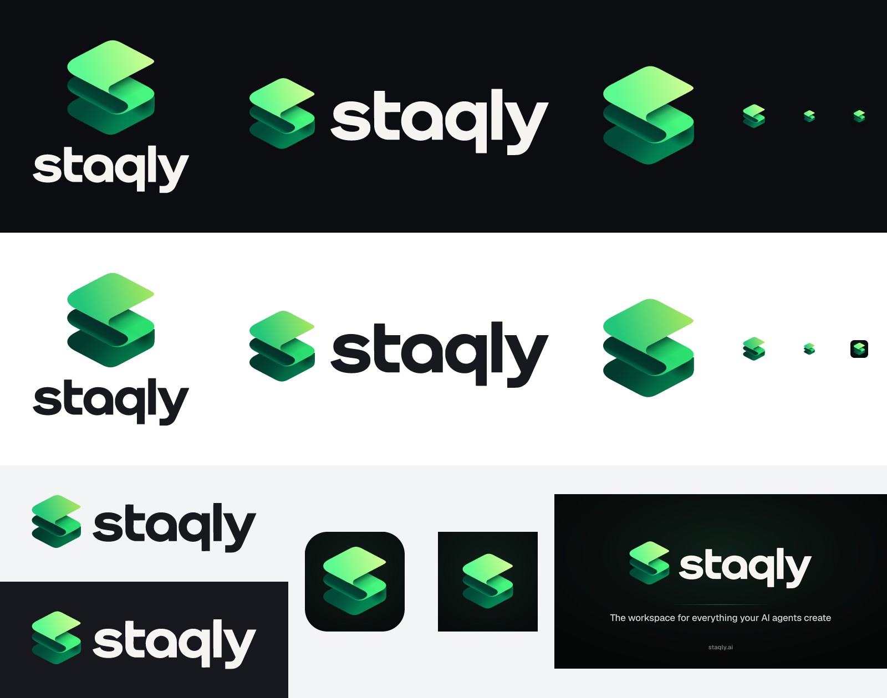

# staqly brand assets

The product name is **staqly**: always lowercase, one word, no dot. The website is **staqly.ai**.

The logo is an isometric "S" folded from three stacked layers (the "stack"), with the
geometric lowercase wordmark under it or to the right of it. `staqly-logo-source.png` is the
original artwork. Every SVG here is redrawn from it: the layer geometry was measured on the
source, the gradient stops were sampled from it, and the wordmark is an outline traced from it.



## Files

| File | What it is |
|---|---|
| `staqly-logo-source.png` | Original artwork (1254×1254, on near-black). Reference only. |
| `staqly-logo-dark.svg` / `staqly-logo-light.svg` | Stacked logo (mark above wordmark). **dark** = for dark backgrounds (off-white wordmark), **light** = for light/white backgrounds (graphite wordmark, deeper greens). Transparent background. |
| `staqly-logo-{dark,light}@{512,1024,2048}.png` | PNG exports of the stacked logo, transparent, width in px. |
| `staqly-logo-horizontal-dark.svg` / `-light.svg` | Horizontal lockup (mark left of the wordmark) for headers and READMEs. |
| `staqly-logo-horizontal-{dark,light}@{512,1024,2048}.png` | PNG exports of the horizontal lockup. |
| `staqly-mark.svg` | The mark on its own (same as `staqly-mark-dark.svg`). 64×64 viewBox, transparent. |
| `staqly-mark-dark.svg` / `staqly-mark-light.svg` | The mark for dark / light backgrounds. |
| `staqly-mark-{dark,light}@512.png` | PNG exports of the mark. |
| `staqly-wordmark.svg` | The wordmark alone, `fill="currentColor"`. |
| `staqly-app-icon.svg` | App icon: the mark on a near-black rounded tile. |
| `favicon.svg`, `favicon.ico` (16/32/48), `favicon-{16,32,48}.png` | Favicons (dark tile, mark enlarged so it survives 16 px). |
| `apple-touch-icon.png` | 180×180, square (iOS rounds it). |
| `icon-192.png`, `icon-512.png` | Web app manifest icons. |
| `icon-maskable-512.png` | Maskable manifest icon (full-bleed background, mark inside the 80% safe zone). |
| `og-image.png` / `og-image.svg` | Open Graph / social card, 1200×630. |
| `brand-preview.png` | Every variant on dark and light backgrounds. |

The apps use copies: `apps/dashboard/app/{icon.svg,favicon.ico,apple-icon.png,opengraph-image.png}`,
`apps/dashboard/public/brand/` (marks + manifest icons) and the same set in `apps/docs`. The dashboard
and docs `<Logo>` components inline the wordmark path and show the light/dark mark by theme.

### Using it in a GitHub README

```html
<picture>
  <source media="(prefers-color-scheme: dark)" srcset="assets/brand/staqly-logo-horizontal-dark.svg">
  
</picture>
```

## Palette

### Logo gradient (sampled from the source)

| Role | Hex |
|---|---|
| Top layer: lime highlight → mint | `#D2FD97` → `#98FB8B` → `#5CFA90` |
| Middle layer (lit): green | `#06B86B` → `#33EC77` → `#47F67D` |
| Fold / underside (shadow) | `#013A2D` → `#024536` → `#03B86C` (rim) |
| Bottom layer: emerald | `#024A3A` → `#037E50` → `#058A55` |
| Wordmark on dark | `#F7F5F1` (off-white) |
| Wordmark on light | `#17191F` (graphite) |

The light variant of the mark deepens the top layer (`#A6E85F` → `#63DA73` → `#22C77A`) and the
shadow layers so the mark keeps its shape on white.

### UI tokens (apps/dashboard `globals.css`, apps/docs `global.css`)

| Token | Light | Dark |
|---|---|---|
| `--brand` (links, icons, filled buttons) | `oklch(0.52 0.13 152)` ≈ `#137D41`, white text 5.2:1 | `oklch(0.82 0.19 148)` ≈ `#5AE87B`, 11:1 on the dark background |
| `--brand-strong` (hover, text on soft bg) | `oklch(0.46 0.11 154)` ≈ `#0F693A` | `oklch(0.88 0.16 145)` |
| `--brand-foreground` (text on brand) | `oklch(0.99 0.01 150)` | `oklch(0.24 0.05 155)` (dark green) |
| `--brand-soft` (selected rows, chips) | `oklch(0.62 0.16 150 / 12%)` | `oklch(0.82 0.19 148 / 13%)` |
| `--ring` (focus) | `oklch(0.62 0.16 150 / 55%)` | `oklch(0.8 0.18 148 / 55%)` |
| `--brand-gradient` ("Most popular", Pro badge, upgrade buttons) | `#C9FB93 → #63F08E → #1ED27B`, always with dark text `#052817` | same |

The brightest lime is never used for text on white; in light mode text and links use the deep
green. Neutrals stay graphite (`oklch(... 0.004–0.014 260–265)`). The status "approved" badge and
Approve buttons use **teal**, so they don't read as the brand accent.

## Usage

* **Clear space:** keep at least the height of the wordmark's "a" (x-height) free on every side
  of the logo; for the mark alone, 25% of its width.
* **Minimum size:** mark 16 px (use the favicon tile below 24 px); horizontal lockup 96 px wide;
  stacked logo 64 px wide.
* Use the **dark** variant on dark or photographic backgrounds and the **light** variant on white
  or light grey. Don't recolour the mark, add outlines or shadows, rotate or stretch it, or
  rebuild the wordmark in another typeface.
* In running text write "staqly" in the surrounding font; the outlined wordmark is for logos only.
