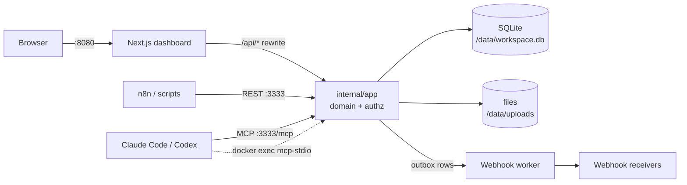

# Architecture (staq.ly)

## Process model

One Go process (`server`) serves the REST API, the MCP Streamable HTTP endpoint
and runs the webhook worker. SQLite allows one writer at a time, so a single
process is the simplest correct design; the dashboard (Next.js) is a separate
container that proxies `/api/*` to the Go API, so the browser only ever talks
to one origin and the session cookie stays first-party.

`mcp-stdio` is a second binary in the same image. It is launched by an agent
via `docker exec -i staqly-api mcp-stdio`, so it runs **in the same container**
against the same database file (SQLite WAL handles multiple processes on one
host). Webhook deliveries it queues are sent by the server's worker.



## Layers

| Package | Role |
|---|---|
| `internal/app` | Domain services. Every exported method takes a `Principal` and checks scopes itself, so REST and MCP cannot diverge or bypass authorization. |
| `internal/httpapi` | chi router, JSON handling, API-key/session auth, CSRF, idempotency keys, structured errors, request logging (paths only, never headers/query). |
| `internal/mcpserver` | MCP tools on the official `modelcontextprotocol/go-sdk`. HTTP uses stateless Streamable HTTP: each request is authenticated and gets a server bound to that principal. |
| `internal/store` | Opens SQLite (pragmas per connection via DSN), runs goose migrations, `VACUUM INTO` backups. |
| `internal/db` | sqlc-generated, typed queries (plus one whitelisted dynamic ORDER BY). |

## SQLite configuration

DSN pragmas apply to every pooled connection: `journal_mode=WAL`,
`foreign_keys=ON`, `busy_timeout=10000`, `synchronous=NORMAL`, and
`_txlock=immediate` so write transactions take the lock up front (no
`SQLITE_BUSY` on lock upgrade). Timestamps are fixed-width ISO-8601 UTC text,
so string comparison equals time order. JSON columns are `TEXT` with
`json_valid` checks; critical fields (status, type, collection, timestamps) are
relational columns with indexes.

Migrations are embedded and applied at startup; each goose migration runs in
its own transaction, so an interrupted startup leaves the schema at the last
fully applied version and simply continues next time.

## Schema (simplified)

```
installation(id=1)            -- guards one-time setup
workspaces(id, name, recovery_verifier, …)
api_keys(id, workspace_id, prefix, key_hash UNIQUE, scopes JSON, expires_at, revoked_at, last_used_at)
sessions(id, workspace_id, token_hash UNIQUE, csrf_token, expires_at, revoked_at)
collections(id, workspace_id, name UNIQUE NOCASE per ws, default_view, actions JSON, archived_at)
media(id, workspace_id, storage_name, mime_type, size_bytes, sha256)
items(id, workspace_id, collection_id, title, type, content, url, media_id, metadata JSON,
      status, source, external_ref, feedback, version, decided_at, …)
item_versions(item_id, version, snapshot JSON, actor)      -- snapshot before each change
events(seq, id, workspace_id, type, collection_id, item_id, actor_*, data JSON)  -- immutable (trigger)
webhooks(id, workspace_id, url, secret, events JSON, collection_ids JSON, active, timeout_ms, max_attempts)
webhook_deliveries(id, webhook_id, event_id, status, attempts, next_attempt_at, last_*; UNIQUE(webhook_id,event_id))
idempotency_keys(workspace_id, principal_id, key, request_hash, status_code, response_body)
```

Every table carries `workspace_id`; every query filters by it. The MVP exposes
one workspace, but nothing in the schema prevents several (tenant isolation is
covered by tests).

## Search and pagination

`items_fts` is an external-content FTS5 index (title, content, metadata;
`unicode61 remove_diacritics 2`) kept in sync by triggers. User text is turned
into quoted prefix terms (operators cannot be injected); `ł` gets `l`/`ł`
variants because Unicode does not treat it as a diacritic. Results are ranked
with `bm25` (title weighted highest) when `q` is set. Pagination is keyset
(`(sort value, id)` encoded in an opaque cursor), so pages do not shift when
items are added. `VACUUM INTO` backups rebuild the index in the copy because
VACUUM may renumber rowids.

## Workspaces, plans and limits

Every table is keyed by `workspace_id`. Local mode has one workspace
(`installation` row); cloud mode creates one per signup. Plans live in code
(`internal/app/plans.go`); `workspaces.plan` stores the assignment and
`usage_counters (workspace, YYYY-MM, metric)` meters monthly item creation in
the same transaction as the insert. Counts (webhooks, active keys) and storage
are computed from their tables. Violations return 402 with machine-readable
`details`. Local mode always resolves to the unlocked plan.

## Connect a device

`device_links` holds hashed one-time tokens (5-minute TTL). The dashboard
renders `PUBLIC_WEB_URL/connect#<token>` as a QR code; the phone posts the
token to `/v1/device-links/redeem` and receives its own session cookie.
Redemption is a conditional `UPDATE … WHERE used_at IS NULL AND expires_at >
now`, so a token works exactly once. Sessions work in both modes; in local mode
the API treats requests whose `X-Forwarded-Host` (set by the dashboard proxy)
is not local as remote, so LAN devices need such a session.

## Decisions and state changes

`RunAction` (approve, reject, custom actions) and item updates go through one
path: inside a `BEGIN IMMEDIATE` transaction it loads the item, checks scope,
allowed statuses and feedback requirements, snapshots the old version, updates
with `WHERE version = ?`, inserts the event, and inserts outbox rows for every
matching webhook — then commits. Concurrent decisions serialize on the write
lock; the loser sees a non-pending item and gets `409`.

## Webhooks

* Outbox rows share the transaction with the domain change and the event.
* The worker polls due rows (and is nudged after each commit), *leases* a row by
  moving `next_attempt_at` forward 5 minutes and incrementing `attempts`, then
  sends the HTTP request outside any transaction. If the process dies mid-send,
  the lease expires and the delivery is retried (at-least-once).
* Payloads are built from the stored event snapshot, not the current item.
* Signature: `sha256=hex(HMAC_SHA256(secret, "<unix ts>.<raw body>"))`.
* Backoff: `WEBHOOK_RETRY_BASE · 2^(attempt-1)`, ±20 % jitter, capped at
  `WEBHOOK_RETRY_MAX`; terminal `failed` after `max_attempts` or on `410`.
* SSRF: IP policy enforced in the dialer's `Control` hook (post-DNS, so DNS
  rebinding does not help); link-local (incl. 169.254.169.254), multicast and
  unspecified addresses are always refused; redirects are not followed; no
  proxy from the environment.

## Authentication model

**Local mode** (default): requests without credentials get a full-access
`local` principal if the TCP peer is loopback/private, the `Host` header is a
local name, any `Origin` is local (blocks DNS rebinding and cross-site
requests) and any `X-Forwarded-Host` is local (other LAN devices coming through
the dashboard). The workspace is created at startup. Session cookies (from QR
device links) and bearer keys are honoured too.

**Cloud mode** (`STAQLY_MODE=cloud`): everything below applies; signup is
public (rate-limited) unless `SETUP_TOKEN` is set.

| Credential | Stored as | Used for |
|---|---|---|
| API key `stk_…` (256-bit) | SHA-256 hash + 6-char display prefix | REST + MCP, scoped |
| Session cookie (256-bit) | SHA-256 hash | Dashboard; HttpOnly, SameSite=Lax, `Secure` with `COOKIE_SECURE=true`, 30-day expiry, revocable |
| CSRF token | per session | Required in `X-CSRF-Token` for cookie-authenticated unsafe requests |
| Recovery key (200-bit) | SHA-256 hash | Only `POST /v1/sessions/recover`; rotated from a dashboard session or `server recovery-key` on the host |

High-entropy random secrets make a plain SHA-256 an adequate verifier (no
password hashing needed). `/mcp` accepts only bearer keys, never cookies.
Sessions implicitly hold all scopes (the dashboard is the workspace owner);
API keys are least-privilege.

## Media

Uploads are streamed to `/data/uploads/<xx>/<random>.<ext>` with a size limit;
the type is sniffed from content (allowlist: common images, video, audio, PDF,
text, CSV, JSON, ZIP; SVG/HTML/JS rejected). Files are served only through
`GET /v1/media/{id}` after authorization, with the stored MIME type,
`nosniff`, a sandboxing CSP and Range support for video seeking. The backend
never fetches external URLs; items may reference them.

## Frontend

Next.js App Router, TanStack Query for server state, shadcn/ui components,
React Hook Form + Zod, types generated from `openapi.yaml`. See `apps/web`.
