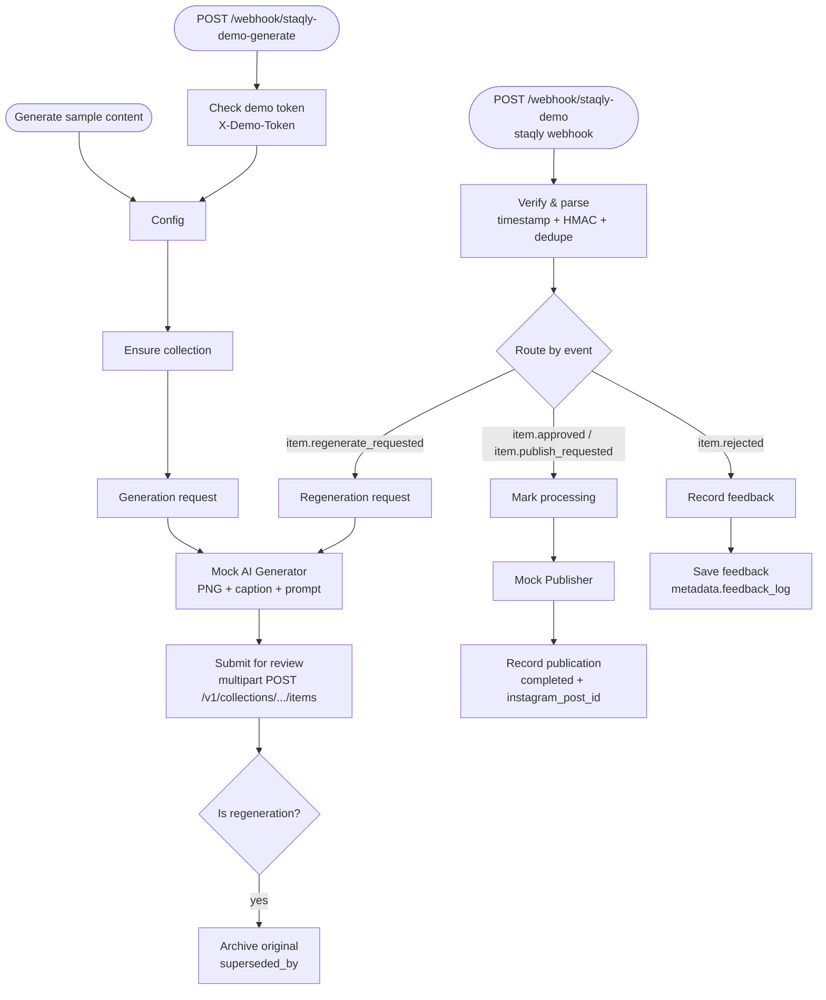

# n8n integration

n8n talks to staqly in two directions:

* **n8n → staqly**: HTTP Request nodes call the REST API — no credentials in
  local mode; in cloud mode add a *Header Auth* credential
  (`Authorization: Bearer {API_KEY}`), see [cloud.md](cloud.md).
* **staqly → n8n**: a staqly webhook posts review events to an n8n *Webhook*
  trigger, signed with HMAC.

## Networking — pick your setup

Inside a container, `localhost` is the container itself, not your machine.

| n8n runs... | n8n → staqly API URL | staqly webhook URL (→ n8n) |
|---|---|---|
| on the staqly Docker network (e.g. [`integrations/n8n/compose.yml`](../integrations/n8n/compose.yml)) | `http://api:3333` | `http://n8n:5678/webhook/staqly-demo` |
| on the host (`npx n8n`, desktop app) | `http://localhost:3333` | `http://host.docker.internal:5678/webhook/staqly-demo` |
| in another container / compose project | `http://host.docker.internal:3333` or attach n8n to `staqly_default` and use `http://api:3333` | `http://host.docker.internal:5678/...` or, on a shared network, `http://<n8n-container>:5678/...` |

Notes:

* In local mode staqly only accepts keyless requests whose `Host` is a local
  name; `api`, `localhost`, `host.docker.internal` and the container name are
  built in. If n8n reaches staqly under another name, add it to
  `LOCAL_ALLOWED_HOSTS`.
* `host.docker.internal` works on Docker Desktop; on Linux the compose file
  maps it via `extra_hosts: host-gateway` for the API container. For another
  n8n container on Linux add the same `extra_hosts` entry to it.
* To share a network with an existing n8n container:
  `docker network connect staqly_default <n8n-container>`.
* Webhook targets on private networks are allowed by default
  (`WEBHOOK_ALLOW_PRIVATE=true`); loopback targets are not
  (`WEBHOOK_ALLOW_LOOPBACK=false`) — only relevant when running the API
  outside Docker with n8n on `localhost`.
* Media URLs inside webhook payloads use `PUBLIC_API_URL`. If n8n should
  download images from those URLs, set `PUBLIC_API_URL` to the address n8n can
  reach (e.g. `http://api:3333`) and send the API key header.

## Demo: Instagram Avatar (no external accounts)

Workflow: [`integrations/n8n/instagram-avatar-demo.json`](../integrations/n8n/instagram-avatar-demo.json)
(tested on n8n 2.42.7; uses widely available node versions).



### Steps

1. Have an n8n running — your own, or the example next to staqly:
   `docker compose -f integrations/n8n/compose.yml up -d` — open
   http://localhost:5678 and create the n8n owner account. The example
   publishes n8n on `127.0.0.1` only; to reach it from other machines change
   the port mapping and protect n8n yourself (owner account, HTTPS). The
   example joins the `staqly_default` network of the Compose setup; with the
   image via `docker run`, create it once first:
   `docker network create staqly_default && docker network connect --alias api staqly_default staqly`.
2. Register the collection and the webhook in staqly:
   ```bash
   ./integrations/n8n/setup-demo.sh
   # n8n on the host instead:
   ./integrations/n8n/setup-demo.sh http://host.docker.internal:5678/webhook/staqly-demo
   ```
   It prints the webhook signing secret and a random demo token. (It needs
   `curl` and `jq` or `python3`; an API key is passed to curl through a
   private header file, never on the command line.)
3. In n8n: **Create workflow → ⋯ → Import from file** → choose the JSON.
   (With the example compose you can also run
   `docker compose -f integrations/n8n/compose.yml exec n8n n8n import:workflow --input=/workflows/instagram-avatar-demo.json`.)
4. Local mode needs no credentials. (Cloud instance: on each HTTP Request
   node choose *Authentication → Generic → Header Auth* with
   `Authorization: Bearer {API_KEY}`.)
5. If n8n is not in this compose project, change `apiBaseUrl` in the **Config**
   node and in **Verify & parse** (`http://localhost:3333` for n8n on the host).
6. Paste the secret into `CONFIG.webhookSecret` in **Verify & parse**. The
   node fails closed: while the secret is empty it rejects every event. It
   checks that `X-Staqly-Timestamp` is a plain number within 5 minutes,
   verifies `X-Staqly-Signature` (HMAC-SHA256, constant-time compare) and
   drops repeated deliveries of the same `X-Staqly-Event-Id` (the last 500
   IDs are kept in the workflow's static data, which n8n persists for
   published workflows). Signature checks use Node's `crypto`, which n8n only
   allows in Code nodes with `NODE_FUNCTION_ALLOW_BUILTIN=crypto` (set in the
   example `integrations/n8n/compose.yml`).
7. Paste the demo token into `DEMO_TOKEN` in **Check demo token**. The HTTP
   trigger only runs for requests that send it in an `X-Demo-Token` header;
   while it is empty the HTTP trigger is disabled. The manual trigger needs
   no token.
8. **Publish** (activate) the workflow, then click **Execute workflow** on
   *Generate sample content*, or
   `curl -X POST http://localhost:5678/webhook/staqly-demo-generate -H 'X-Demo-Token: <token>'`.
9. Review in the staqly Inbox: approve → item becomes *completed* with an
   `instagram_post_id`; reject with feedback → feedback appears in
   `metadata.feedback_log`; **Regenerate** with feedback → a new pending item
   appears and the original is archived.

All of these paths were executed against a real n8n 2.42.7 instance (local
mode, no credentials), including rejection of unsigned, forged, stale and
malformed-timestamp events, deduplication of a repeated event ID, and
rejection of generate requests without the demo token.

## Building your own flows

* Create items: `POST /v1/collections/{id or name}/items` — JSON, or multipart
  with a `file` (binary) part and an `item` part holding the JSON fields.
  Send `Idempotency-Key` so n8n retries do not create duplicates.
* Report progress: `PATCH /v1/items/{id}` with `status`
  (`processing`/`completed`/`failed`) and `metadata_patch`.
* React to decisions: subscribe a webhook to `item.approved`, `item.rejected`,
  `item.*_requested` (custom actions) — optionally filtered by collection.
* Deliveries are at-least-once; use `event.id` (or `X-Staqly-Event-Id`) to
  deduplicate if a side effect must not repeat.
