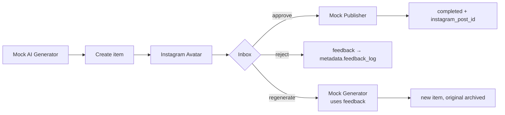

# Technical overview

The full technical tour of staqly: modes, concepts, REST API, MCP, n8n,
webhooks, backup and project layout. New here? Start with the
[README](../README.md) or the documentation site.

## Quick start

Requirements: Docker with Compose v2.

```bash
make up                             # = docker compose up -d --build --wait + open a signed-in browser
```

| What | URL |
|---|---|
| Dashboard | http://localhost:8080 (`make up` opens it signed in) |
| REST API | http://localhost:3333 (OpenAPI: http://localhost:3333/openapi.yaml) |
| MCP (Streamable HTTP) | http://localhost:3333/mcp |

Ports bind to `127.0.0.1` only. Copy `.env.example` to `.env` to change ports,
the mode, upload limits or the webhook network policy.

### Local mode (default): no keys

`make up` starts everything and opens the dashboard already signed in. The
workspace is created automatically on first start; there is no sign-up, no
API key and no password. Agents, n8n and scripts on your machine call the API
(`http://localhost:3333`) without credentials.

* **API — keyless, this machine only.** It listens on `127.0.0.1` and accepts
  credential-less requests only from loopback/Docker peers whose `Host` is a
  local name and whose `Origin` (if any) is local, so a website you visit
  cannot drive your staqly (no cross-site requests, no DNS rebinding).
* **Dashboard — reachable from your network, one-time sign-in per browser.**
  It listens on `:8080` so phones and tablets can use it; each browser signs in
  once with a one-time link (`make up` opens one, `make connect` prints another,
  phones scan a QR from *Connect a device*). Sessions last 30 days.

Optional demo data: `make seed`.

### Cloud mode: hosted, many workspaces, plans

`STAQLY_MODE=cloud` turns the same app into a hosted, multi-tenant service:

* anyone can **create a free workspace** (no card, no email) — or only holders
  of `SETUP_TOKEN`;
* each workspace gets **API keys** `stk_…` (scoped; the key decides the
  workspace), a **recovery key** and browser sessions;
* **plans** limit each workspace — Free (100 items/month, 3 webhooks,
  3 keys, 1 GB), Indie $9 (2,000 / 20 / 20 / 20 GB), Team $29 (unlimited,
  200 GB). Over a limit the API answers `402 plan_limit_exceeded`. Payments are
  not integrated yet: the operator sets plans with `make set-plan`. Local
  installs are **unlocked**.

Clients switch to a cloud workspace by using its URL plus that workspace's key.
Details, deployment and moving local data: [docs/cloud.md](cloud.md).

### Phones and tablets: Connect a device

The dashboard works on phones and tablets. **Connect a device** shows a QR
code; scanning it opens staqly on the phone already signed in. The link
works once, expires in 5 minutes, and the device appears under
*Settings → Devices*, where you can revoke it. For phones on your Wi-Fi add
`PUBLIC_WEB_URL=http://<LAN IP>:8080` to `.env` (see
[docs/cloud.md](cloud.md#connect-a-device-qr)).

## Concepts

- **Collection** — e.g. *Instagram Avatar*, *AI Research*. Has a default view
  (gallery / table / list) and configurable **actions**. Names are unique, so
  agents can refer to collections by name.
- **Item** — an output: `image`, `video`, `text`, `link`, `json` or `file`,
  with title, content, metadata (JSON), media, source, external_ref, status and
  a full version + event history. Status lifecycle:
  `draft → pending → approved | rejected | expired → processing → completed | failed → archived`.
  Items can expire (`expires_in`) and restrict what a reviewer may edit
  (`editable`).
- **Human approval gate** — an agent creates an item, waits on
  `GET /v1/items/{id}/wait` (MCP `await_decision`, SDK `requestApproval`, CLI
  `staqly push --wait`), acts only if approved, then reports the outcome
  (`/result`).
- **Approve / reject** — built-in, need the `items:review` scope, only from
  `pending`, atomic (concurrent decisions: one wins, the rest get `409`).
- **Custom actions** — configured per collection (no code): name, label, event,
  `requires_feedback`, optional `set_status`, `allowed_statuses`. Defaults:
  `regenerate`, `publish`, `retry`, `archive`. Running one records an event and
  notifies webhooks; external tools do the work.
- **Rules** — evaluated when an item arrives: auto-approve, auto-reject, set a
  status, expire, or escalate (optionally to one notification channel), matched
  on collection, type, source, text and metadata conditions.
- **Watchers** — poll RSS/Atom feeds or watch web pages on a schedule; new
  entries become pending items (18 presets: Hacker News, Reddit, Pinterest,
  YouTube, GitHub, npm, PyPI, arXiv, Google News, …).
- **Notifications** — Telegram, Slack, Discord, ntfy and email channels with
  approve/reject buttons or one-tap links ([docs/notifications.md](notifications.md)).
- **Events** — immutable activity log (DB trigger forbids updates), exportable
  as NDJSON/CSV; full workspace export as ZIP ([docs/data-export.md](data-export.md)).
- **Webhooks** — signed, retried, at-least-once deliveries via a SQLite
  transactional outbox.

## REST API

Full contract: [`apps/api/openapi.yaml`](../apps/api/openapi.yaml) (also served
at `/openapi.yaml`). TypeScript SDK: [`packages/sdk-typescript`](../packages/sdk-typescript).
Examples below are for local mode; in cloud mode add
`-H "Authorization: Bearer $STAQLY_API_KEY"`.

```bash
API=http://localhost:3333

# create a collection
curl -s -X POST $API/v1/collections -H 'Content-Type: application/json' \
  -d '{"name":"Instagram Avatar","default_view":"gallery"}'

# create a text/JSON/link item (collection by ID or name)
curl -s -X POST "$API/v1/collections/Instagram%20Avatar/items" -H 'Content-Type: application/json' \
  -H 'Idempotency-Key: gen-42' \
  -d '{"title":"Caption draft","content":"Golden hour ☀️","metadata":{"prompt":"…","seed":42},"source":"n8n"}'

# upload an image and create the item in one call
curl -s -X POST "$API/v1/collections/Instagram%20Avatar/items" \
  -F file=@avatar.png -F 'item={"title":"Avatar #1","content":"caption","metadata":{"seed":42}}'

# pending items across all collections
curl -s "$API/v1/items?status=pending&type=image"

# approved yesterday
curl -s "$API/v1/items?status=approved&decided_after=2026-10-12&decided_before=2026-10-13"

# approve (optionally editing first) / reject with feedback / custom action
curl -s -X POST $API/v1/items/{ITEM_ID}/actions/approve -H 'Content-Type: application/json' -d '{"edits":{"content":"Fixed caption"}}'
curl -s -X POST $API/v1/items/{ITEM_ID}/actions/reject  -H 'Content-Type: application/json' -d '{"feedback":"Too dark"}'
curl -s -X POST $API/v1/items/{ITEM_ID}/actions/regenerate -H 'Content-Type: application/json' -d '{"feedback":"Make her smile"}'

# record publication status from your automation
curl -s -X PATCH $API/v1/items/{ITEM_ID} -H 'Content-Type: application/json' \
  -d '{"status":"completed","metadata_patch":{"instagram_post_id":"1790…"}}'

# history
curl -s $API/v1/items/{ITEM_ID}/events
```

Lists support keyset pagination (`limit` + opaque `cursor`), filtering
(`status`, `type`, `collection_id`, `source`, `external_ref`, date ranges),
`sort`, and `q` — full-text search (SQLite FTS5) over title, content and
metadata with prefix matching and diacritics folding (`slonca` finds
`słońca`), ranked by relevance.
Errors are `{"error":{"code","message","fields"}}`. Unsafe requests accept an
`Idempotency-Key` (24 h replay window).

### Scopes (cloud mode)

`collections:read`, `collections:write`, `items:read`, `items:write`,
`items:review`, `actions:execute`, `webhooks:manage`, `admin`.
Creating content (`items:write`) is separate from deciding on it
(`items:review`), so a generator agent cannot approve its own output. The key
created at setup has every scope except `admin`; manage keys under
**Integrations → API keys**. Only SHA-256 hashes of keys are stored. In local
mode every local client has full access.

## MCP (Claude Code, Codex, other agents)

14 tools: `list_collections`, `create_collection`, `get_collection`,
`list_items`, `get_item`, `create_item`, `update_item`, `search_items`,
`list_pending_approvals`, `approve_item`, `reject_item`,
`list_available_actions`, `execute_custom_action`, `get_item_history`.
Both transports run the same server code as the REST API and enforce the API
key's scopes.

**Claude Code** (verified: `claude mcp list` → ✔ Connected, prompts executed):

```bash
claude mcp add --transport http staqly http://localhost:3333/mcp
# or STDIO, running inside the API container:
claude mcp add staqly -- docker exec -i staqly-api mcp-stdio
```

**Codex** (verified: `mcp: staqly/list_pending_approvals (completed)`):

```bash
codex mcp add staqly --url http://localhost:3333/mcp
# or STDIO:
codex mcp add staqly -- docker exec -i staqly-api mcp-stdio
```

**OpenCode** (verified: `opencode mcp list` → ✓ staqly connected): copy
[`integrations/opencode/opencode.json`](../integrations/opencode/opencode.json)
into your project.

Cloud instance: same commands with your URL plus
`--header "Authorization: Bearer {API_KEY}"` (Claude Code) or
`--bearer-token-env-var STAQLY_API_KEY` (Codex).

Then ask: *“Create a collection called Instagram Avatar.”*, *“Show me all
pending images.”*, *“Add this generated image to my collection.”*, *“Find the
images I approved yesterday.”*, *“Reject {ITEM_ID} with feedback: too dark.”*
More in [docs/mcp.md](mcp.md).

## n8n

An importable workflow, [`integrations/n8n/instagram-avatar-demo.json`](../integrations/n8n/instagram-avatar-demo.json),
runs the full Instagram Avatar loop with local mocks (no external accounts):



```bash
# use your own n8n, or start the example next to staqly:
docker compose -f integrations/n8n/compose.yml up -d    # n8n at http://localhost:5678
./integrations/n8n/setup-demo.sh     # collection + webhook → n8n, prints the signing secret
```

Then in n8n: import the workflow, paste the printed secret into the
*Verify & parse* node, publish, and run *Generate sample content*. No
credentials are needed in local mode.
Networking for n8n on the host / in this compose network / in another
container is covered in [docs/n8n.md](n8n.md).

## Webhooks

Configure under **Webhooks** or `POST /v1/webhooks` with event patterns
(`"*"`, `"item.*"`, `"item.approved"`) and an optional collection filter.

```
POST <your url>
X-Staqly-Event: item.approved
X-Staqly-Event-Id: evt_…        # stable per event
X-Staqly-Delivery: dlv_…        # stable across retries of one delivery
X-Staqly-Timestamp: 1791800000
X-Staqly-Signature: sha256=<hex HMAC-SHA256(secret, timestamp + "." + raw body)>

{"id":"evt_…","type":"item.approved","created_at":"…","delivery_id":"dlv_…","attempt":1,
 "actor":{…},"data":{"item":{…},"collection":{"id":"…","name":"…"},"feedback":"…","previous_status":"pending"}}
```

Delivery is **at-least-once**: events and their deliveries are written in the
same transaction as the change, a background worker sends them (outside any
transaction), retries non-2xx/timeouts with exponential backoff (default 15 s
doubling, cap 1 h, 8 attempts, `410 Gone` stops immediately), survives restarts,
and keeps a delivery history with manual retry. Deduplicate on
`X-Staqly-Event-Id`. SSRF guard: link-local/metadata/multicast addresses are
always blocked, checked on the resolved IP at connect time; private and loopback
targets are controlled by `WEBHOOK_ALLOW_PRIVATE` / `WEBHOOK_ALLOW_LOOPBACK`;
redirects are not followed.

## Backup and restore

```bash
make backup                                   # → backups/<timestamp>/{workspace.db,uploads.tar.gz}
make restore BACKUP=backups/20261013T081329Z  # stops api, replaces data, starts api
```

The database copy uses SQLite `VACUUM INTO`, which is consistent while the
server is writing (never copy the live `.db` file under WAL). Details and manual
procedures: [docs/backup.md](backup.md).

## CLI and SDKs

* **CLI** — `staqly` ([apps/cli](../apps/cli), [docs/cli.md](cli.md)): inbox in
  the terminal, `push --wait` as an approval gate in CI, items, rules,
  watchers, webhooks, keys and `mcp config` for your agent.
* **TypeScript** — `@staqly/sdk` ([packages/sdk-typescript](../packages/sdk-typescript)),
  ESM, no dependencies, Node ≥ 20.19 / Bun / edge.
* **Python** — `staqly` ([packages/sdk-python](../packages/sdk-python)), sync and
  async clients.

```ts
import { Staqly } from "@staqly/sdk";
const staqly = new Staqly(); // local mode: no key
const decision = await staqly.requestApproval("Instagram Avatar", { title: "Post this?", content: "caption" });
if (decision.approved) { /* publish, then report the result */ }
```

## Documentation

The user documentation site lives in [apps/docs](../apps/docs) (Fumadocs, static
export) and is published to GitHub Pages by `.github/workflows/docs.yml`:
https://staqly.github.io/staqly.
Operational docs: [monitoring](observability.md) (`/livez`, `/readyz`,
`/metrics`), [data export & privacy](data-export.md), [notifications](notifications.md),
[cloud & plans](cloud.md), [MCP](mcp.md), [n8n](n8n.md),
[backup](backup.md), [troubleshooting](troubleshooting.md).

## Development

```bash
make test        # Go API + CLI (race detector), both SDKs, dashboard
make test-e2e    # full Docker end-to-end run in an isolated compose project
make lint-openapi
make sqlc        # regenerate typed queries after editing apps/api/db/queries
```

CI (`.github/workflows/ci.yml`) runs formatting, lint, types, tests and builds
for every part, checks generated code is up to date, builds the Docker images
and runs the end-to-end suite. `openapi.yaml` is the hand-written contract; a
Go contract test fails if a route is undocumented or a real response doesn't
match its schema.

Run without Docker: `cd apps/api && go run ./cmd/server` (data in `./data`;
add `WEBHOOK_ALLOW_LOOPBACK=true` for receivers on localhost) and
`cd apps/web && npm install && npm run dev`.

```
apps/api            Go backend: chi REST, MCP (stdio + HTTP), webhook worker
  cmd/server          REST + /mcp + workers; operator commands (backup, workspaces, recovery-key, set-plan, connect-link)
  cmd/mcp-stdio       MCP over STDIO (keyless locally; STAQLY_API_KEY in cloud mode)
  internal/app        domain services + authorization (shared by REST and MCP)
  internal/httpapi    HTTP handlers, auth/CSRF/idempotency middleware, tests
  internal/mcpserver  MCP tool definitions
  internal/store      SQLite open/migrate/backup
  internal/db         sqlc-generated queries
  db/migrations       goose migrations (embedded; one init migration so far)
  openapi.yaml        OpenAPI 3.2 contract
apps/web            Next.js dashboard
apps/cli            `staqly` CLI (Go)
apps/docs           documentation site (Fumadocs)
packages/sdk-typescript  TypeScript SDK (types generated from OpenAPI)
packages/sdk-python      Python SDK
integrations/       n8n example + workflow, Claude Code, Codex, OpenCode configs
scripts/            backup, restore, seed, e2e
docs/               architecture, cloud, MCP, n8n, notifications, export, observability, CLI, backup, troubleshooting
```

More: [architecture](architecture.md) · [progress & limitations](PROGRESS.md) ·
[security policy](../SECURITY.md).

## License

Apache License 2.0 — see [LICENSE](../LICENSE) and [NOTICE](../NOTICE).
