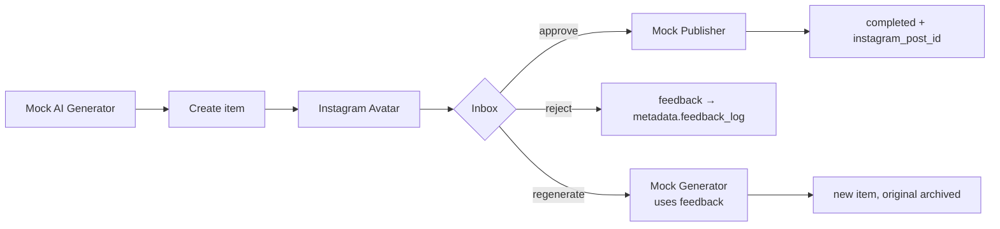

# Technical overview

The full technical tour of staqly: modes, concepts, REST API, MCP, n8n,
webhooks, backup and project layout. New here? Start with the
[README](../README.md) or the documentation site.

## Quick start

Without Docker (macOS, Linux): one binary with the API, MCP and dashboard.

```bash
curl -fsSL https://raw.githubusercontent.com/staqly/staqly/main/scripts/install.sh | sh
staqly serve                        # or: staqly service install (background, starts with your computer)
```

With Docker: one pre-built container, no checkout needed (every flag is explained in
[Run with Docker](https://docs.staqly.ai/self-hosting/docker)):

```bash
docker run -d --name staqly --restart unless-stopped \
  -p 127.0.0.1:3333:3333 -p 8080:8080 \
  -v staqly-data:/data \
  -e LOCAL_TRUSTED_PEERS=10.0.0.0/8,172.16.0.0/12,192.168.0.0/16,fc00::/7 \
  --read-only --tmpfs /tmp:size=64m,mode=1777 \
  --cap-drop ALL --security-opt no-new-privileges:true \
  --memory 640m --pids-limit 256 \
  ghcr.io/staqly/staqly:latest
docker exec staqly server connect-link   # one-time sign-in link for the dashboard
```

Developing staqly: `make dev` builds the image from this checkout and starts the dev
stack (`compose.yml` + `compose.dev.yml`).

| What | URL |
|---|---|
| Dashboard | http://localhost:8080 |
| REST API | http://localhost:3333 (OpenAPI: http://localhost:3333/openapi.yaml) |
| MCP (Streamable HTTP) | http://localhost:3333/mcp |

The API binds to `127.0.0.1` only. With Docker the dashboard (`DASHBOARD_PORT`, default 8080)
is published on your network; `staqly serve` keeps it on this computer unless you pass `--expose`. Settings are
environment variables (`-e` with `docker run`; `.env.example` lists them for the Compose setup).

### Local mode (default): no keys

`staqly serve` or the container starts everything. The workspace is created automatically on first start; there is no sign-up, no
API key and no password. Agents, n8n and scripts on your machine call the API
(`http://localhost:3333`) without credentials.

* **API — keyless, this machine only.** It listens on `127.0.0.1` and accepts
  credential-less requests only from loopback/Docker peers whose `Host` is a
  local name and whose `Origin` (if any) is local, so a website you visit
  cannot drive your staqly (no cross-site requests, no DNS rebinding).
* **Dashboard — on this computer, or on your network with a sign-in.**
  `staqly serve` keeps it on `127.0.0.1:8080` with no sign-in. The Docker
  image and `staqly serve --expose` publish it on `:8080` so phones and
  tablets can use it; then each browser signs in once with a one-time link
  (`staqly serve connect-link` or `docker exec staqly server connect-link`
  prints one, phones scan a QR from *Connect a device*). Sessions last 30 days.

Optional demo data from a checkout: `make seed` (`scripts/seed.sh`, against
`STAQLY_API_URL`, default `http://localhost:3333`).

### Cloud mode: hosted, many workspaces, plans

`STAQLY_MODE=cloud` turns the same app into a hosted, multi-tenant service:

* anyone can **create a free workspace** (no card, no email) — or only holders
  of `SETUP_TOKEN`;
* each workspace gets **API keys** `stk_...` (scoped; the key decides the
  workspace; the `admin` key from signup signs browsers in to the dashboard), a
  single-use **recovery key** and browser sessions;
* **plans** limit each workspace — Free (50 approvals/month, unlimited items, 3 webhooks,
  1 key, 1 GB, 5 MB files, no exports) and Pro $30 (unlimited, 100 GB, 100 MB
  files, backups and data export; new
  workspaces get a 7-day Pro trial, then are read-only until paid or switched
  to Free). Over a limit the API answers `402 plan_limit_exceeded`. Workspaces
  upgrade by card through Stripe Checkout when the operator sets the `STRIPE_*`
  variables; otherwise the operator sets plans with `server set-plan` (`docker exec staqly server set-plan ...`). Local
  installs are **unlocked**.

Clients switch to a cloud workspace by using its URL plus that workspace's key.
Details, deployment and moving local data: [docs/cloud.md](cloud.md).

### Phones and tablets: Connect a device

The dashboard works on phones and tablets. **Connect a device** shows a QR
code; scanning it opens staqly on the phone already signed in. The link
works once, expires in 5 minutes, and the device appears under
*Settings → Devices*, where you can revoke it. With `staqly serve --expose` a
dashboard opened as `localhost` puts this computer's Wi-Fi address in the QR on
its own; with Docker the dialog asks for that address once (or set
`PUBLIC_DASHBOARD_URL=http://<LAN IP>:8080`); see
[docs/cloud.md](cloud.md#connect-a-device-qr).

## Concepts

- **Collection** — e.g. *Instagram Avatar*, *AI Research*. Has a description,
  icon, colour and configurable **actions**; the dashboard shows its items as a
  table. Names are unique, so agents can refer to collections by name.
  (`default_view` is still accepted and returned by the API for compatibility,
  but the dashboard ignores it.)
- **Item** — an output: `image`, `video`, `text`, `link`, `json` or `file`,
  with title, content, metadata (JSON), media, source, external_ref, status and
  a full version + event history. Status lifecycle:
  `draft → pending → approved | rejected | expired → processing → completed | failed → archived`.
  Items can expire (`expires_in`) and restrict what a reviewer may edit
  (`editable`).
- **Human approval gate** — an agent creates an item, waits on
  `GET /v1/items/{id}/wait` (MCP `await_decision`, SDK `requestApproval`, CLI
  `staqly push --wait`), acts only if approved, then reports the outcome
  (`/result`).
- **Approve / reject** — built-in, need the `items:review` scope, only from
  `pending`, atomic (concurrent decisions: one wins, the rest get `409`).
- **Custom actions** — configured per collection (no code): name, label, event,
  `requires_feedback`, optional `set_status`, `allowed_statuses`. Defaults:
  `regenerate`, `publish`, `retry`, `archive`. Running one records an event and
  notifies webhooks; external tools do the work.
- **Watchers** — an HTTP poll of any URL the user gives, on a schedule: `rss`
  (RSS/Atom entries become pending items) or `url_diff` (an item when the page
  text changes; JSON endpoints too). robots.txt is respected for both. No
  built-in source catalog; push sources post to `POST /v1/items` instead.
- **Summaries and auto-tags** — every new item gets a one-line `summary`
  (and 1-3 tags if it came without any) from a background queue. `staqly serve`
  uses your own AI CLI (`claude -p --model haiku`, else `codex exec`, or
  `TAGGER_COMMAND`; `off` disables it); the Docker image and cloud mode use an
  OpenAI-compatible endpoint (`TAGGER_URL`, `TAGGER_MODEL` default
  `gpt-4o-mini`, `TAGGER_API_KEY`, `TAGGER_CONCURRENCY` default 2). Ask for a
  new one with `POST /v1/items/{id}/summarize`; `item.summarized` records it.
- **Notifications** — Telegram, Slack, Discord, ntfy and email channels with
  approve/reject buttons or one-tap links ([docs/notifications.md](notifications.md)).
- **Events** — immutable activity log (DB trigger forbids updates). Each event
  records its type, actor (`type`, `id`, `name`), the collection/item it is
  about and `data`; list them filtered by `type`, `type_prefix`, `actor_type`,
  `actor_id` and a `from`/`to` date range, or export them as NDJSON/CSV; full workspace export as ZIP ([docs/data-export.md](data-export.md)).
- **Webhooks** — signed, retried, at-least-once deliveries via a SQLite
  transactional outbox.

## REST API

Full contract: [`apps/api/openapi.yaml`](../apps/api/openapi.yaml) (also served
at `/openapi.yaml`). TypeScript SDK: [`sdks/typescript`](../sdks/typescript).
Examples below are for local mode; in cloud mode add
`-H "Authorization: Bearer $STAQLY_API_KEY"`.

```bash
API=http://localhost:3333

# create a collection
curl -s -X POST $API/v1/collections -H 'Content-Type: application/json' \
  -d '{"name":"Instagram Avatar","description":"Generated avatar captions"}'

# create a text/JSON/link item (collection by ID or name)
curl -s -X POST "$API/v1/collections/Instagram%20Avatar/items" -H 'Content-Type: application/json' \
  -H 'Idempotency-Key: gen-42' \
  -d '{"title":"Caption draft","content":"Golden hour ☀️","metadata":{"prompt":"...","seed":42},"source":"n8n"}'

# upload an image and create the item in one call
curl -s -X POST "$API/v1/collections/Instagram%20Avatar/items" \
  -F file=@avatar.png -F 'item={"title":"Avatar #1","content":"caption","metadata":{"seed":42}}'

# pending items across all collections
curl -s "$API/v1/items?status=pending&type=image"

# approved yesterday
curl -s "$API/v1/items?status=approved&decided_after=2026-10-12&decided_before=2026-10-13"

# approve (optionally editing first) / reject with feedback / custom action
curl -s -X POST $API/v1/items/{ITEM_ID}/actions/approve -H 'Content-Type: application/json' -d '{"edits":{"content":"Fixed caption"}}'
curl -s -X POST $API/v1/items/{ITEM_ID}/actions/reject  -H 'Content-Type: application/json' -d '{"feedback":"Too dark"}'
curl -s -X POST $API/v1/items/{ITEM_ID}/actions/regenerate -H 'Content-Type: application/json' -d '{"feedback":"Make her smile"}'

# record publication status from your automation
curl -s -X PATCH $API/v1/items/{ITEM_ID} -H 'Content-Type: application/json' \
  -d '{"status":"completed","metadata_patch":{"instagram_post_id":"1790..."}}'

# history
curl -s $API/v1/items/{ITEM_ID}/events
```

Lists support keyset pagination (`limit` + opaque `cursor`), filtering
(`status`, `type`, `collection_id`, `source`, `external_ref`, date ranges),
`sort`, and `q` — full-text search (SQLite FTS5) over title, content and
metadata with prefix matching and diacritics folding (`slonca` finds
`słońca`), ranked by relevance.
Errors are `{"error":{"code","message","fields","details"}}`. Unsafe requests accept an
`Idempotency-Key` (24 h replay window).

### Scopes (cloud mode)

`collections:read`, `collections:write`, `items:read`, `items:write`,
`items:review`, `actions:execute`, `webhooks:manage`,
`watchers:manage`, `channels:manage`, `admin`.
Creating content (`items:write`) is separate from deciding on it
(`items:review`), so a generator agent cannot approve its own output. The key
created at signup is the "Admin key" (scope `admin`, which signs browsers in);
give agents their own scoped keys under **API keys** in the sidebar. Only SHA-256 hashes of keys are stored. In local
mode every local client has full access.

## MCP (Claude Code, Codex, other agents)

71 tools covering every REST operation except the browser-only flows, the agents list, summarize and
recovery key rotation: collections, items (incl. bulk actions, versions,
purge), media, events and exports, approval gate, watchers, webhooks,
notification channels, API keys, sessions, workspace and plan. The full list
is in `apps/docs/content/docs/mcp/tools.mdx`.
Both transports run the same server code as the REST API and enforce the API
key's scopes.

**Claude Code** (verified: `claude mcp list` → ✔ Connected, prompts executed):

```bash
claude mcp add --transport http staqly http://localhost:3333/mcp
# or STDIO, running inside the staqly container (Docker):
claude mcp add staqly -- docker exec -i staqly mcp-stdio
```

**Codex** (verified: `mcp: staqly/list_pending_approvals (completed)`):

```bash
codex mcp add staqly --url http://localhost:3333/mcp
# or STDIO:
codex mcp add staqly -- docker exec -i staqly mcp-stdio
```

**OpenCode** (verified: `opencode mcp list` → ✓ staqly connected): copy
[`integrations/opencode/opencode.json`](../integrations/opencode/opencode.json)
into your project.

Cloud instance: same commands with your URL plus
`--header "Authorization: Bearer {API_KEY}"` (Claude Code) or
`--bearer-token-env-var STAQLY_API_KEY` (Codex).

Then ask: *“Create a collection called Instagram Avatar.”*, *“Show me all
pending images.”*, *“Add this generated image to my collection.”*, *“Find the
images I approved yesterday.”*, *“Reject {ITEM_ID} with feedback: too dark.”*
More in [docs/mcp.md](mcp.md).

## n8n

An importable workflow, [`integrations/n8n/instagram-avatar-demo.json`](../integrations/n8n/instagram-avatar-demo.json),
runs the full Instagram Avatar loop with local mocks (no external accounts):



```bash
# use your own n8n, or start the example next to staqly:
docker compose -f integrations/n8n/compose.yml up -d    # n8n at http://localhost:5678
./integrations/n8n/setup-demo.sh     # collection + webhook → n8n, prints the signing secret
```

Then in n8n: import the workflow, paste the printed secret into the
*Verify & parse* node, publish, and run *Generate sample content*. No
credentials are needed in local mode.
Networking for n8n on the host / in this compose network / in another
container is covered in [docs/n8n.md](n8n.md).

## Webhooks

Configure under **Webhooks** (Automation in the sidebar) or `POST /v1/webhooks`
with event patterns (`"*"`, `"item.*"`, `"item.approved"`; 1-50, unknown
patterns such as `item.aproved` are `422`) and an optional collection filter.

```
POST <your url>
X-Staqly-Event: item.approved
X-Staqly-Event-Id: evt_...        # stable per event
X-Staqly-Delivery: dlv_...        # stable across retries of one delivery
X-Staqly-Timestamp: 1791800000
X-Staqly-Signature: sha256=<hex HMAC-SHA256(secret, timestamp + "." + raw body)>

{"id":"evt_...","type":"item.approved","created_at":"...","delivery_id":"dlv_...","attempt":1,
 "actor":{...},"data":{"item":{...},"collection":{"id":"...","name":"..."},"feedback":"...","previous_status":"pending"}}
```

Delivery is **at-least-once**: events and their deliveries are written in the
same transaction as the change, a background worker sends them (outside any
transaction), retries non-2xx/timeouts with exponential backoff (default 15 s
doubling, cap 1 h, 8 attempts, `410 Gone` stops immediately), survives restarts,
and keeps a delivery history with manual retry. Deduplicate on
`X-Staqly-Event-Id`. SSRF guard: link-local/metadata/multicast addresses are
always blocked, checked on the resolved IP at connect time; private and loopback
targets are controlled by `WEBHOOK_ALLOW_PRIVATE` / `WEBHOOK_ALLOW_LOOPBACK`;
redirects are not followed.

## Backup and restore

```bash
staqly serve backup ~/staqly-backup.db                          # binary
docker exec staqly server backup /data/backups/staqly-backup.db # Docker; then docker cp it out
```

The database copy uses SQLite `VACUUM INTO`, which is consistent while the
server is writing (never copy the live `.db` file under WAL). Uploads are archived
separately. Details, restore and the checkout's `make backup` / `make restore`:
[docs/backup.md](backup.md).

## CLI and SDKs

* **CLI** — `staqly` ([apps/cli](../apps/cli), [docs/cli.md](cli.md)): inbox in
  the terminal, `push --wait` as an approval gate in CI, items,
  watchers, webhooks, keys and `mcp config` for your agent.
* **TypeScript** — `@staqly/sdk` ([sdks/typescript](../sdks/typescript)),
  ESM, no dependencies, Node ≥ 20.19 / Bun / edge.
* **Python** — `staqly` ([sdks/python](../sdks/python)), sync and
  async clients.

```ts
import { Staqly } from "@staqly/sdk";
const staqly = new Staqly(); // local mode: no key
const decision = await staqly.requestApproval("Instagram Avatar", { title: "Post this?", content: "caption" });
if (decision.approved) { /* publish, then report the result */ }
```

## Documentation

The user documentation site lives in [apps/docs](../apps/docs) (Fumadocs, static
export) and is published to GitHub Pages by `.github/workflows/docs.yml`:
https://docs.staqly.ai.
Operational docs: [monitoring](observability.md) (`/livez`, `/readyz`,
`/metrics`), [data export & privacy](data-export.md), [notifications](notifications.md),
[cloud & plans](cloud.md), [MCP](mcp.md), [n8n](n8n.md),
[backup](backup.md), [troubleshooting](troubleshooting.md).

## Development

```bash
make test        # unit and integration tests of every package (pnpm turbo run test)
make check       # formatting, lint, types and tests of every package
make test-api    # one package: test-api, test-cli, test-dashboard, test-sdk, test-sdk-python
make test-e2e    # full Docker end-to-end run (e2e/ package, compose.e2e.yml)
make lint-openapi
make gen         # regenerate sqlc queries, dashboard API types and the TypeScript SDK schema
make dev         # build from this checkout with compose.dev.yml (debug logs, Mailpit, optional Stripe CLI)
make site        # landing page :8070 and docs :8090 from this checkout
make release VERSION=v0.2.0   # tag origin/main; CI publishes the binaries and the image
```

CI (`.github/workflows/ci.yml`) runs formatting, lint, types, tests and builds
for every part, checks generated code is up to date, builds the Docker image
and runs the end-to-end suite. `openapi.yaml` is the hand-written contract; a
Go contract test fails if a route is undocumented or a real response doesn't
match its schema.

Run without Docker: `cd apps/api && go run ./cmd/server` (data in `./data`;
add `WEBHOOK_ALLOW_LOOPBACK=true` for receivers on localhost) and
`pnpm install && pnpm --filter @staqly/dashboard dev`.

```
apps/api            Go backend: chi REST, MCP (stdio + HTTP), webhook worker
  cmd/server          REST + /mcp + workers; operator commands (backup, workspaces, recovery-key, set-plan, connect-link, stats)
  cmd/dashboard       serves the dashboard static export and proxies /api/* (standalone; the staqly image embeds the dashboard in server)
  cmd/mcp-stdio       MCP over STDIO (keyless locally; STAQLY_API_KEY in cloud mode)
  internal/app        domain services + authorization (shared by REST and MCP)
  internal/httpapi    HTTP handlers, auth/CSRF/idempotency middleware, tests
  internal/mcpserver  MCP tool definitions
  internal/store      SQLite open/migrate/backup
  internal/db         sqlc-generated queries
  db/migrations       goose migrations (embedded, append-only)
  openapi.yaml        OpenAPI 3.2 contract
apps/dashboard      Next.js dashboard (static export)
apps/cli            `staqly` CLI, `staqly serve` and `staqly service` (Go)
apps/docs           documentation site (Fumadocs), docs.staqly.ai
apps/web            landing page, staqly.ai
sdks/typescript  TypeScript SDK (types generated from OpenAPI)
sdks/python      Python SDK
integrations/       n8n example + workflow, Claude Code, Codex, OpenCode configs
e2e/                end-to-end tests against the Docker stack (@staqly/e2e, Vitest)
scripts/            backup, restore, seed, install
bin/release.sh      `make release`: tags origin/main with a version
docs/               architecture, cloud, MCP, n8n, notifications, export, observability, CLI, backup, troubleshooting
```

More: [architecture](architecture.md) · [progress & limitations](PROGRESS.md) ·
[security policy](../SECURITY.md).

## License

Apache License 2.0 — see [LICENSE](../LICENSE) and [NOTICE](../NOTICE).
